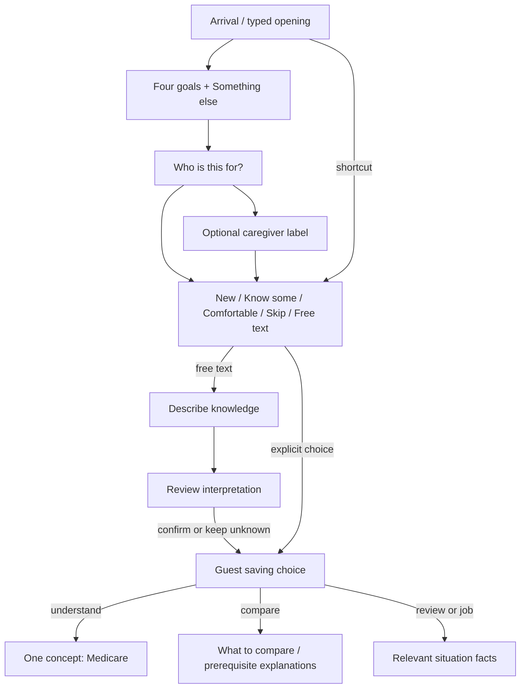
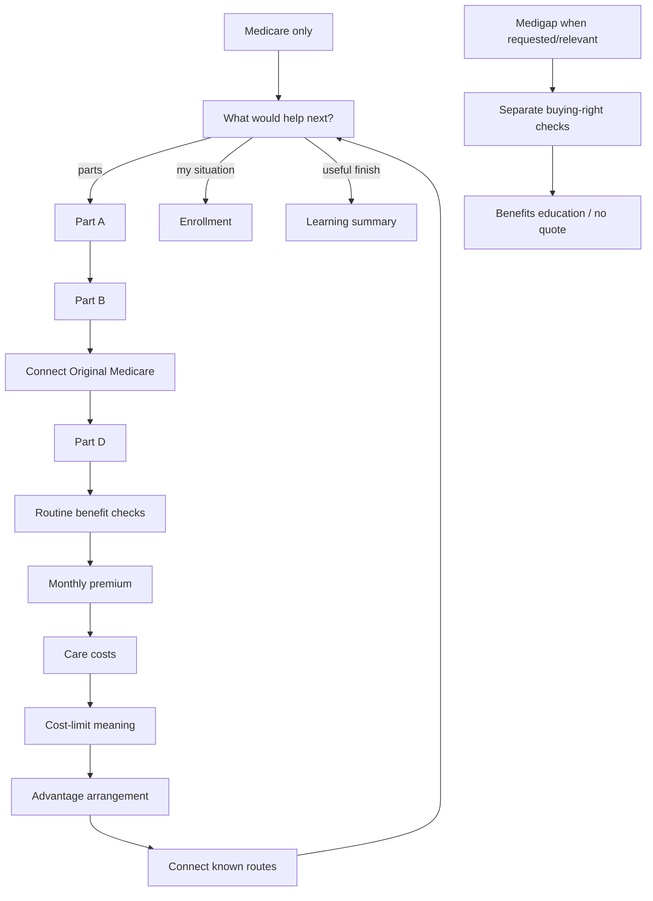
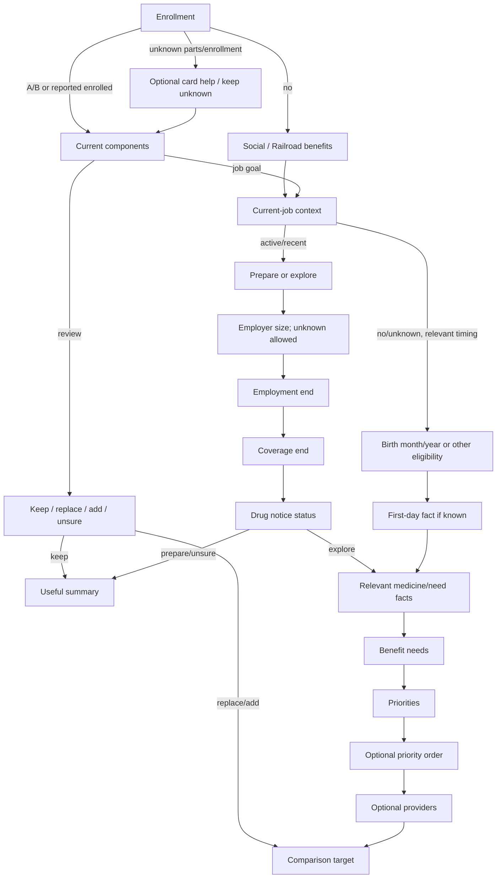
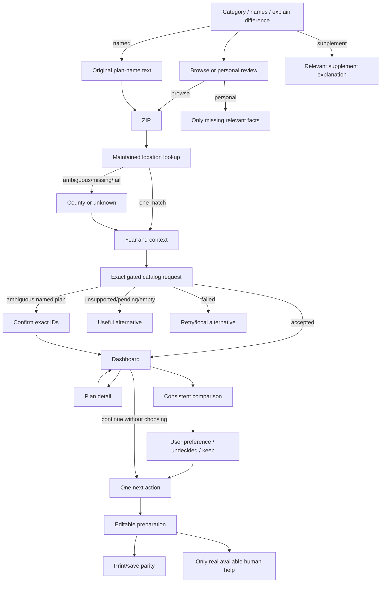
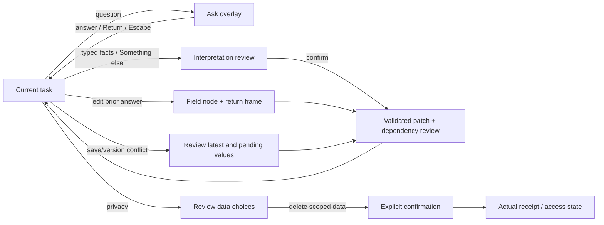

# Daylight branching wireframes

**Current presentation: D65 appendix at the end supersedes conflicting legacy separate-screen details.**

Design version 1.0 · October 21, 2026. These are proposed behavior/layout wireframes, not rendered app screenshots or implementation. Exact question/options/profile writes live in [the node inventory](BRANCHING_NODES.md). Policy and component rules live in [the master](MASTER_DESIGN.md). Every inventory node maps to a template in the coverage table below; a template plus a node's full specification is its parameterized wireframe. Do not replace the node's question/options with text invented during styling.

## 1. Common shell and agent task · W1

```text
┌─────────────────────────────────────────────────────────────────────────────┐
│ ☀ Daylight Medicare                               Saved • [Your information] │
├─────────────────────────────────────────────────────────────────────────────┤
│ 1 Your goal      2 Your situation      3 Your options      4 Your next step  │
│                  You are here                                              │
│ Your situation · Medicare enrollment                                      │
├──────────────────────────────────────────┬──────────────────────────────────┤
│ Daylight · AI assistant                  │ Your Medicare picture            │
│ “What is already in place changes        │ [Hide Medicare guide]            │
│ which questions will help you.”          │                                  │
│                                          │ [ Medicare ]                     │
│ Do you have Medicare yet?                │       │                          │
│ Why we ask: …                            │ [Part A: hospital care]          │
│                                          │ [Part B: medical care]           │
│ ○ Yes, Parts A and B                     │                                  │
│ ○ Yes, Part A only                       │ Conceptual pieces, not proof     │
│ ○ Yes, but unsure which parts            │ of your enrollment.              │
│ ○ No                                    │                                  │
│ ○ I am not sure whether I have Medicare   │ Select a named piece for help.   │
│                                          │ [Source: Medicare.gov]           │
│ Something else / answer in your words    │                                  │
│ [Multiline text …                      ] │                                  │
│ [Review my answer]                       │                                  │
│                                          │                                  │
│ [Continue]                               │                                  │
│ Back                                     │                                  │
│ Ask Daylight                             │                                  │
├──────────────────────────────────────────┴──────────────────────────────────┤
│ Optional deeper explanation / source / What you have told Daylight         │
└─────────────────────────────────────────────────────────────────────────────┘
```

Annotations: one primary Continue; Review my answer submits a proposal, not a route advance. Choices are unselected on a fresh task. The short agent message is the primary guide, not a decorative intro above a rigid form. A user may give multiple facts or ask a question in the task composer. The agent responds and confirms changes through W4. Reading history is available by a labeled control after current content. Header save status must reflect the backend receipt; Your information is management, not duplicate Ask Daylight. Do not use an unlabeled icon as the only profile/privacy control.

## 2. Arrival, goal, recipient and knowledge · W2

```text
ARRIVAL A00
☀ Daylight Medicare
                  Your coverage, plain as day
       Daylight is an AI assistant to help you understand,
          explore available evidence and prepare next steps.
                         [Get started]
               Already know what you want to explore?
               Skip explanations and compare published plans
                           Ask Daylight
        [Meaningful capable older-person image, subordinate to actions]
       No account needed • No ID numbers • Current comparison scope

GOAL A01                              KNOWLEDGE A03
What would you like help with today?  How familiar are you with Medicare?
○ Understand Medicare                ○ New to Medicare
○ Compare plans                      ○ Know some basics
○ Review or change my coverage       ○ Comfortable with the basics
○ My job coverage is ending          ○ I would rather explain in my own words
Something else [text]                 Skip this for now
[Continue] / Back / Ask Daylight      [Continue] / Back / Ask Daylight

RECIPIENT A02                        KNOWLEDGE TEXT A04
Who is this for?                     What do you already know, and what
○ Me                                 would you like explained?
○ Someone I am helping               [I know A/B but I am lost on drugs…]
Something else [text]                [Review Daylight's interpretation]
[Continue]                           → W4; no classification committed yet
```

A00 direct shortcut sets compare intent and concise presentation, not knowledge certainty. A03 can be skipped. A02B optional naming uses W3; no required identity. Four fixed phases begin with the first task; arrival does not show a complete insurance diagram or restore the removed preview. New users never have an answer preselected.

## 3. Text, date and optional-list fields · W3

```text
Your situation · Employment end month
Daylight: “Employment and health coverage can end at different times.”
When does employment end?
[Month ▼] [Year ____]   ○ Actual   ○ Expected
○ I do not know yet
○ Employment is continuing
[Continue]
Back
Ask Daylight

Your situation · Medicines
Daylight: “We can make a checking list without claiming coverage or prices.”
Would you like to add medicines?
[Name / original text] [Strength, optional] [Form, optional] [Remove item]
[Add another medicine]
Save scope: Visit only • [Choose whether to save these details]
[Review my list] → W4 if extracted; direct reviewed entries → Continue
[Continue]  (explicitly supports continuing without details)
Back / Ask Daylight
```

Month/year preserves unknown and forecast states; no age-65 arithmetic. A blank optional date is not the same as no employment. Medicine/provider matching never silently resolves a similar entity. Multi-line text retains newlines. Lists can expand without hiding Continue behind an unbounded editor; a review summary precedes progression. Never ask for Medicare/SSN/card numbers or document uploads. Sensitive saving uses W12 before durable write.

## 4. Confirm an interpretation · W4

```text
Underlying task remains exactly where it was.
┌──────────────────────────────────────────────────────────────┐
│ Did Daylight understand you correctly?        [Return]        │
│ Your words: “I have A and my work plan ends in March.”         │
│                                                              │
│ Proposed details                                             │
│ Medicare: Part A reported; Part B not established [Edit]       │
│ Job insurance ends: March [year still unknown]   [Edit]        │
│ Actual or expected: not established             [Edit]        │
│                                                              │
│ We will keep the missing details open.                        │
│ [Confirm these details]                                      │
│ Edit the interpretation • Keep unresolved details unknown     │
│ Return without changes                                       │
└──────────────────────────────────────────────────────────────┘
```

The agent may extract several facts from one paragraph, but raw text, proposed value and uncertainty remain visible. Confirming user report is not verification. A proposed knowledge depth uses the same pattern: “You know the basics and would like prescription coverage explained. Start with a short Part D lesson?” Confirm/Edit/Keep unknown/Return. X01 never accepts a model-generated rule, arbitrary database path, automatic enrollment right or silently changed subject.

## 5. Progressive concept lesson · W5

```text
Your situation · Part B
Daylight: “Here is the next coverage piece.”
Part B: medical care                         Your Medicare picture
Short reviewed explanation                  [Hide Medicare guide]
                                             [ Medicare ]
[Continue]                                        │
I know this                                  [Part A] [Part B ← new]
Back                                          No future blocks yet
Ask Daylight                                  Source + named definitions

After Continue: concept seen; no answer selected; no competence badge.
After I know this: explicit per-topic familiarity; still no enrollment fact.
After Hide: question, relevance, terms, source and help stay available.
```

Each L node adds only the concept identified in the master picture table. L04/L11 connect existing blocks rather than adding several new products. The current concept is highlighted without motion. A prior concept can remain visible on Back; future concepts cannot appear because the renderer knows the whole final model. Comfortable users may explicitly show a full reference; doing so never marks all topics seen or understood.

## 6. Local picture explanation · W6

```text
TASK COLUMN UNCHANGED                    REFERENCE AREA ONLY
Question / entered answer                [Back to picture]
Continue / Back / Ask                    What is Part B?
                                         Short source-linked explanation.
                                         Source: Medicare.gov
                                         [Ask more about this]
```

This is ordinary reference content, not a focus trap. Named piece opens here. Back restores the same accumulated picture and focus to the named piece, not an unrelated top control. Ask more closes the local explanation and opens W7 with the selected topic; no stacked overlays.

## 7. Ask Daylight over the picture · W7 desktop

```text
┌───────────────────────────────────────────────────────────────────────────┐
│ ☀ Daylight             fixed progress track unchanged                     │
├───────────────────────────────────┬───────────────────────────────────────┤
│ TASK visibly in the same place    │ ┌───────────────────────────────────┐ │
│ Current question and choice       │ │ Daylight · AI assistant           │ │
│ preserved, inert while modal      │ │ [Return to your question]         │ │
│                                   │ │ Task: Your drug-coverage question │ │
│ Continue stays where it was       │ │                                   │ │
│ Back                              │ │ Why does Part D matter if I do    │ │
│ Ask Daylight                      │ │ not take medicines?               │ │
│                                   │ │ Direct concise answer first.      │ │
│                                   │ │ Scope/uncertainty + source.        │ │
│                                   │ │ Optional relevant small visual.   │ │
│                                   │ │                                   │ │
│                                   │ │ [Follow-up question 1]            │ │
│                                   │ │ [Follow-up question 2]            │ │
│                                   │ │ Read earlier questions            │ │
│                                   │ │ Your question [multiline…] [Send] │ │
│                                   │ │ What is sent to AI / logging      │ │
│                                   │ └───────────────────────────────────┘ │
└───────────────────────────────────┴───────────────────────────────────────┘
```

No column insertion, page takeover or underlying layout reflow. Visible task context helps orientation but background controls remain inert for modal correctness. If width is insufficient use the phone/full-height sheet behavior with a short task reminder. Escape and Return restore exact task, answer/draft and scroll. Sources distinguish local reviewed explanation/live AI/unavailable reply. Common follow-ups remain visible; previous history is optional. Keyboard is not opened merely by tapping a suggested question.

## 8. Phone task and help · W8

```text
PHONE TASK                         PHONE HELP OVER TASK
☀ Daylight                         ┌────────────────────────────┐
2 Your situation                   │ Daylight · AI assistant    │
Your goal / Situation /            │ Return to your question    │
Options / Next step (fixed)        │ Task: Medicare enrollment  │
Current question                   ├────────────────────────────┤
Why we ask                         │ Literal selected question  │
[Compact current concept]          │ Answer first               │
○ Answer                           │ Source / uncertainty       │
○ Answer                           │ Visible follow-ups         │
Something else [text]              │                            │
[Continue]                         │ One main reading region    │
Back                              ├────────────────────────────┤
Ask Daylight                       │ Your question [text] Send  │
[Show/Hide Medicare guide]         │ AI transfer disclosure     │
Deeper reference below            └────────────────────────────┘
```

At narrow width the phase labels may form a compact 2×2 status grid or a current-phase line plus full labeled track below it; their order/identity never changes. Help can grow with visual viewport/keyboard. Short height must retain reading, Return and composer access; no fixed desktop header stack leaving a 20px reading slit. 320px reflow, enlargement, landscape and real keyboards require later rendered checks.

## 9. Published options dashboard · W9

```text
3 Your options · Published Medicare Advantage plans
2027 · Collier County, FL · ZIP 34102 [Edit context]
Priorities: doctors / monthly cost • Doctors still need checking [Edit]
Current coverage: reported Advantage • full policy details unknown

Category [MA-PD ▼]   Sort [Published source order ▼]   Search [name / ID…]
Showing N records • [Clear filters] • What affects this order [evidence]

┌───────────────────┐ ┌───────────────────┐ ┌───────────────────┐
│ Exact plan name   │ │ Exact plan name   │ │ Exact plan name   │
│ Company / type    │ │ Company / type    │ │ Company / type    │
│ Year / exact ID   │ │ Year / exact ID   │ │ Year / exact ID   │
│ Plan premium     │ │ Plan premium     │ │ Plan premium     │
│ Medical limit    │ │ Medical limit    │ │ Medical limit    │
│ Drug deductible  │ │ Drug deductible  │ │ Drug deductible  │
│ Personal checks  │ │ Personal checks  │ │ Personal checks  │
│ Source/status    │ │ Source/status    │ │ Source/status    │
│ □ Save candidate │ │ □ Save candidate │ │ □ Save candidate │
│ View details     │ │ View details     │ │ View details     │
└───────────────────┘ └───────────────────┘ └───────────────────┘
[Show more]                 Saved candidates: 2  [Compare candidates]
[Continue] / Back / Ask Daylight
```

All cards have identical emphasis; the first is not a recommendation. Show correct units, missing/conflict/N/A states and additional Part B/component costs. No doctor match badge from a typed provider name. Candidate tray cannot obscure content. Filters/sort are explicit commands with retained context; the assistant explains but cannot alter result order behind the user's back. A snapshot/source/personal-context change produces a visible stale state before comparison is treated as current.

## 10. Comparison, preference and explanation · W10

```text
Compare these exact candidates      2027 / county / snapshot / [Edit]
Dimension                  Candidate A              Candidate B
Identity/category          exact ID                 exact ID
Monthly plan premium       published value          unknown—source missing
Medical limit / scope      published value          published value
Drug facts                 known / restrictions     conflict shown
Doctors                    Not checked              Not checked
Personal medicine price    Not available            Not available
Source                     dated evidence           dated evidence

Daylight: “Here are the differences we can establish. Your doctor
participation and personal drug prices remain open.”
○ Record my preference   ○ Continue with checks open
[Continue]  (one primary page advance; selected intent resolves next node)
Change candidates • Back • Ask Daylight

PREFERENCE O10: “What would you like to keep as your preference?”
○ Candidate A (exact ID) ○ Candidate B ○ Keep current ○ Still deciding
○ Check unresolved facts first
Material checks shown beside confirmation → [Continue]
```

For browsing, “continue with checks open” is valid. For an unsupported total-cost or route bundle request, show W11 rather than filling numeric gaps with an example or a model estimate. Ask can explain a row in W7, retaining columns and scroll on return. Phone comparison labels each candidate and dimension explicitly; keyboard/screen reader can reach all cells without relying on horizontal visual alignment.

## 11. Unsupported data, failed service and changed answers · W11

```text
Data awaiting validation / Unsupported scope / Live AI unavailable
What happened: clear service-specific sentence, not a raw stack trace.
What remains: your request, answers, notes and candidates retained.
What is not established: exact missing facts / failed operation.
[Retry] (when retry can help)
Use reviewed guide explanations / Official comparison / Prepare questions
Back to the same task

CHANGED CONTEXT
“You changed the year/location/coverage. We kept the saved candidates
for reference. The old comparison is no longer current.”
Affected: snapshot / rationale / draft / checks
[Refresh this comparison]  Review what changed  Edit  Back
```

No false completed phase after a failed API. Model failure preserves submitted text and draft. Save failure says Not saved; uncertainty checks operation receipt before retry. Unsupported/unknown county does not imply outside. Empty accepted search differs from a pending/unavailable service. O11 supplement benefits use this template with a reviewed benefits chart and quote/rights limits, not an empty insurer-card grid.

## 12. Guest saving, resume and deletion · W12

```text
A05 STORAGE CHOICE
Would you like to save this guide for your next visit?
Server guest profile • no account • this browser can reopen it.
Shared device: anyone using this browser may access it.
Approved retention period / processors / review-and-delete controls
○ Save a guest guide on this browser
○ Use only for this visit
[Continue]  Review what is saved

X08 SENSITIVE CHOICE
Save medicine and provider details for another visit?
These details can reveal health information.
○ Save the reviewed selected categories
○ Use details only for this visit
[Continue] • AI-use permission remains separate

X05 RESUME                          X07 DELETE
Resume your saved guide?            Delete this saved guest guide?
Masked goal / last visit            Scope: profile / selected category
[Resume]                           What happens now / retention limits
Start separate visit               [Delete this guide]
Manage saved information            Keep my guide (initial focus)
```

The actual configured notice must be present before production persistence. Server cookie possession is not a claim of identity or legal representation. Resume shows no sensitive names before confirmation. Forget browser access and Delete saved data are different actions. Expiry/cleared-cookie state offers a new guide and explains recovery limits. Never offer a public resume URL containing a bearer secret.

## 13. Useful ending and future handoff · W13

```text
4 Your next step
Your next step: check how your job coverage will end
Why: employment and coverage dates are not yet confirmed.
[Prepare questions for my benefits office]

What you reported                     Still to check
Part A; Part B unknown                 Current-job coordination
Expected work/coverage end             Actual end dates
Drug notice unknown                   Creditable drug notice

Other relevant checks / retained notes / sources
Back • Ask Daylight • Print/save

PREPARATION F01
“Questions for the benefits office” [Editable text]
Prepared—not sent • [Copy] [Print] • [Continue]

HUMAN HANDOFF H01 (future gated capability)
Actual qualified recipient / availability / exact proposed payload
[Approve this exact handoff] • Edit • Do not share
→ H02 Requested / Sent(receipt) / Acknowledged / Failed / Uncertain
```

Education ending summarizes explored concepts with optional next learning. Review ending can preserve current coverage. No generic seven-item wall for every user. Preparation is usable even without a staffed service. Print uses the same summary model and may occupy several readable pages. Handoff is disabled until real fulfillment is authorized and available; selecting a plan does not authorize sharing or enrollment.

## 14. Route graphs

Arrows below are confirmed transitions; the agent can propose eligible detours through the common contract. Every task also has Back/edit/help/error behavior in G1. Full answer lists and conditional resolver branches are in BRANCHING_NODES; these graphs are overview wireframes, not replacements for that matrix.

### Guided entry and knowledge



### Education and personal context



Returning lesson queues may stop after the requested concept and return to the unanswered task. The full default educational chain is optional; it is not required before plan browsing or a useful education ending.

### Enrollment, review and job routes



Unknown branch destinations use the current goal and resolver; the full matrix distinguishes enrollment unknown from parts unknown. A B-only value can be confirmed through Something else. C07 actual Part B month appears only for relevant timing/supplement work, never inferred from birth month.

### Comparison and next action



### Common overlay and correction loop



## 15. Concrete exemplar journeys

### Beginner, personal context and comparison

A00 Start → A01 Understand → A02 Me → A03 New → A05 storage choice → L00 Medicare → L01 Connect to my situation. Scheduler inserts missing A/B/Original concepts one at a time with return to C00. C00 No → C02 No benefits → J00 No active-job coverage → C05 birth month/year → C06 first-day answer. Relevant drug lesson → N00 Yes → optional N01 confirmed medicine entries, X08 save choice, N02 pharmacy optional. L06 before N03 benefit question; N04 doctors + lower monthly payments → N05 no forced top choice → N06 optional provider list. Cost/route lessons appear before consequential route comparisons. O00 Advantage → O01 personal already satisfied → O03 34102 → O04 unique Collier → O05 2027 → O06 accepted only if actual gates allow → O07/O09. No accepted service means X04 with no fabricated cards. O10 Still deciding → F00 doctor/drug verification next action. Pass: user can explain what is known and why personal fit remains unverified.

### Knowledgeable comparer

A00 shortcut → A03 Comfortable or Skip → A05 choose saving → O00 drug plans → O01 Browse → O03/04 location → O05 year → O06 accepted records → O07 explicit sort/filter → save exact candidates → O09 consistent published dimensions → O10 preference or undecided → F00. No birth/job/doctor/medicine intake is forced. Guide initially hidden; Show does not mark topics learned. Ask about deductible returns to the same comparison. Pass: user sees a useful comparison quickly and does not infer enrollment eligibility from a record.

### Job transition

A01 job → recipient/knowledge/storage → missing prerequisite concepts only → C00 A only → J00 current-job insurance → J01 Prepare → J02 employer size unknown → J03 expected employment end → J04 coverage end unknown → J05 needs creditable notice → F00 benefits-office questions → F01 edited draft. Keep Part B date and enrollment deadline unresolved. Copy/Print does not contact anyone. Back returns through actual transition fields. Pass: no instruction to delay B from job status alone; no universal shopping sequence.

### Caregiver reviewing existing coverage

A01 Review → A02 Someone → A02B “my mother” optional → A03 Know some → A05 saving notice → C00 A/B reported → concise route definitions as needed → C03 Advantage reported → C04 Replace → O00 Medigap → cost/supplement/rights lessons → O11 benefits education. Ask C07 Part B month only if a timing question is requested; preserve unknown rather than deriving it from birth. F01 supplement/transition checking questions. Pass: no assumption that fall switching grants Medigap buying rights, no caregiver legal-authority claim, no insurer quote.

### Ambiguous free text, interruption and resume

A01 Something else: “I know most of it; I am helping Dad, whose work plan might end soon.” X01 proposes review/job goal as unresolved, knowledge comfortable as proposed only, recipient someone. User corrects goal to job and knowledge some; confirms the patch. Missing details remain unknown and eligible tasks update; no fixed questions repeated for confirmed fields. In J03 user opens Ask, types draft, closes by Escape, changes knowledge depth and returns. Save times out: show Not saved; Retry queries receipt first. Resume same browser uses X05 and refreshes state/capabilities; it never discloses medicine/provider names on the masked preview. Pass: raw text, pending state and original subject survive; uncertain dates remain uncertain.

## 16. Complete node-to-wireframe coverage

Each row instantiates the named template with the exact question, options, dependencies and transitions in BRANCHING_NODES. W1 also governs shared Continue/Back/Ask ordering; W8 is the phone adaptation for all task templates.

| Node | Template | Surface |
|---|---|---|
| A00 | W2 | arrival |
| A01 | W2 | single_choice |
| A02 | W2 | single_choice |
| A02B | W3 | optional_text |
| A03 | W2 | knowledge |
| A04 | W3 | free_text |
| A05 | W12 | privacy_notice |
| L00 | W5 | lesson |
| L01 | W1 | learning_intent |
| L02 | W5 | lesson |
| L03 | W5 | lesson |
| L04 | W5 | lesson |
| L05 | W5 | lesson |
| L06 | W5 | lesson |
| L07 | W5 | lesson |
| L08 | W5 | lesson |
| L09 | W5 | lesson |
| L10 | W5 | lesson |
| L11 | W5 | lesson |
| L12 | W5 | lesson |
| L13 | W5 | lesson |
| C00 | W1 | single_choice |
| C01 | W1 | unknown_fact |
| C01B | W1 | reference |
| C02 | W1 | single_choice |
| C03 | W1 | multi_choice |
| C04 | W1 | single_choice |
| C05 | W3 | optional_dates |
| C06 | W1 | single_choice |
| C07 | W3 | optional_dates |
| J00 | W1 | single_choice |
| J01 | W1 | single_choice |
| J02 | W1 | single_choice |
| J03 | W3 | optional_dates |
| J04 | W3 | optional_dates |
| J05 | W1 | single_choice |
| N00 | W1 | single_choice |
| N01 | W3 | sensitive_list |
| N02 | W3 | sensitive_list |
| N03 | W1 | multi_choice |
| N04 | W1 | multi_choice |
| N05 | W1 | optional_choice |
| N06 | W3 | sensitive_list |
| O00 | W1 | single_choice |
| O01 | W1 | scope |
| O02 | W3 | free_text |
| O03 | W1 | location |
| O04 | W1 | lookup |
| O04B | W1 | single_choice |
| O05 | W1 | scope |
| O06 | W11 | catalog_loading |
| O06B | W1 | record_choice |
| O07 | W9 | dashboard |
| O08 | W9 | plan_detail |
| O09 | W10 | comparison |
| O10 | W10 | preference_confirmation |
| O11 | W11 | unsupported_quote |
| F00 | W13 | summary |
| F01 | W13 | preparation |
| F02 | W13 | print |
| F03 | W12 | finish |
| H00 | W13 | handoff |
| H01 | W13 | handoff_review |
| H02 | W13 | handoff_status |
| X01 | W4 | confirmation_overlay |
| X02 | W11 | error_overlay |
| X03 | W11 | conflict_overlay |
| X04 | W11 | unsupported |
| X05 | W12 | resume |
| X06 | W12 | privacy_panel |
| X07 | W12 | delete_confirmation |
| X08 | W12 | sensitive_notice |
| X09 | W12 | session_result |
| X10 | W7/W8 | assistant_overlay |

## D65 current presentation contract · October 21, 2026

Owner approved implementation in full. [Revision and before/after wireframes](UI_SIMPLIFICATION_REVISION.md), [completion evidence](UI_SIMPLIFICATION_COMPLETION.md) and `flow-contract.json` version `1.1.0-simplified` supersede historical separate-screen/lesson-queue presentation in this document. Keep legacy IDs for saved-guide migration.

| Current screen | Retained fields / behavior | Old IDs redirected |
|---|---|---|
| A02 | Recipient, optional caregiver wording in same submit | A02B → A02 |
| A03 | Medicare introduction plus voluntary depth question/free text | A04 → A03; old L00 → L01 topic navigation |
| O00 | Category and browse/personal mode; difference opens contextual routes topic | O01 → O00 |
| O03 | ZIP, inline county source/ambiguity, requested year | O04/O04B/O05 → O03 |
| C03 | Coverage components and review/change intention | C04 → C03 |
| J00 | Job status and requested task | J01 → J00 |
| J03 | Separate employment and coverage end dates; independent unknowns | J04 → J03 |
| L01/E01/E02/E03/E04 | Real topic choices with concise contextual teaching; useful Finish | L02–04 → E01; L05 → E02; L06–09 → E04; L10–11 → E03 |
| O11 | Relevant Medigap limitations and real next-task choices | L12–13 → O11 |

A05 saving is optional secondary/end action. No mandatory repeated definition pages. Unknown/skipped/reported/derived remain distinct; no new insurance rule or recommendation capability is introduced.

```text
SUN Daylight Medicare
1 Your goal  →  2 Your situation  →  3 Your options  →  4 Your next step
QUESTION + concise relevant teaching        CORE RELATIONSHIP MAP
explicit choices / related grouped fields   (only introduced architecture)
[Continue]  Back
☀ Ask Daylight · AI assistant
Your guide & privacy (secondary)

Ask overlay (over map; underlying geometry unchanged)
Ask Daylight  AI assistant                  Return
current task, answer/source, visible follow-ups
editable proposed reports + next task (answer mode only)
[Confirm and continue] (explicit, records reports)
composer / Send
AI may make mistakes. Privacy details
```

Acceptance: no preselection or automatic advance; every forced page asks a relevant question; back/edit preserves reports/drafts; old saved locations migrate; resume/save receipts and conflicts remain truthful; one phase marker per phase; no malformed empty pseudo-glyph; no consumer budget telemetry; $1 aggregate backend cap and plan gates unchanged. Desktop/tablet/phone and short-height overlay checks are required, with limits reported honestly.
