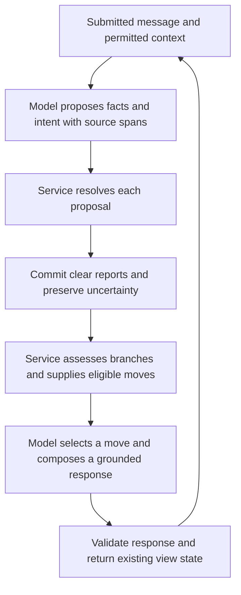

# Natural advisor conversation implementation plan

October 30, 2026 · D86 flow revision · **Planning only for :8893**

Daylight should listen, consolidate clear information into the person's profile, explain what matters and continue with one useful question. Routine replies should no longer lead to **Does this look right? / Use these details / Make edits**. The agent demonstrates understanding through the relevance of its response and next question, rather than reading a field summary back to the person.

The owner explicitly requested a plan and **no UI changes**. This revision supersedes blanket review of every interpreted report in the earlier [hybrid plan](LLM_FIRST_HYBRID_PLAN_2026-10-30.md) for the proposed :8893 flow. It leaves the restored :8891 layout, current application behavior and other variants intact. Implementation and activation are separate next steps.

## The intended experience

For “I've been retired for a few years, and am turning 65 in November,” capture the explicit retirement circumstance and age-65 month, identify the first-person beneficiary where unambiguous, and leave the unstated year open. Current insurance, actual enrollment and desired coverage start remain unanswered. A likely enrollment topic is a provisional conversational focus, not an asserted user goal or an authorization to investigate.

An illustrative complete turn could read:

> We can take this step by step so you feel ready for what comes next. Have you already signed up for any part of Medicare, or are you just getting started?

This illustrates the tone and continuity; it is not a response template, an exact acceptance string or an instruction to always ask about enrollment. The live model must generate the acknowledgment from the actual resolved context. The service supplies eligible question meanings; the model selects a useful move within that set. In this example, asking about progress can be a better first move than immediately requesting an insurance date. If prior context already establishes enrollment, reuse it and select a different missing fact.

Application progress, actual enrollment and Medicare familiarity are different. The illustrative question is an optional orientation move: keep its answer in visit dialogue state unless it explicitly supplies an existing field. “Just getting started” cannot become `RC04=neither`, and “I applied” cannot become active Part A/B coverage. When actual A/B status is needed, ask its precise meaning. Orientation adds no required field or readiness gate. A familiarity question is optional and useful only when it changes the explanation. Current insurance becomes necessary before a supported timing or coordination finding, rather than before any useful conversation.

For this audience, use familiar language, contractions and respectful warmth. Avoid reflexive “That's great,” praise for being retired, repeated name use, sales language, exhaustive paraphrases and assumptions about age, technical comfort or understanding. Usually give one or two connected sentences and one focused question, around 30–60 words altogether. Explain a relevant implication or the purpose of the next step; keep generic reassurance brief. A distressed or experienced visitor needs a different response from a newcomer seeking reassurance.

## Why the present system cannot do this

| Current boundary | Required change |
| --- | --- |
| [The local controller](../../alternatives/advisor-first/advisor_flow.py) stages any changed personal report for review. It also applies inherited uncertain proposals to a candidate before staging. | Classify and resolve changes first. Simply removing `stage()` would accept uncertainty accidentally. |
| [The language adapter](../../alternatives/advisor-first/narrative_agent.py) forbids authored insurance prose; its inherited validator clears `reflection`. The controller replaces nonreview replies with fixed `REASONS`. | Introduce a local generation contract for grounded conversational language; remove those substitutions only for validated generated replies. |
| Calls receive the public 41-question catalog, but only four prior field values and presence markers for most other reports. | Supply a minimal, permissioned account of relevant facts and conversational progress. More reasoning cannot recover context that was never sent. |
| The profile envelope labels values `confirmed_by_user`, including agent interpretations. | Distinguish a direct report, an interpretation awaiting clarification, an explicit confirmation and an externally verified finding. |

Use local adapters in `alternatives/advisor-first/`. The hash-pinned shared engine and :8891 remain read-only. D71 already permits clear reports without acceptance cards, and [D73's hybrid contract](STRATEGIC_THESIS.md#hybrid-capture-review-and-confirmation) explicitly rejects a confirmation turn after every message.

## Resolve profile facts before composing the response

Use two planned model stages for substantive free-text turns as the initial correctness baseline. Keep the stages independently testable.

The first stage extracts; it does not write consumer advice. The service then decides which facts are usable and computes eligible next steps against the updated profile. The second stage receives that resolved snapshot, selects among those moves and writes the response. The service validates the selected move before display. A joint extraction-and-prose call would compose language before rejected facts and branch changes were known. Treat that as a later optimization requiring equivalence evidence.

For an exact choice or structured input, resolve the report directly and use at most one composition call when a generated response adds value. Saving, Back, an exact edit, unknown/defer and opening a reviewed explanation need no extraction call. Do not skip extraction from arbitrary free text through brittle keyword guesses: an educational question can also contain important personal information.

Reserve the combined worst-case cost before starting a two-stage turn, and settle each request separately under one turn ID. Implement the grouped reservation through a reviewed local budget adapter; do not double-reserve inside the inherited runner or modify its pinned code. These are intentional stages, not retries. No hidden model retry or automatic paid repair call is permitted. Keep the current GPT-5.4 baseline; first evaluate low reasoning for extraction and the lowest sufficient composition setting. Preserve the shared $1/UTC-day cap and reviewed input/output/pricing limits. The current 900-token output ceiling includes reasoning and formatting as well as visible output; keep both schemas compact and evaluate truncation before proposing a separate policy revision. [OpenAI reasoning token limits](https://developers.openai.com/api/docs/guides/reasoning#controlling-costs).

If extraction fails, preserve the submitted text and current state. If composition fails after a valid profile update, preserve that update and return a brief transparent recovery message with the canonical next question. Maintain an owner-bound visit turn journal keyed by request ID and original revisions, recording the resolved delta/revision, stage status and response receipt. A lost connection followed by the same submission returns the same accepted state; a composition-only retry binds to that resolved revision and never reextracts. Retain no raw message in the journal. Release reservations for requests certainly not sent; retain uncertain charges under the existing fail-closed policy. On cancellation, stop any unissued stage and expose whether resolution already occurred. Expired or conflicting requests require recovery from the latest permitted state, rather than silent replay.

## Capture clear reports without a ceremony

Apply this policy per fact, rather than accepting or rejecting an entire message:

| Proposal | Profile treatment | Conversational treatment |
| --- | --- | --- |
| Explicit supported report with clear person, item and time scope | Apply as user-reported, with provenance and revision. | Continue naturally; acknowledge the implication when useful. |
| Explicit partial fact | Preserve the known part and missing precision separately. | Ask for precision only when it affects the next supported finding. |
| Plausible inference or tentative statement | Keep a tentative candidate outside actionable reports. | Clarify only if consequential now; otherwise continue with what is known. |
| Unclear person, item or conflicting value | Hold the affected field; preserve unaffected clear reports. | Ask one specific question naming the ambiguity. |
| Explicit correction with an unambiguous target | Supersede the old report and invalidate affected derived work/action tokens. | Briefly acknowledge the correction and proceed. |
| Unsupported leap | Reject the proposed field. | Compose without using it; do not ask the user to approve the model's guess. |

“Retired” never establishes retiree insurance. A birthday never establishes a requested start date. November without a year remains a partial milestone until a supported calculation actually needs the year. Unknown, deferred, none, not asked, tentative, stale and conflicting remain distinct. Do not silently resolve an ambiguous “remove that one” or transfer the helper's facts to the beneficiary.

Extend metadata on the existing guide/readiness records with capture method, report status, subject/item ID, temporal scope, revision and supersession. Validate exact supporting spans during the visit; do not introduce raw-message or transcript persistence. Durable provenance records the capture method and revision without claiming to retain the original wording. Use a versioned local adapter for the inherited `confirmed_by_user` constraint; automatic capture must never be mislabeled explicit confirmation. Preserve old records and their original semantics, without upgrading them to a new status by inference.

This is a transactional extension to the existing two records, not a parallel customer database. Validate owner/revision and use server-issued state bindings. Commit related guide/readiness updates consistently, preserve idempotency and invalidate only the dependent results. Automatic consolidation updates visit state; persistence still follows the person's separate saving and sensitive-field choices.

## Give every model request the right context

Build the context in the service from permitted structured state. Do not let the browser or model invent its own authoritative summary.

| Context | What the request needs |
| --- | --- |
| Task and person | Explicit goal versus provisional focus, beneficiary/helper scope, relevant explanation preferences and last active topic. |
| Relevant profile | Permitted field values, partial/unknown/conflict status, report provenance and current revisions. Include current-message facts for extraction; only accepted reports for composition. |
| Conversation continuity | Last question target ID, person/item, missing fields, phrasing variant and purpose; topics already explained, deferred topics and unresolved clarifications. Preserve enough bounded visit context to understand short replies such as “through my wife.” |
| Branch contract | All 41 IDs remain addressable. Supply compact meanings and the full relevant dependency/field/option contracts; distinguish the 78 original paths, additive reports and named gaps. |
| Evidence and capability | Relevant reviewed teaching, exact allowed claim references, actual tool receipts, and source/recommendation holds. Missing sources are not missing customer answers. |
| Next step | Eligible targets and priority, person/item, exact missing meaning, reason each helps now, allowed response types and remaining holds. A mandatory dependency may leave only one eligible target. |

Use structured dialogue state rather than another opaque model-authored biography. A summary cannot silently create facts or erase an open question. Keep it subordinate to the field records and regenerate it from them after corrections. Retain question/target metadata rather than copied assistant sentences. Any necessary literal text or derived summary retains the sensitivity, permission and retention rules of its underlying facts.

**Privacy is an implementation dependency.** Today's notice promises that earlier sensitive values and raw history are not automatically attached. Define a versioned allowlist covering the relevant circumstance/date/care-item values for the active task, and test the actual outgoing payload. Existing `aiConsent:true` authorizes only the old scope. Reuse the existing AI permission control with an updated notice and context-policy version before transmitting earlier values under the expanded scope; do not ask again on every turn. Declining preserves the narrower context and deterministic guidance. Where permission does not cover a value, use a known/missing marker or deterministic service result instead. Saving permission does not authorize AI transfer. ID numbers, unrelated health details, commercial economics and unneeded history stay out. Keep `store:false`; do not introduce a hosted conversation store as a shortcut to memory. The API supports application-managed conversation context, so a hosted history is unnecessary for this design. [OpenAI conversation state](https://developers.openai.com/api/docs/guides/conversation-state).

## Generate language while the service owns meaning

The composer receives the accepted changes, relevant prior reports, unresolved uncertainty, eligible next moves and reviewed explanatory material. It returns a selected move ID, a generated acknowledgment/explanation and natural wording for its follow-up, with report/evidence references. The service supplies each target's exact meaning, options, person/item scope and required qualifiers. Composition cannot change fields, switch the beneficiary, authorize an action or choose an unsupported dependency. Recheck the move against the resolved revision; rejected selection recovers to the service's canonical highest-priority move.

The prompt contract should instruct it to:

- Respond to the person's concern or question first, using the actual context and tone.
- Show understanding through a useful connection or explanation. Avoid reciting every captured fact or announcing internal profile processing.
- Use the last question and accepted updates to carry the conversation forward without re-asking known facts.
- State only the insurance implications supported by supplied reviewed evidence; express provisional focus as provisional.
- Produce a concise bridge into one selected question. Put no duplicate intake question in the bridge. Use the existing question slot for the selected ask, preserving its reviewed meaning and choices.
- Keep report status inspectable through the existing profile utility and reserve a specific qualification for a claim where it matters. Do not repeat a universal “not verified coverage” paragraph after each reply.

Generate both parts from the outset and render them through the existing response and question slots. Question wording must preserve actual versus intended coverage, person/item references, units and acceptable answers; the renderer retains the target's existing controls. Canonical wording is the recovery when a generated question fails validation. Bridge-only generation can be an intermediate development increment, but does not complete the requested natural flow.

Validate schema, snapshot/target references, length, duplicate questions, unsupported dates/amounts/entities and action claims before display. A cited field ID does not prove that the generated sentence faithfully expresses it. Semantic accuracy requires held-out model evaluation and independent review. [OpenAI Structured Outputs](https://developers.openai.com/api/docs/guides/structured-outputs) also distinguishes schema adherence from correctness.

## Integrate the branching logic and final review

Retain the 41-ID inventory as a capability map. Extend `assess()` to produce eligible next moves with their purpose and dependency priority. First resolve a blocking ambiguity or answer a direct supported question; then choose a useful orientation, missing fact, precision form or supported preparation step. The agent may propose an order among equally eligible moves, but mandatory dependencies remain service-owned and are rechecked after every accepted update.

A birthday story can support an orientation or enrollment-progress question before precise timing intake. A medicine question should not start a generic retirement interview. Returning from a side question resumes the unresolved topic with the draft preserved. Explicit unknown/defer should not loop. Keep first provider/medicine entry natural; exact identity matches and ambiguous candidate selection still need targeted confirmation, distinct from repeatedly approving the person's own report.

Reuse the existing **Review information** utility for optional profile inspection and correction, serving the proposed “Review your profile” purpose. Make full review available near a supported plan-review boundary, without forcing it after each message or blocking learning/sample browsing. Review is optional; the independent checks required for a personal result are not.

Preserve explicit authorization for a named consequential action, bound to the beneficiary, exact profile revision, evidence/capability version and action arguments. Existing preparation tokens/idempotency remain useful. An optional profile review cannot authorize comparison, sharing, enrollment or outside contact. Personal plan comparison remains held until its external evidence and release gates are actually satisfied. Form submission captures entered values and leaves them inspectable; this revision removes the blanket acceptance ritual, while preserving focused clarification and action-specific review.

## Implementation sequence

| Step | Local deliverable | Exit evidence |
| --- | --- | --- |
| 1. State and permission contracts | Versioned report statuses/provenance, partial acceptance, correction rules, minimized context allowlist and scoped permission behavior. | Mapping to original fields/IDs, old-record compatibility, no new required questions or unauthorized storage/AI transfer. |
| 2. Resolution service | Replace blanket staging with per-fact resolution; retain ambiguous candidates outside usable reports. Extend post-update branch assessment. | Mixed valid/invalid proposals, helper/entity isolation, unknowns, corrections and stale-action tests. |
| 3. Generated conversation | Local extractor/composer contracts, bounded context builder, combined budget reservation and partial-turn recovery. | Actual payload inspection, generated-language evaluation and measured cost/latency; no canned reason substitution on a successful generated turn. |
| 4. Existing renderer integration | Feed generated bridge and selected question through existing response/question slots; routine reports return no `review`. Reuse the existing profile utility. | No CSS, layout, typography, shell or new component changes; no duplicate question, lost draft, preselection or extra acceptance click. |
| 5. Compare and activate | Bounded fictional verification against the current :8893 and matched :8891 scenarios; activate :8893 only after the flow is authorized and checks pass. | Preserve protected files/stores, no source/recommendation release, explicit rollback preserving profile data and AI charges. |

## Acceptance criteria

Test meaning and behavior rather than matching a scripted sentence. All figures below are proposed gates, not achieved results.

| Scenario | Required behavior |
| --- | --- |
| Retirement/birthday → spouse's job insurance → separate end dates | Capture clear reports without a review card; preserve the unstated year and all distinct date/coverage meanings; ask only relevant missing facts. |
| Several explicit facts plus an educational question | Consolidate each supported fact, answer from reviewed evidence, then one useful next ask. No repeat of supplied facts as questions. |
| Valid birthday plus invalid inferred retiree insurance | Accept only the birthday; composition cannot receive or repeat the rejected insurance claim. |
| Helper/beneficiary, same-name providers, two medicine strengths | Preserve person/item identity; clarify only actual ambiguity; no identity match becomes verified coverage. |
| Tentative statement, unknown, correction or ambiguous deletion | Preserve status, avoid loops, target corrections correctly and invalidate dependent work. |
| Partial form interrupted by a side question | Preserve all drafts and accepted reports; resume without another situation invitation. |
| Learning, browsing or a held source | Offer useful supported work without a mandatory profile review or unnecessary personal intake. |
| AI/saving permission declined, save omissions, failure or cap reached | No unauthorized transfer/storage, hidden retry, lost accepted update or fabricated generated response. |
| Optional profile review followed by edit and named action | Edits work without restart; stale and duplicate authorizations cannot execute. |

Deterministic contract/privacy/budget tests must all pass, with zero routine acceptance cards for clear reports, wrong-person/item writes or stale-action execution. For independently adjudicated held-out conversations, target at least 99% precision and 95% recall for explicit scoped facts, zero material unsupported insurance/action claims, and at least 98% avoidance of already answered/deferred questions. Measure extraction proposals and committed reports separately; count silent omissions, invalid responses and abandoned turns in the outcome accounting. Report the denominators, confidence limits and critical failures. Zero critical errors in a finite test set is a release check, not a general accuracy guarantee; a small smoke test cannot establish these rates.

Have reviewers judge acknowledgment, relevance, concision and usefulness of the next ask separately. Target satisfactory ratings on all four dimensions for at least 90% of ordinary turns, normally within 60 words and one focused question. A small group of related missing dates may be one ask. Do not reward mere warmth or longer responses.

Measure total visible-response latency and cost across the whole turn, including both stages and charged failures. Initial design targets are p95 at or below 12 seconds and mean cost at or below $0.03 per generated turn, within the unchanged daily cap. The cost target covers two calls combined and requires measurement; it is not an established allowance. If those targets fail, optimize context/schema size and composition effort, or evaluate a joint call against this baseline. Do not claim reliable percentiles from a handful of examples or spend beyond the shared cap to finish an evaluation batch.

Technical/model success is separate from consumer proof. Observe representative Medicare users completing the same tasks with the same evidence in the adaptive baseline and proposed flow. Measure consequential omissions, correction without help, comprehension, active effort, elapsed time and abandonment. Pre-register the comparison thresholds and include people who keep coverage or defer. The “dramatically easier” claim requires less work with preserved accuracy and control.

## Requirement review and current stage

| D73 review item | Application |
| --- | --- |
| Consumer task and minimal intake | D49/D52/D71/D79/D86: capture multiple facts, answer early, clarify only consequential uncertainty and preserve the existing visual contract. Proposed flow. |
| Coverage paths and independent decisions | D22/D26/D47/D64: reviewed education, fair path comparisons, current-coverage baseline and no commercial inputs to context or ordering. Existing requirements retained. |
| Two gates and actual capability | D23/D56/D73: reported facts remain separate from external verification; education/preparation and labeled samples remain the current scope. |
| Permission and control | D53/D54/D75: truthful capture status, minimized AI context, separate saving, inspectable correction, protected stores and revision-bound actions. Context expansion needs its scoped contract. |
| Evidence of improvement | D24/D57/D73: state tests, model semantics and consumer comparison are separate gates. This document completes the planning step only. |

This plan changes documentation only. It runs no paid model calls, restarts no service and changes no UI or live conversation behavior.
