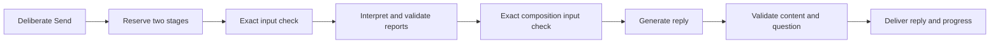

# D90 response-failure investigation · November 3, 2026

The owner requested a systemic investigation of the recently observed failed responses and the confusing budget explanation. Work is limited to :8893. [Binding contract](../../docs/product/RESPONSE_RELIABILITY_2026-11-03.md).

**Final status:** 894 passing full-suite tests, twelve unchanged retained replies replayed successfully on the final source, and `response-reliability-r1` activated on :8893. Both six-turn scenarios completed in separate live attempts; there is no successful same-revision two-case live run. [Evaluation and remaining gaps](EVALUATION.md), [verification](verification.json), [activation](activation.json).

## What actually failed

The original [two-case attempt](../live-sample-conversations-20261103/20261103T095724-0500-91c196/result.json) failed both openings with **$2.7798885 still available**. No daily-cap denial occurred. The first turn paid for successful generation, then discarded the answer when its follow-up repeated “Collier County” from the current request without a canonical report/evidence binding. The second stopped at exact input verification before paid generation. Its counter used `BudgetError` for every transport/provider/format failure, losing the underlying cause. The name of that class was not proof of cap exhaustion.

Successful first-turn requests used 6,963/7,515 input tokens and 466/428 output tokens, within 16,000/900. The original two stages settled $0.049605; two unissued reservations cancelled at zero. No own uncertain hold remained.

Budget, connection/preflight, generation and content rejection occur at different points in this chain. The former generic notice concealed those distinctions.

## History and causal limits

- The coupled answer/question grounding guard is present in the retained [November 1 source](../comparison-integration-20261101/before/natural_agent.py). It predates D88/D89. The repository is largely untracked, so retained byte snapshots are more useful here than an invented Git blame history.
- [November 2 evidence](../advisor-reply-transport-20261102/README.md) captured Python's `SSLV3_ALERT_BAD_RECORD_MAC` on a third independent check. The local transport then switched to system curl. The earlier full suite preceded that final curl integration; subsequent counter/stream mocks did not exercise its process/pipe implementation.
- [Three new count-only probes](preflight-probes.json), including the exact caregiver opening, all succeeded: 0.302–0.533 seconds, curl exit zero, **zero paid generation calls**. They were independent probes with no automatic retries.
- Existing retained production logs had fixed categories but no dependable per-attempt timeline/denominator. They support multiple failure categories, not an onset date or failure rate. The historical count failure's specific network/provider cause cannot be reconstructed because it was discarded. No evidence justifies blaming a VPN, the user's choices or the newly added task-work registry.

## Reproduced contract defects and changes

1. **Answer and follow-up were coupled.** Replay the unchanged original fictional proposal: the old core rejects its location-bearing question. The new wrapper can substitute only the already selected candidate's exact approved wording and rerun the same full validator. It preserves the answer, never guesses a target and never makes another paid call. An unsafe answer still fails. Names appearing only in request/history are explicitly excluded from factual name authority in generation instructions; this clarification leaves the guard intact.
2. **Generation and validation disagreed about size.** In [attempt cbe9ae](../live-sample-conversations-20261103/20261103T102514-0500-cbe9ae/result.json), caregiver replies 1–5 delivered, but the final summary used exactly 1,800 reply characters plus a 165-character question. Each field fit its schema; the pair exceeded the validator's shared 1,800-character allowance. The schema now reserves the 350-character question allowance and separator, leaving 1,449 for reply, with explicit concise-summary instructions. `text_bound` now survives controller classification instead of becoming `composition_unavailable`.
3. **A missing location dependency became a conflict.** In [attempt a7b59b](../live-sample-conversations-20261103/20261103T103012-0500-a7b59b/result.json), provider replies 1–3 delivered; turn 4 captured home ZIP 34102 and corrected the office to Bonita Springs, but a prior county-only proposal remained pending. Because `T03`'s baseline mapping is ZIP, that county hold removed the valid ZIP from composition reports. A county mention without the ZIP required by the existing operation now remains a missing dependency; the normal ZIP question stays available. A county-only hold cannot suppress an accepted ZIP.
4. **Coequal priorities became conflicting edits.** The same exact extraction replay exposed separate “doctors” and “total_cost” proposals from one sentence. Compatible positive same-message priorities now form the existing multi-select answer, with matching subject/scope and the exact encompassing user span. Explicit corrections, across-turn changes and unknown/defer retain their guards.
5. **Failures lost identity and calls were overcounted.** Token verification has its own fixed `input_token_verification` code and connection-check notice. Curl errors retain bounded exit status and fixed transport categories; safe provider status/codes survive. No body, key, raw exception message or user text enters these diagnostics. Composition metrics count submitted stages, including uncertain submissions, rather than failed count attempts. Certainly unissued reservations still cancel at zero cost; completed but rejected output remains paid.
6. **Reported provider names were lost or blocked before composition.** In [attempt 6d597a](../live-sample-conversations-20261103/20261103T103820-0500-6d597a/result.json), the caregiver again completed six turns, but the provider case stopped at turn 2. The positive generic provider list made the later specific name look like a conflicting replacement, and the office operation projected only its practice name back over the baseline list. Naming a provider now follows the existing additive list behavior. The local office override preserves independently reported list text and reconciles exact office text changes only for one unambiguous retained office. It does not restore a retired list or invent a multi-office text binding. Regression expectations separately assert retained clinician and practice names; exact extraction replay uses independently authored grounded acknowledgments rather than silently accepting old now-ineligible confirmation questions or unrecorded carrier claims.
7. **The proper-name detector mistook grammar for an entity.** In [attempt cc5c1f](../live-sample-conversations-20261103/20261103T104504-0500-cc5c1f/result.json), the provider case reached turn 3 and produced “Most Advantage plans also include drug coverage.” The detector treated “Most Advantage” as a name outside its sources. Common quantifiers now normalize like the existing conversational prefixes, and Advantage is recognized as the ordinary public shorthand. The exact full captured reply passes unchanged; invented names such as Blue Cross and Fabricated Insurance remain rejected without sources. The caregiver case completed all six turns again. A separate final provider-only run uses a fresh visit and all six original messages, not a rescued continuation; its ceiling is twelve stages ($0.642), within the same remaining daily allowance. It is not relabeled a successful two-case run.

## Evidence and preserved scope

[Before hashes](before.json), retained `before/` source, [scoped source comparison](source-comparison.json) and [patch](source.patch) make changes reviewable without discarding the dirty workspace. The frozen engine, request limits, budget policy, D88 statement registry/lock, D89 task-work source and L01/L03 acceptance receipts are checked unchanged. No web source, saved customer database or other variant is changed. D88 retains thirteen statements and L03 r9 retains 392,570 obligations with no acceptance change.

New tests directly exercise curl's process/pipe adapter, HTTP versions/interim headers, private stdin, endpoint/TLS/retry restrictions, fixed curl categories, late stream failure and cleanup. Separate regressions cover exact rejected proposals, unsafe-answer rejection, compatible schema bounds, exact fictional extraction replay, actual HTTP preflight behavior and disposable-ledger settlement. Existing tests remain in the full run.

The first unrestricted offline regression run passed 889 tests. After the schema change, 891 passed. Final source checks, the last frozen live attempt, performance review and activation are recorded in `verification.json` and `EVALUATION.md`. Earlier failed attempts remain retained; they are not relabeled successful or silently continued. No automatic paid retry or persona rescue is introduced.

The $5 UTC-day shared allowance, model/reasoning settings, 16,000 input/900 output/96,000-byte bounds, stage count, v3 visit permission, separate saving, no real transcript logging, commercial independence and all source/recommendation/fulfillment holds remain. This investigation does not establish consumer understanding or broad production reliability from a small fictional sample. Intermittent transport failures remain possible; their future diagnostics are now identifiable.
