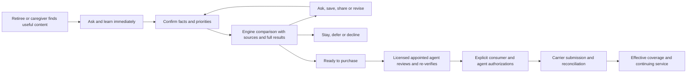

# How people will use the product

The product is an immediately available AI Medicare research workspace for retirees themselves and for caregivers helping someone else. Retirees can ask questions, understand their own options and prepare a decision at their own pace. Caregiver participation is optional and permissioned. When the person wants to buy, a licensed, appointed insurance agent takes responsibility for the purchase review and authorized submission. This is the intended workflow; today's delivered software is the underlying public-data experiment.

## A retiree's direct journey

A retiree opens the site, chooses **I'm researching for myself**, and starts asking questions immediately. They can ask what coverage terms mean, what changes when they retire or move, and how to compare options for their own location and year. They can learn before creating an account or booking a call.

The AI helps them collect and confirm current coverage, relevant timing, doctors, medicines, pharmacy and priorities as supported data becomes available. The retiree controls what is saved, what matters in the comparison and whether to invite anyone to help. The product keeps those preferences visible and explains what remains unchecked.

The retiree receives the engine's ordered comparison with sources, tradeoffs, full results and exclusions. They can ask follow-up questions, inspect an option, change and confirm their priorities, save and return later, keep existing coverage or request a licensed purchase session. The AI explains the engine's results without changing the order or telling the retiree what to buy. A confirmed change causes a new computation and snapshot.

**Ready to purchase** carries that retiree's complete context to a licensed, appointed agent. The same required review, re-verification, explicit application authorization and real status tracking described below apply. A caregiver is not required to complete this journey.

## A caregiver's journey

An adult child finds useful content while researching Medicare for a parent, perhaps after work. They open the site and start asking questions immediately. They can learn without first booking a call or providing a purchase-ready identity packet.

The assistant establishes whose coverage they are researching, the relevant location/year, current coverage and the questions that matter. As the necessary capabilities become supported, it helps capture doctors, medicines, pharmacies, timing and priorities. It asks the person to confirm important facts and preferences. It explains missing checks rather than filling them in from a guess.

With consent, the caregiver saves the case, returns later and invites the parent or another authorized person. The system remembers who supplied and confirmed each fact. Being a family member does not by itself authorize applications or unrestricted access to health details.

The comparison engine uses the confirmed criteria and verified data to order the supported options. People can inspect why an option appears where it does, the important disadvantages, sources, unresolved questions, full results and exclusions. They can change priorities, confirm the change and get a newly computed comparison. Compensation and referral partners cannot affect that order. Keeping current coverage, waiting or declining remain legitimate choices.

The AI helps them understand the comparison in plain language. It does not reshuffle the options or decide what they should buy. The parent/caregiver can ask questions and pause without losing the comparison's context.

When the person chooses **Ready to purchase**, the system opens a licensed-agent session or offers an actual scheduled slot if the agent is unavailable. Research may be available overnight; the product shows the staffed purchase-review expectation separately. The agent receives the complete transcript, confirmed profile, selected option, pinned comparison and all open checks, so the person need not reconstruct their research.

The qualified agent confirms identity, consent and representative authority; reviews the choice and required materials; rechecks relevant doctors/drugs/pharmacy and replacement risks; and prepares the actual application. If a material fact changes, the person sees it and reviews the revised basis before proceeding. The person explicitly approves the exact application, and the agent submits or authorizes submission through the approved channel. A research selection is never permission to cancel an existing policy.

After submission, the product shows real carrier status and helps with requests, notices and service issues. Submission, acceptance and effective coverage are separate milestones. Later reviews happen with permission, and a policy change returns through the licensed process.

## Other users and distribution

Retirees researching for themselves are direct users from the outset. The acquisition and research priority remains caregivers, then self-directed researchers, then Medigap shoppers; this order does not require a retiree to involve a caregiver. Medigap shopping expands once actual quote and underwriting evidence exists; the product explains price assumptions, discounts, acceptance conditions and renewal questions rather than assuming standardized benefits mean identical products or guaranteed acceptance.

Initially people arrive through direct caregiver content and search. Later, financial-advisor software and publishers can bring them into the same research workspace with permissioned context. The ranking and licensed-purchase requirements remain the same. Health-system entry comes after actual outcome evidence and the required agreements.

The experience should save repeated research and repeated intake. The operating test is whether that produces understood, suitable decisions and effective retained coverage with less total human work, while preserving complete licensed review and continuing support.
