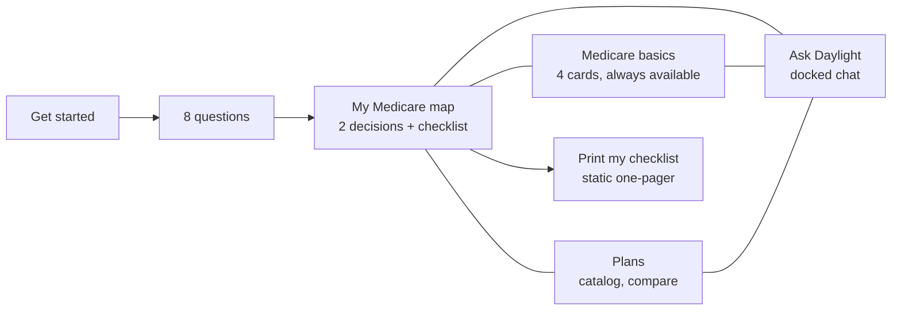
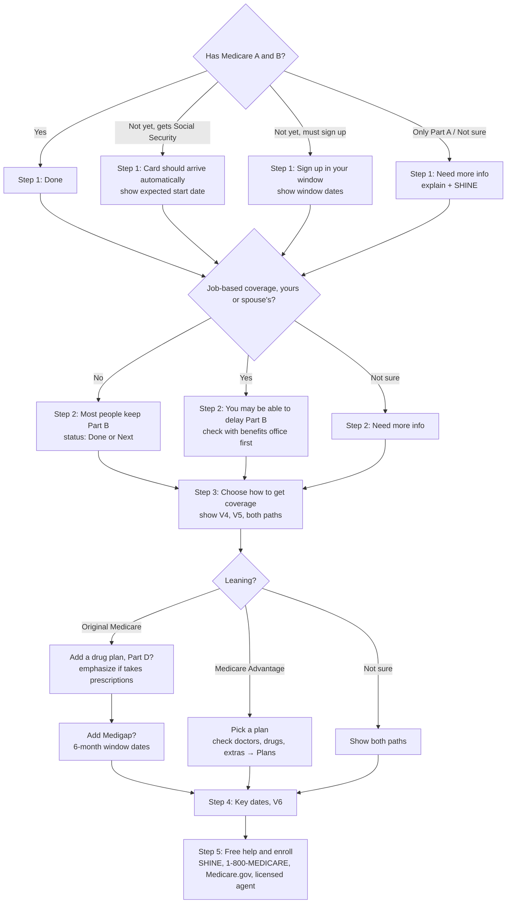

# Daylight guide redesign: basics, decision map and chat

Prepared October 19, 2026. Status: **design proposal for review**. Nothing here is implemented. It builds on the earlier chat implementation, chat review and chat implementation prompt, the [README](../../../README.md) and the [Collier data gap plan](../../COLLIER_DATA_GAP_PLAN.md).

## Summary

Keep the product's shape: **Get started → 8 questions → chat**. Change what the person lands on after the questions:

- **Before:** the person lands in a chat window and has to know what to ask.
- **After:** the person lands on **their Medicare map**. It is a picture of their two decisions and a short, dated checklist of what to do next, built from their answers.

Three things sit around the map:

1. **Medicare basics:** four always-available cards that mirror the official Medicare welcome booklet.
2. **Plans:** the existing catalog.
3. **Ask Daylight:** the chat, docked beside everything, used to explain whatever is on screen.

The map and the basics are **deterministic and reviewed**: the same answers always produce the same map. The chat **explains; it never decides**. Every card, visual and map step has an **Ask about this** button. The chat can open any visual from a fixed library instead of writing long paragraphs. When the person is done, **Print my checklist** produces a one-page static summary they can keep, like the booklet.

---

## 1. The vision this has to fit

From the README: Daylight Medicare helps people explore coverage "with a calm, step-by-step experience." Its operating model is **self-directed research, licensed transaction**. The app starts with **Get started**, asks the Chapter-style starter questions (seven, or eight with timing), and carries answers into the chat and the **What I know so far** panel.

This redesign keeps all of that, plus every constraint from the implementation prompt:

- The model never chooses, hides, reorders, scores or calls a plan best.
- Ordering stays deterministic.
- No IDs, documents or sign-up are ever requested.
- Tab-only model state; the blue and white look stays.
- Commissions never affect anything shown.

**What changes:**

- The question set (still 8).
- The landing screen after the questions.
- A persistent basics area.
- A library of reviewed visuals.
- One new field in the chat output.
- A printable checklist.

---

## 2. Who we're designing for, and what they actually need

**Primary test user:** someone about to turn 65, or just turned 65, new to Medicare, often holding the Medicare welcome booklet that arrives in the mail. **Secondary:** an adult child helping a parent.

### What they bring

- They've heard the words but can't tell them apart: Part A, Part B, Part C, Part D, Medigap, Supplement, Advantage.
- They're afraid of getting it wrong, mostly penalties and deadlines.
- They're tired of ads and pushy calls, so they're wary of anything that feels like sales.
- They often use an iPad or laptop, sometimes with a family member beside them, and many like paper.

### The five questions they need answered, in order

| # | Their question | Where we answer it |
| --- | --- | --- |
| 1 | What is Medicare, and how do I get it? | Basics card A |
| 2 | What does it cover? | Basics card B |
| 3 | How does it work, and what will I pay? | Basics card C |
| 4 | What are my options for more coverage, and how do they differ? | Basics card D + the two-paths visuals |
| 5 | What do I need to do, and by when? | The decision map + printable checklist |

The welcome booklet already answers 1–4 in this order and ends with "What you need to do now: you have 2 main decisions." We copy that structure on purpose. Using the same order and the same words as the paper in their hand builds trust and makes the tool feel official-adjacent rather than salesy.

---

## 3. Design principles

1. **Show the whole picture before asking for effort.** The map gives the complete situation without typing anything. Chat is optional.
2. **Two decisions, not a maze.** Frame everything as the booklet does: (1) how you'll get your coverage, and (2) whether to keep Part B. Everything else hangs off those.
3. **Deterministic where it matters, conversational where it helps.** Rules, dates and comparisons come from reviewed content and code. The model explains them in plain words and answers follow-ups.
4. **Pictures first, paragraphs second.** If a visual exists for it, the chat shows it and adds two sentences, rather than writing ten.
5. **Plain words first, the official name second.** For example: "plans from private companies that bundle your coverage, called Medicare Advantage."
6. **Always one tap from the basics.** The four basics cards never disappear behind the chat.
7. **Never a dead end.** Every screen offers the next step, "Ask about this," and free human help (SHINE, 1-800-MEDICARE).
8. **Honest about what isn't checked yet.** Say it in one plain sentence, once per topic, with what to do instead (from the gap plan: doctor networks, personal drug costs, Medigap quotes).
9. **No pressure.** No countdown timers or "act now." Dates are shown calmly with what happens if missed.
10. **Paper is a feature.** The checklist prints cleanly on one page and doesn't require an account.

---

## 4. Information architecture



Four places, always reachable from a top bar: **My map · Basics · Plans · Ask Daylight.** The person's answers stay editable via **What I know so far**. Editing an answer recomputes the map instantly.

### Layout

**Laptop or tablet in landscape:** two panes. The left pane shows the current place (map, basics or plans). The right pane is Ask Daylight, collapsible.

```text
+--------------------------------------------------------------------------------+
| Daylight Medicare      [ My map ]  [ Basics ]  [ Plans ]     What I know so far |
+-----------------------------------------------------+--------------------------+
|  Your Medicare map                                   |  Ask Daylight            |
|  For: Linda  ·  Naples (Collier)  ·  Starts Mar 2027 |                          |
|                                                      |  Hi Linda. This is your  |
|  ( 2 decisions picture: V1 )                         |  map. You have 2         |
|                                                      |  decisions. Tap any step |
|  [✓] 1. Get Parts A and B ............ Done          |  and I'll explain it.    |
|  [→] 2. Keep Part B? ................. Your next step|                          |
|  [ ] 3. Choose how to get coverage ... Decide by     |  [What's Part B?]        |
|         Original Medicare | Medicare Advantage       |  [Show me the 2 paths]   |
|  [ ] 4. Key dates (V6 timeline)                      |  [I have a question]     |
|  [ ] 5. Get free help / enroll                       |                          |
|                                                      |  ______________________  |
|  [ Print my checklist ]        [ Ask about this ]    |  Type a question...  [>] |
+-----------------------------------------------------+--------------------------+
```

**Phone:** a single column with a bottom tab bar (**Map · Basics · Plans · Ask**). Ask opens full-screen with a "Back to map" button at the top.

**Why not a chat-first screen:** a beginner can't ask about what they don't know exists. Open-ended chat makes the person do the work of structuring the problem. The map does that work for them, and chat becomes the "what does this mean?" button.

---

## 5. The 8 questions: keep the count, change what they capture

The current set covers who, ZIP, current coverage, timing, prescriptions, hearing, vision and dental. Three answers that the two decisions depend on are missing:

- **Job-based coverage** decides whether delaying Part B is even a question.
- **Doctor priority** decides how much networks matter.
- **Living part of the year elsewhere** is very common in Naples, and it changes how local-network plans work for someone.

Dental, vision and hearing can share one screen.

| # | Current question | Proposed question (one per screen) | What it drives on the map |
| --- | --- | --- | --- |
| 1 | Who is coverage for? | **Who are we looking at Medicare for?** Me / Someone else (with relationship) | Wording ("you" vs "your mom") |
| 2 | ZIP | **What's the ZIP code?** Then confirm "Is that in Collier County?" | Plan availability; never assume county from ZIP |
| 3 | Existing Medicare coverage | **Do you have Medicare yet?** Yes, Parts A and B / Only Part A / Not yet, and I get Social Security (card comes automatically) / Not yet, I'll need to sign up / Not sure | Step 1 status; automatic vs sign-up route |
| 4 | Timing (only if not yet) | **What month do you turn 65?** Month + year (or "Medicare starts in…" if they know) | All dates on the timeline (V6) |
| 5 | (none) | **Do you or your spouse have health coverage from a current job?** Yes / No / Not sure | Step 2: keep Part B or check before delaying |
| 6 | Prescription coverage | **Do you take prescriptions regularly?** Yes / No / Not sure | Emphasis on Part D and drug checks |
| 7 | (none) | **Which of these matter to you?** (pick any) Keeping my current doctors / Seeing doctors when I'm away from Naples / Low monthly cost / Fewer surprise bills / Not sure yet | Questions to weigh in Step 3; catalog sort priorities (unscored ones labeled) |
| 8 | Hearing, Vision, Dental (3 screens) | **Any extras you'd like covered?** (pick any) Dental / Vision / Hearing / None / Not sure | Step 3 notes; catalog filter |

That's 7 questions, or 8 with timing, matching today's count. "Not sure" is always offered and stored as `unknown`, never guessed. Questions 5 and 7 are new.

**Privacy.** Birth month and employment are personal. Today, starter answers are written to local `.txt` logs. Complete gap-plan item **C01** before shipping these questions: don't log them, or log only with clear notice. Model state stays tab-only as today.

---

## 6. Medicare basics: the four always-available cards

These mirror the booklet pages supplied (pages 4, 8, 9 and the Part A/B page). Content is **reviewed text with sources**, stored as content files, not generated by the model. Each card has:

- A one-line summary.
- 3–6 bullets.
- One visual.
- Tap-to-define terms.
- A source link.
- **Ask about this.**

| Card | Title (plain) | Content (from booklet / Medicare.gov) | Visual |
| --- | --- | --- | --- |
| **A** | **What Medicare is and how you get it** | Health insurance for people 65+ (and some younger people with a disability or End-Stage Renal Disease). Some people get it automatically: if you already get Social Security or Railroad Retirement benefits, it starts when you turn 65 (or after 24 months of disability benefits). Others sign up. | V0: "Automatic or sign up?" two-box picture |
| **B** | **What Parts A and B cover** | Part A (hospital insurance): inpatient hospital care, skilled nursing facility care, hospice, some home health care. Part B (medical insurance): doctors and other providers, outpatient care, home health, medical equipment (wheelchairs, walkers, hospital beds), many preventive services (screenings, vaccines, yearly wellness visit). | V2: two-column picture with the booklet's hospital and stethoscope icons |
| **C** | **How Original Medicare works and what you pay** | Parts A and B together are called Original Medicare. You usually pay a deductible first, then about 20% of the Medicare-approved amount for Part B services (coinsurance). Costs can be lower with doctors who "accept assignment." Find them at Medicare.gov/care-compare. Original Medicare has no yearly limit on your 20% share. 2027 premium and deductible amounts appear once CMS publishes them (gap plan C29). | V3: "Who pays what" bar |
| **D** | **Ways to get more coverage** | Medicare Advantage (Part C), Medicare drug coverage (Part D), and Medicare Supplement Insurance (Medigap). Medigap and Medicare Supplement are the same thing. | V4: building blocks |

**Glossary (tap, not hover):** deductible, coinsurance, copay, premium, network, accept assignment, Part A/B/C/D, Medigap, out-of-pocket limit, formulary. One short definition each, from the same reviewed source set. Tapping a term never calls the model.

---

## 7. Visual library

These visuals are reviewed, deterministic components. The chat can open them by ID (section 9). They cost no model call to display. Numbers inside visuals come from data tables (gap plan G3) or are clearly marked "example."

| ID | Name | What it shows | Used in |
| --- | --- | --- | --- |
| **V0** | Automatic or sign up? | Two boxes: "Getting Social Security already → card arrives automatically" / "Not yet → you sign up" | Card A, map Step 1 |
| **V1** | Your two decisions | The booklet's framing as a picture. Decision 1: how to get coverage (Original Medicare or Medicare Advantage). Decision 2: keep Part B (most people do). | Top of map |
| **V2** | What A and B cover | Two columns with icons | Card B |
| **V3** | Who pays what | Bar for an example $100 Medicare-approved Part B bill after the deductible: Medicare $80, you $20. Caption: "Example only. Medigap can pay some or all of your share." | Card C, Step 3 |
| **V4** | Building blocks | **Original Medicare path:** stacked blocks [Part A][Part B] + optional [Part D drug plan] + optional [Medigap]. **Advantage path:** one box containing [A + B] + usually [drugs] + often [extras]. A note between them: "You pick one path. Medigap doesn't work with Advantage." Under both: "You still pay the Part B premium." | Card D, Step 3 |
| **V5** | Side by side | The comparison table below | Step 3, chat |
| **V6** | Your timeline | Personal dates from answers: sign-up window, coverage start, Medigap 6-month window, each fall's change period. "Today" marker. | Map Step 4, print |
| **V7** | What's checked and what isn't | For plan lists: "Sorted by lowest monthly premium. Not a recommendation. Doctors not checked yet." | Plans |
| **V8** | Medigap letter plans | Which standardized letters exist, what each covers (benefit chart), and Florida price ranges labeled "illustrative." Appears when gap plan G4 data lands. | Step 3 (Original), Plans |

### V5: Original Medicare vs Medicare Advantage (content for review)

| | Original Medicare (+ optional Medigap and Part D) | Medicare Advantage |
| --- | --- | --- |
| Who runs it | The federal government | Private companies approved by Medicare |
| Doctors and hospitals | Any in the U.S. that accept Medicare | Usually a network; going outside it can cost more or not be covered, except emergencies |
| Specialist referrals | Usually not needed | Often needed, especially in HMOs |
| Approval before some care | Rarely | More often |
| Prescription drugs | Add a separate Part D plan | Usually included |
| What you pay when you get care | Usually 20% after the deductible, with no yearly limit; Medigap can cover most of that | Copays or coinsurance, with a yearly out-of-pocket limit for covered services |
| Monthly cost | Part B premium + Part D premium + Medigap premium (if you buy one) | Part B premium + the plan's premium (many Naples plans are $0) |
| Dental, vision, hearing | Generally not covered | Many plans include some |
| When away from Naples | Works the same anywhere in the U.S. | Mostly local network; check each plan's travel rules |
| Changing later | You can switch to Advantage each fall. Buying Medigap later may require health questions outside your 6-month window. | You can change plans each fall (Oct 15–Dec 7) |

Rules for this table:

- Domain review signs every cell before release.
- The "many Naples plans are $0" claim must come from catalog data at render time (today 54 of 70 records show a $0 Part C premium), not be typed in.
- No cell says "better."

---

## 8. The decision map ("What you need to do now")

### Structure

A vertical path of five steps, styled like a simple route with a **You are here** marker. Each step has:

- **Status, in words plus an icon (never color alone):** Done / Your next step / Coming up / Not needed for you / Need more info.
- **One sentence** saying what this step is.
- **"Why this applies to you":** one line quoting their answer ("You said you have coverage from a current job").
- **The step's own action or information:**
  - Step 1 (Get A and B): the date or sign-up link.
  - Step 2 (Keep Part B?): "check with your benefits office first."
  - Step 3 (Choose how to get coverage): the V4 and V5 visuals and the two path cards.
  - Step 4 (Key dates): the V6 timeline.
  - Step 5 (Free help and enrolling): the help contacts.
- **Ask about this.**

```text
 (✓) 1  Get Medicare Parts A and B
  |
 (→) 2  Decide about Part B           ← You are here
  |
 ( ) 3  Choose how to get your coverage
  |       ├─ Original Medicare  → add drug plan? → add Medigap?
  |       └─ Medicare Advantage → pick a plan (check doctors, drugs)
  |
 ( ) 4  Key dates
  |
 ( ) 5  Get free help and enroll
```

**Branches stay visible.** In Step 3, both paths show side by side as cards. If the person taps "I'm leaning toward Original Medicare," the map expands that path's sub-steps (Part D, Medigap) and the other path folds into a gray "the other option" card. One tap brings it back. Leaning is optional, "Not sure" is fine, and the tool never picks.

**Their priorities appear as questions, not verdicts.** Example:

> You said keeping your doctors matters. With Original Medicare, any doctor who accepts Medicare works. With Medicare Advantage, you'd check each plan's network. We can't check networks yet, so call the doctor's office to confirm.

### Map rules (deterministic; implement in code, e.g. `decision_map.py`, with unit tests)



**Rules come from gap plan G3 (C25, C30) and must cite their source passages.** Each rule below must be verified against Medicare.gov before shipping:

- **Initial sign-up window:** 7 months around the 65th birthday month. Watch the edge case of a birthday on the 1st of the month.
- **Coverage start date:** depends on when the person signs up.
- **Automatic enrollment:** applies to people already getting Social Security or Railroad Retirement benefits.
- **Delaying Part B with job-based coverage:** the conditions and the special enrollment period afterward. Employer size matters, so the tool says "check with your benefits office" rather than deciding.
- **Late penalties:** the Part B and Part D penalty triggers.
- **Medigap open enrollment:** a 6-month window starting when the person is 65+ and Part B begins.
- **Change periods for people already on Medicare:** fall Oct 15–Dec 7, and the Medicare Advantage open enrollment period Jan 1–Mar 31.
- **Unknown inputs:** any unknown input produces "Need more info," never a guessed date.

**Medicare.gov wording to mirror:** "Most people keep Part B. You need both Part A and Part B to join a Medicare Advantage Plan or (in most cases) buy a Medigap policy."

### Already on Medicare (review mode)

If Question 3 is "Yes, Parts A and B," the map changes:

- Steps 1–2 show as Done.
- Step 3 becomes **Review your coverage for 2027.**
- The key dates show this fall's change window.
- A caregiver helping a parent during open enrollment lands here.

### Printable checklist (static)

**Print my checklist** opens a one-page print view. It contains:

- Name or relationship.
- ZIP/county.
- Today's date.
- The five steps with statuses.
- Their dates.
- The questions to weigh (from their priorities).
- Free help phone numbers.
- "This is general information, not a recommendation."

It works offline after loading and needs no account. Nothing is saved on the server; the person can also save it as a PDF from the browser's print dialog. Large type, black and white friendly.

---

## 9. The chat, redesigned around the map and visuals

### Role

Daylight explains what's on screen, answers "what does this mean / what about my situation," and moves the person to the right place. It does not:

- Decide.
- Rank or pick plans.
- Edit the map.

The map changes only when the person's answers change. The person changes them, or the chat proposes an update the person confirms.

### Context sent with each turn (small, cache-friendly)

The existing state is unchanged, plus:

```json
{
  "map": {
    "current_step": "s2_part_b",
    "leaning": "original | advantage | unknown",
    "steps": [{"id": "s1_ab", "status": "done"}, {"id": "s2_part_b", "status": "next"}]
  },
  "on_screen": {
    "view": "map | basics | plans | plan | comparison",
    "card": "A | B | C | D | null",
    "visual": "V0 … V8 | null",
    "step": "s1_ab | s2_part_b | s3_path | s4_dates | s5_help | null"
  }
}
```

**Ask about this** sends the item's ID plus its reviewed text (or its fact IDs) as a tool result. The model explains the same reviewed content the person is looking at. It doesn't need a separate lookup.

### New output field: `show`

```json
"show": {
  "type": ["object", "null"],
  "properties": {
    "visual": {"type": "string", "enum": ["V0","V1","V2","V3","V4","V5","V6","V7","V8","card_A","card_B","card_C","card_D","map_step","plans"]},
    "target": {"type": ["string", "null"]}
  },
  "required": ["visual", "target"],
  "additionalProperties": false
}
```

**How the browser handles `show`:** it renders the visual inline in the chat as a compact card with "Open full size," or switches the left pane. Validation rejects unknown IDs (one correction retry, then the safe fallback). For `plans`, `target` may only be a category filter; ordering stays deterministic.

### Instruction additions (append to the Phase 3 block; keep it one stable block)

```text
THE MAP AND VISUALS
- The person has a map with 5 steps built from their answers. Refer to steps by number and name ("Step 2, deciding about Part B").
- Never change, reorder or skip map steps yourself. If the person gives a new answer, put it in state_update; the app rebuilds the map.
- Prefer showing over telling. If a visual answers the question, set show to it and keep reply to 1-2 sentences that point at it ("Here's the side-by-side. The biggest difference is how doctors work.").
- Explain the item in on_screen first when the person says "this," "that" or "what does this mean."
- Use the booklet's framing: two decisions, how you get coverage, and whether to keep Part B. Use the person's words for their priorities.
- When a step depends on a rule (dates, penalties, Part B delay), use the rule text supplied; don't state dates from memory.
- For anything personal or uncertain (job coverage, Medicaid, disability), say what usually applies, then point to Step 5 free help (SHINE, 1-800-MEDICARE).
```

### Quick replies by context (at most 3)

| Where | Default quick replies |
| --- | --- |
| Map, first open | "Explain my next step" · "Show me the 2 paths" · "What's Part B?" |
| Step 3 | "What's the biggest difference?" · "Which costs more?" · "What about my doctors?" |
| Basics card | "Give me an example" · "What does this mean for me?" · "Next card" |
| Plans | "What does this list mean?" · "Compare 2 plans" · "What isn't checked?" |

**Example turn** (person on Step 3, asks "so which one is cheaper?"):

> **reply:** It depends on how much care you use. Advantage often has a lower monthly cost, while Original Medicare with Medigap usually means more predictable bills when you need care. This side-by-side shows where the costs come from.
>
> **show:** V5
>
> **question:** Would an example help, like a year with a hospital stay?
>
> **quick replies:** "Yes, show an example" · "What about drugs?" · "Back to my map"

No "best," no pick, one question, and the visual carries the detail.

---

## 10. Older-adult usability requirements

- **Type:** body text at least 18px. Primary buttons at least 48px tall with full-width tap targets on phone. Contrast meets WCAG 2.2 AA.
- **Gestures:** no hover-only content, no swipe-only gestures, no auto-advancing carousels.
- **Status:** never color alone; always word + icon.
- **Navigation:** one primary action per screen. The Back button always works and keeps answers.
- **Chat input:** never required. Every chat path has buttons.
- **Reading time:** no timers, no auto-dismissing messages.
- **Zoom:** text resizes to 200% without breaking layout.
- **Print:** the print view is tested on a real printer.
- **Words:** plain throughout, at roughly an 8th-grade reading level, checked with a readability tool and by a reviewer.
- **Identity:** the chat states it's automated in its first message (already implemented).

---

## 11. What shows when data is missing (ties to the gap plan)

| Topic | Until the data exists | Gap plan item |
| --- | --- | --- |
| 2027 Part A/B amounts | "2027 amounts not published yet; we'll show them when CMS does." | C29 |
| Medigap prices (V8) | Letter-plan benefits chart only; prices "coming soon," or Florida illustrative rates clearly labeled | C22–C25 |
| Doctor networks | "We can't check networks yet. Call the doctor's office and ask if they take the plan." Hospital table once ready. | C26–C28 |
| Personal drug costs | Coverage/tier evidence + link to Medicare.gov Plan Finder | H01 |
| Dates needing unknown answers | "Need more info" status + what to find out | C30 |

---

## 12. Testing with 65-year-olds

**Two rounds, five people each.** Five participants per round find most usability problems. Recruit people within six months of turning 65, plus at least two caregivers. Ask them to bring their welcome booklet if they have one. Use synthetic personas for any personal details. Never collect real Medicare numbers.

- **Round 1 (no chat):** basics + map + print. Tests whether the structure alone makes sense.
- **Round 2 (with chat):** the same tasks with Ask Daylight available. Tests whether chat helps or distracts.

**Tasks:**

1. Without help, tell me in your own words what Parts A and B cover (teach-back).
2. What are your two decisions?
3. Explain the difference between Original Medicare and Medicare Advantage to a friend (teach-back).
4. What's your next step, and by what date?
5. Find out what "coinsurance" means.
6. (Round 2) Ask Daylight a question about something on your screen.
7. Print your checklist and tell me what you'd do with it.

**Measures:**

- Task success.
- Teach-back accuracy, scored against a rubric by a reviewer.
- Time on task.
- Confidence (1–5) before and after.
- Moments of confusion (note the screen and words).
- Chat turns per answered question.
- Whether anyone believed the tool recommended a plan. Target: no one.

**Pass bar for moving on:**

- 4 of 5 complete tasks 2–4 unaided.
- Teach-back for task 3 is correct on cost and doctors for 4 of 5.
- No one thinks the tool picked a plan for them.

**Personas** (synthetic, for prototypes and map unit tests):

- **Linda:** turns 65 in March 2027, retired, gets Social Security, takes 2 prescriptions, wants to keep her NCH cardiologist, spends summers in Ohio.
- **Robert:** 65, still working with employer coverage, no prescriptions.
- **Maria:** helping her mother, who has had Medicare for years and is reviewing coverage this fall.

---

## 13. Guardrails (unchanged and new)

- **Unchanged:**
  - No plan picks, scores, "best" or hidden plans.
  - Deterministic ordering.
  - SNPs labeled "only for people who qualify."
  - No IDs, SSNs, documents or sign-up.
  - Tab-only model state.
  - `store: false`.
- **New:** the map, basics and visuals are reviewed content. The model can display them but not alter their text or numbers.
- **New:** "leaning" toward a path is recorded only from the person's explicit choice. It's never inferred, and it never filters plans out without a visible, one-tap undo.
- **Later, not in this task:** commercial compliance language (TPMO disclaimer, scope of appointment) before any licensed transaction flow, per the operating model.

---

## 14. Implementation plan and checklist

**Agent protocol:**

- Read this checklist first and work the lowest unblocked item.
- When finishing an item, in the same change: tick it, add `DONE <date> — evidence: <path/test/screenshot>`, and update **Last updated**.
- Mark blocked items `BLOCKED <date> — <reason>`.
- Add new items with the next free ID; never renumber.
- Record any design decision in the Decision log.
- Don't tick an item without evidence.

**Last updated:** 2026-10-19 (proposal created; no items started)

### Phase A: Content (reviewed, no model)

- [ ] **U01** · Write basics cards A–D as content files (JSON or Markdown) with source URLs and review dates, using the booklet structure and Medicare.gov wording.
- [ ] **U02** · Write the glossary (about 12 terms) with sources.
- [ ] **U03** · Write the V5 comparison content. Make the $0-premium cell data-driven from the catalog.
- [ ] **U04** · Domain reviewer signs U01–U03.

### Phase B: Visuals (deterministic components)

- [ ] **U05** · Build V0–V4 as static SVG/HTML components in the blue and white style, with text in the DOM (not images) so it scales and reads aloud.
- [ ] **U06** · Build V5 as an accessible table that stacks into cards on phone.
- [ ] **U07** · Build V6 timeline from computed dates, with a "Today" marker and "Need more info" placeholders.
- [ ] **U08** · Build V7 plan-list banner, replacing today's banner text where needed.
- [ ] **U09** · V8 Medigap chart: benefits-only version now; prices when gap plan C23 lands.

### Phase C: Decision map engine

- [ ] **U10** · Implement `decision_map.py`: answers → steps (id, status, why-line, actions, dates). Rules come from gap plan C25/C30 with source passages; unknowns become "Need more info."
- [ ] **U11** · Unit tests: every answer combination for Questions 3 and 5, the birthday-on-the-1st edge case, the already-on-Medicare review mode, and the three personas.
- [ ] **U12** · Map UI: route view, statuses (word + icon), branch cards with leaning/undo, Ask about this on each step.
- [ ] **U13** · Print view: one page, black-and-white friendly, no server save.

### Phase D: Flow and layout

- [ ] **U14** · Complete gap plan **C01** (logging/privacy) before adding Questions 4, 5 and 7 to production.
- [ ] **U15** · Update the starter flow to the proposed 8 questions. Keep Back, Edit answers and "Not sure."
- [ ] **U16** · Land on My map after the questions. Add the top bar (Map · Basics · Plans · Ask) and the phone tab bar.
- [ ] **U17** · Editing **What I know so far** recomputes the map instantly.

### Phase E: Chat integration

- [ ] **U18** · Add `map` and the extended `on_screen` to state. Make Ask about this send the item ID + reviewed text as a tool result.
- [ ] **U19** · Add the `show` output field, browser rendering and validation (unknown ID → one retry → safe fallback).
- [ ] **U20** · Append the instruction additions (section 9). Keep the prefix stable for caching and confirm the cached-token share stays above 50%.
- [ ] **U21** · Make the first chat message local and free, referencing the map.
- [ ] **U22** · Add eval fixtures: "which is cheaper," "what's this," "explain Step 2," "pick for me," caregiver review mode. Extend the rubric with "used a visual when one existed" and "changed the map without a confirmed answer" (target 0).

### Phase F: Test with people

- [ ] **U23** · Accessibility pass: 18px type, 48px targets, AA contrast, 200% zoom, screen reader, print.
- [ ] **U24** · Usability round 1 (no chat), 5 participants; record results against the pass bar.
- [ ] **U25** · Fix round-1 findings.
- [ ] **U26** · Usability round 2 (with chat), 5 participants; record results.
- [ ] **U27** · Write a findings report and decide what ships.

### Decision log

| Date | Decision | By |
| --- | --- | --- |
| 2026-10-19 | Proposal: map-first landing after 8 questions; deterministic map and visuals; chat explains with `show`; printable checklist | Proposal, pending owner review |

### Change log

| Date | Change | By |
| --- | --- | --- |
| 2026-10-19 | Created | Claude |

---

## Sources

- Medicare welcome booklet pages supplied by the owner (Medicare basics; Parts A and B coverage; How does Medicare work?; Can I get more coverage?; What you need to do now).
- [Medicare.gov: your coverage options](https://www.medicare.gov/basics/get-started-with-medicare/get-more-coverage/your-coverage-options) (cited in the booklet)
- [Medicare.gov: joining a plan](https://www.medicare.gov/basics/get-started-with-medicare/get-more-coverage/joining-a-plan)
- [Medicare.gov: Medicare costs](https://www.medicare.gov/basics/costs/medicare-costs)
- [Medicare.gov: Medigap, ready to buy](https://www.medicare.gov/health-drug-plans/medigap/ready-to-buy)
- [Medicare.gov Care Compare](https://www.medicare.gov/care-compare) and [Plan Compare](https://www.medicare.gov/plan-compare) (cited in the booklet)
- [Official Collier SHINE directory](https://www.floridashine.org/Counseling-Sites/Collier.aspx)
