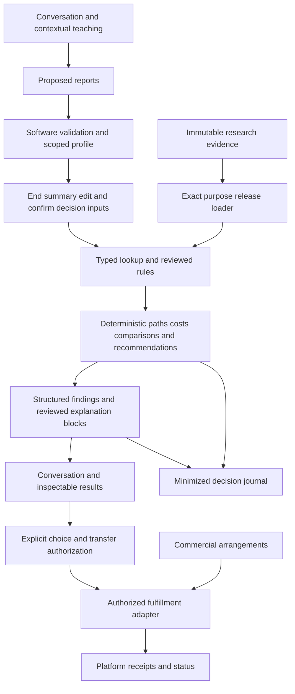

# Daylight architecture alignment and implementation guide

November 2, 2026 · Architecture assessment and guide for ongoing implementation

**Owner clarification November 2:** Confirm decision inputs at the end of the information-gathering conversation, through one editable summary immediately before the requested personal comparison or recommendation. Capture and clarify naturally along the way; do not add intermediate input-acceptance checkpoints. The owner confirms that the other workstreams are already underway. Use this guide to coordinate and verify that continuing work, rather than treating its steps as a new backlog or an instruction to restart.

The [current connected milestone](/Users/cep4u/daylight/docs/product/plan-comparison-2026-11-01/MILESTONE_2026-11-02.md) already directs two parallel tracks: complete H5652-002 meaning/discrepancy/extraction reconciliation in additive r12, and connect identity choices, corrections and source-STOP/deletion handling into a tested chat-to-comparison journey. Current execution evidence establishes completion; the inspection snapshot below does not supersede that ongoing work.

Daylight is substantially aligned with the attached design in its principles and planned boundaries. The current local software implements conversational intake, validated reported facts, reviewed general teaching, protected research access and deterministic comparison mechanics. It does not yet operate the complete confirmed profile → accepted recommendation → reviewed personalized explanation → authorized enrollment workflow.

Across the attachment's sixteen functional practices, the inspection snapshot records **four working local core behaviors, eight partial foundations and four capabilities whose core consumer workflow is not yet available**. These categories describe the inspected implementation and release state, not whether work has started, a percentage of engineering effort or a production readiness score. Work continues in real time beyond this snapshot.

This guide proposes work and acceptance criteria. It does not authorize implementation outside existing scope, accept evidence, activate personal advice or enrollment, change privacy permissions, provision hosting or alter the protected applications. The request is for an assessment and implementation guide; application behavior is unchanged.

## Current architecture and evidence

The current engineering target for the newer work is **:8893**, in [alternatives/advisor-first](/Users/cep4u/daylight/alternatives/advisor-first/README.md). Preserve the original :8890 ten-question application, the :8891 chat-first alternative and the :8896 previous guide, together with their separate stores and policies. The :8893 service reuses a hash-pinned engine; it is not permission to modify the protected engine or migrate guest records.

The [October 21 architecture overview](/Users/cep4u/daylight/docs/ARCHITECTURE.md:3) remains useful history, but its active frontend, tab-only state and transcript descriptions do not describe the newer advisor. Current behavior is established by the newer source and execution packets:

| Boundary | Current evidence | Practical meaning |
| --- | --- | --- |
| Conversation | [Two-stage controller](/Users/cep4u/daylight/alternatives/advisor-first/natural_flow.py:628) and [model contract](/Users/cep4u/daylight/alternatives/advisor-first/natural_agent.py:1) | AI proposes an interpretation; software resolves supported reports before composing a reply. The model cannot directly write the profile or execute enrollment. |
| Profile | [Report adapter](/Users/cep4u/daylight/alternatives/advisor-first/comparison_profile.py:255) and [natural provenance](/Users/cep4u/daylight/alternatives/advisor-first/natural_state.py:550) | Direct reports, explicit confirmation and external verification have different meanings. Unknown, none, deferred, tentative, conflicting and stale remain distinct. |
| Comparison | [Engine](/Users/cep4u/daylight/alternatives/advisor-first/comparison_engine.py:118), [methods](/Users/cep4u/daylight/alternatives/advisor-first/comparison_methods.py:415) and [service](/Users/cep4u/daylight/alternatives/advisor-first/comparison_service.py:56) | Deterministic conditions, compatible-basis arithmetic, dependencies and stale-result invalidation exist. These are structural mechanics, not accepted Medicare recommendation methods. |
| Evidence authority | [Purpose holds](/Users/cep4u/daylight/alternatives/advisor-first/comparison_evidence.py:146) and [original reference replay](/Users/cep4u/daylight/alternatives/advisor-first/published_reference.py:119) | The six consumer purposes remain held. Exact accepted reference lookup is narrower than general display, personal comparison, ranking, recommendation, quote or enrollment. |
| Research service | [Local execution](/Users/cep4u/daylight/docs/product/plan-comparison-2026-11-01/LOCAL_EXECUTION.md:1) and [current operator seams](/Users/cep4u/daylight/audit-evidence/comparison-next-20261101/README.md:15) | Real retained records can be inspected internally. Research rows do not enter consumer alternatives or AI context; newer identity services are callable operator seams. |
| Database | [Completed integrated load](/Users/cep4u/daylight/docs/data/infrastructure-execution-2026-10-30-local-full-db/README.md:8) | All fifteen selected layer populations are retained together: 17,767,179 source/context rows and 17,823,148 initial projections. This proves a research load, not complete domain normalization or accepted consumer facts. |
| Privacy | [Bounded visit memory](/Users/cep4u/daylight/alternatives/advisor-first/advisor_memory.py:14), [saving boundary](/Users/cep4u/daylight/alternatives/advisor-first/natural_flow.py:980) and [privacy wording](/Users/cep4u/daylight/alternatives/advisor-first/web/advisor.js:668) | Deliberate Send uses versioned AI permission; optional profile saving and sensitive saving remain separate. Current raw dialogue and generated wording are outside saved profiles. |
| Governance | [Principles](/Users/cep4u/daylight/PRINCIPLES.md:13), [strategy](/Users/cep4u/daylight/docs/product/STRATEGIC_THESIS.md:131) and [I01–I10](/Users/cep4u/daylight/docs/product/INDEPENDENCE_ACCEPTANCE.md:24) | Independence, comprehensive scope reporting, reproducibility, consumer control and exact release review are binding requirements. Their specification is not certification that they are all implemented. |

This assessment used source inspection and dated execution evidence. It did not rerun the application suites, certify the running process, inspect customer records or perform a production security audit.

## Alignment with the sixteen proposed practices

**Local** means the named core behavior exists in the local application. **Partial** means useful code exists but a material control, integration or accepted purpose remains incomplete. **Held** means the core consumer workflow is unavailable in this inspection snapshot; underlying engineering, source, operating or approval work may already be underway. These labels do not assign work to a future backlog.

| Practice from the attachment | Status | What is aligned and what remains |
| --- | --- | --- |
| 1 Understand the person's situation | Local | Proposal-only language interpretation, semantic support checks, person/time scope and post-validation composition exist. Broader language coverage and consumer comprehension remain evaluation work. |
| 2 Teach Medicare concepts | Local | Reviewed general teaching and contextual explanations exist. This does not establish approved plan-selling explanations. Literal factual validators are useful safeguards, not proof of semantic support. |
| 3 Fill a dynamic profile | Local | Existing scoped reports, corrections, provenance, unknown/none states and optional saving are reused. A complete populated recommendation-input validator and confirmed decision snapshot remain work under practices 4 and 9. |
| 4 Discover and confirm priorities | Partial | Explicit priority context is revision-bound; the comparator preserves an unordered set and infers no weights. Confirm the material facts, interpretations, priorities and declared constraints together in the editable end summary before the requested personal comparison or recommendation. |
| 5 Evaluate coverage paths and timing | Held | The rule/dependency design represents these questions, but accepted personal path, eligibility and timing execution is absent. Published reference rules cannot substitute for applying them to a person. |
| 6 Check doctors drugs and benefits | Partial | Exact source identities, internal research lookup and operator drug/provider seams exist. Customer-facing identity resolution, current plan-specific checks, receipts and accepted tool purposes remain incomplete. |
| 7 Calculate costs | Partial | Exact Decimal comparisons and declared-scenario mechanics exist. Accepted benefit-rule calculations, accumulation/caps, utilization assumptions, complete totals and binding quote integrations are not established. |
| 8 Compare plans | Partial | Deterministic dimensions, conditions, reason fields, unknown neutrality and dependency hashes exist. Real consumer alternatives and personal comparison authority remain held. |
| 9 Produce recommendations | Held | Reproducibility and independence are specified. There is no released personal recommendation policy or ranking workflow; current real consumer evaluated count is zero and automatic personal order is null. |
| 10 Explore what if tradeoffs | Partial | Pure scenario helpers and stale-dependency mechanics exist. The current preparation case has no declared constraints/scenarios; conversational reruns and isolated scenario promotion are not integrated. |
| 11 Explain why a plan matched | Partial | Structured findings carry rules, reasons and evidence references. A reviewed renderer with approved reason blocks and constrained variables for actual personalized plan explanations is missing. |
| 12 Answer plan-specific follow-ups through tools | Held | Current composition receives capability/hold markers and has no plan-result retrieval or scenario execution tools. Internal research access cannot simply be exposed as a prompt attachment. |
| 13 Deliver disclosures and scope agreements in software | Partial | Versioned AI permission and saving choices exist. An executable brokerage disclosure/scope policy, reviewed content registry and durable delivery/agreement receipts are not established. |
| 14 Complete enrollment through an authorized platform | Held | Downstream fulfillment is designed and enrollment remains explicitly held. No permitted platform integration, beneficiary transfer workflow or real transaction/status reconciliation is implemented. |
| 15 Handle unsupported situations | Local | Unknown states, held capabilities, bounded failures, correction and recovery preserve useful progress. Staffed exception ownership, support permissions and resolution receipts remain operational work. |
| 16 Keep evidence and monitor quality | Partial | Immutable sources, reference verification, version-bound traces and technical QA exist. Current comparison traces and delivered generated wording are not persisted; a minimized decision journal and ongoing operational review remain missing. |

The most consequential source locations for this distinction are [comparison output authority](/Users/cep4u/daylight/alternatives/advisor-first/comparison_engine.py:594), [unordered preferences](/Users/cep4u/daylight/alternatives/advisor-first/comparison_engine.py:319), [empty scenario preparation](/Users/cep4u/daylight/alternatives/advisor-first/comparison_case.py:88), [model hold markers](/Users/cep4u/daylight/alternatives/advisor-first/comparison_service.py:120) and [nonpersisted decision trace](/Users/cep4u/daylight/alternatives/advisor-first/comparison_engine.py:580).

Privacy follows the same pattern. Data minimization, separate AI/saving choices, private local storage, owner isolation and bounded dialogue memory are useful implemented foundations. The [same-browser guest store](/Users/cep4u/daylight/alternatives/chat-first/cms-slice/scripts/guest_profiles.py:76) defaults to expiry seven days after session creation, configurable from one to thirty days. Production encryption/key management, staff authentication, vendor-role review, retention by record class, incident handling and tested recovery still need operational implementation. A formal SOC 2 examination is a separate assurance/business decision; it does not replace those controls.

## Decisions needed to make the design consistent

1. **Confirm decision inputs at the end.** Preserve natural capture and targeted clarification during the conversation. At the end of information gathering, present one editable summary of material facts, interpretations, priorities, declared constraints and unresolved items, followed by a single confirmation immediately before the requested personal comparison or recommendation. Do not add intermediate input-acceptance checkpoints. Explicitly distinguish this end confirmation from authorizing sharing or enrollment. The current adapter's `usable_as_report` is not that confirmation receipt; a legacy compatibility flag cannot supply one.
2. **Separate independent results from fulfillment in code.** Current economic-key rejection is a useful start. Full I01–I10 must also cover retrieval, model selection, experiments, features/proxies, explanations and caches. Record the independent decision before reading optional fulfillment arrangements.
3. **Reconcile the older mandatory-agent purchase plan with the newer operating target.** [The earlier workflow](/Users/cep4u/daylight/docs/PRODUCT_WORKFLOW.md:27) required a licensed purchase session. [The later D73 direction](/Users/cep4u/daylight/docs/product/STRATEGIC_THESIS.md:121) targets self-service with staff for necessary exceptions. Design for zero routine human intervention where the actual approved route permits it; record any required involvement from the reviewed brokerage/platform arrangement. Neither document proves that a particular automated route is legally or contractually available.
4. **Add purposeful decision records without quietly retaining health chat.** Current nonpersistence is intentional. New decision, delivery and authorization records need their own data-purpose, access and retention design. Saving a structured decision is not permission to save all dialogue.
5. **Do not promote research infrastructure into consumer authority.** Loading a database, resolving a drug identity, matching two numbers or obtaining technical agent agreement does not accept a benefit meaning, personal calculation or recommendation.
6. **Keep coverage year explicit.** Current D85/D77 research scope is 2026. Retained older 2027 experiments and 2027 enrollment guidance must not silently change that scope or supply current personal output authority.

## Target software boundaries

Keep the existing modular application. These are logical contracts; they do not require a fleet of microservices or replacement of the current UI.

No commercial data path returns to evidence selection, AI context, comparison, reasons or recommendation. General education can remain conversational. Critical plan-specific conclusions come from accepted findings and reviewed wording. Missing source or method authority closes the affected output while leaving useful supported research and education available.

## Detailed implementation sequence

Each step names an accountable role, dependencies, deliverables and completion evidence for the ongoing work. Roles are responsibility definitions, not claims that particular staff or suppliers are engaged. Apply these checks to existing workstreams and reuse their progress; steps are neither a restart order nor a queue that serializes work already proceeding in parallel. A step's code completion does not by itself release a capability.

### Step 1 Establish the current architecture baseline

**Owner:** engineering lead. **Requirements:** D49, D57, D64, D73, D75, D79, D85–D87. **Dependency:** none.

- Inventory current routes, source trees, engine hashes, configured runtime builds, stores, budget policies, selected research builds and exact acceptance receipts. Record source inspection separately from actual running-process verification.
- Maintain one capability ledger with implemented behavior, connected tools, input sufficiency, source authority, method authority, consumer purpose and unresolved owner/action/closure criteria.
- Cross-link the recent advisor, research and database packets from the architecture index. Preserve older snapshots and sealed packets as history.
- Establish before/after checks for protected variants, stores, ledgers, source hashes and accepted revisions. Use targeted patches in the dirty workspace.

**Exit evidence:** a dated baseline and dependency ledger in which a reviewer can trace every claimed capability to code and an exact scope. No profile migration or data-release change is part of this step.

### Step 2 Resolve the operating and content approval route

**Owner:** founder and accountable licensed brokerage/compliance lead. **Dependency:** step 1; can run alongside engineering.

- Put the actual proposed workflow before counsel and brokerage/platform compliance: conversational education/intake → confirmed inputs → software recommendations → reviewed personalized explanation → authorized electronic enrollment.
- Build a versioned activity matrix keyed by entity, state, coverage year/product, carrier/channel, activity, effective dates and approval owner. Distinguish education, path advice, comparison, recommendation, marketing, data sharing and enrollment.
- Determine supervision, carrier/platform permissions, material approval processes, required disclosures/scope agreements, applicable sales-record retention and exception duties for that specific route.
- Resolve whether an approved route supports zero routine human intervention. Record an actual requirement for a human step when applicable; do not insert an appointment based on an assumption.
- Define how wording/template changes and new variables require review. Software modularity does not transfer responsibility away from Daylight.

**Exit evidence:** scoped written decisions and contract/authority references, with unresolved activities remaining held. Internal synthetic implementation can continue while external decisions are pending.

The review must account for intent/content when classifying marketing and applicable material submission processes. These are regulatory review inputs, not a conclusion that the proposed templates are automatically approved. See [42 CFR 422.2260](https://www.ecfr.gov/current/title-42/section-422.2260), [422.2261](https://www.ecfr.gov/current/title-42/section-422.2261), [beneficiary contact](https://www.ecfr.gov/current/title-42/section-422.2264) and [third-party requirements](https://www.ecfr.gov/current/title-42/section-422.2274).

### Step 3 Specify data purposes permissions and retention

**Owner:** privacy/security lead with engineering and compliance. **Dependencies:** steps 1–2 for final policy; schema design can start immediately.

- Inventory ephemeral drafts/dialogue, reported profile, sensitive saved details, decision inputs/results, delivered sales content, notices/permissions, enrollment records, technical diagnostics and public evidence separately.
- For each class, record purpose, necessary fields, subject/controller/processor roles, recipient, storage location, retention basis, expiry/deletion, legal holds, backups and access roles. Determine HIPAA applicability from actual roles and relationships using [HHS role guidance](https://www.hhs.gov/hipaa/for-professionals/covered-entities/index.html).
- Keep enrollment identifiers out of general conversation and early intake. Collect them only through the approved route when needed.
- Extend permissions only for the newly needed purpose. Keep AI transfer, optional saving, sensitive saving, family access, human sharing and enrollment transfer distinct. Record notice version, purpose, actor, recipient, action, timestamp and revocation/expiry where applicable.
- Preserve current deliberate Send and the approved privacy placement. Do not reintroduce an AI confirmation modal or transfer on typing/navigation.
- Preserve the current no-durable-raw-dialogue default unless the reviewed sales-record policy requires a specifically defined communication record; implement that record deliberately rather than turning on general transcript logging.

**Exit evidence:** an approved data-purpose/retention matrix and permission contract, with tests for version mismatch, revocation, scope expansion, sensitive-save refusal and deletion propagation. Local guest expiry is not the policy for every future record type.

### Step 4 Confirm decision inputs at the end

**Owner:** profile/conversation engineering and product. **Dependencies:** steps 1 and 3; builds on D79/D86/D87.

- Extend the existing profile adapter rather than creating a second profile. Validate populated records, beneficiary versus researcher, current versus future scope, coverage episodes, item identities and exact report revisions.
- Define a `DecisionInputSnapshot` containing purpose, subject, year/geography/category, material facts, provenance, current unknowns, explicit priorities, any confirmed order/weights, declared hard constraints and source profile revisions.
- Keep direct answers and interpreted reports in their truthful capture/provenance states during the conversation. Clarify consequential ambiguity naturally without adding a separate input-acceptance checkpoint. Do not relabel reported facts as externally verified.
- At the end of information gathering, show one concise, editable summary of material facts, interpretations, priorities, declared constraints and unresolved items. Use one explicit confirmation immediately before the requested personal comparison or recommendation. This is the decision-input confirmation point; it does not require completing all 41 conditional meanings.
- Keep familiarity as an explanation-depth signal; do not turn it into risk tolerance. Listing a doctor does not make that doctor a hard constraint, and occasional travel does not imply a network requirement.
- Bind confirmation to the snapshot digest and revision. A correction invalidates affected findings and any pending named action; unchanged facts need no repetitive confirmation.

**Exit evidence:** cases covering wrong-person reports, tentative diagnoses, ambiguous travel, unordered priorities, explicit none, stale facts, corrections, caregiver reports and legacy confirmation flags. No inferred preference can alter a recommendation.

### Step 5 Complete the required evidence semantics and serving models

**Owner:** data/domain lead and independent semantic reviewer. **Dependencies:** step 1; continues in parallel with contract work.

- Keep immutable source-native evidence separate from typed serving projections. Carry exact plan/segment/year/location, effective dates, source pages/quotes, network/channel, conditions and conflict/missing states.
- Preserve and complete the approved full L03 program. The r9 denominator remains **143,505 source-scoped claims + 249,065 condition predicates = 392,570 obligations** for the exact 72 offerings. These are evidence/comparison obligations, not unique benefits or verified facts.
- Preserve the exact accepted r4 reference: **535 entries comprising 451 numeric source observations and 84 qualified notes**, its six conservative dispositions, the 153 historical held dispute groups and all earlier sealed evidence/code. No new work inherits that acceptance.
- Continue complete-meaning reconciliation for H5652-002 and the required pilot/strata scope. As of r11, its **4,675 obligations remain open: 4,659 pending and 16 required missing**. The r10/r11 detailed selections cover 288 distinct IDs; preparation accepts zero. Full source hydration is not semantic closure.
- Finish the required 21 whole-offering representatives, independent layout coverage across 56 strata and inventory-wide reconciliation under the existing closure policy. Do not create a smaller release denominator or infer an MVP exemption.
- Normalize relevant drug, pharmacy, provider/site, cost and coverage-period semantics across the other layers without treating transport projections as complete domain models. Label authentic source-access blockers separately from unfinished internal reconciliation.

**Exit evidence:** exact before/after inventory accounting, independently reviewed complete-meaning comparisons, explicit remaining gaps and new exact-scope acceptance where actually granted. [Current r11 scope and gaps](/Users/cep4u/daylight/docs/data/l03-ma-benefits-2026-11-01-whole-offering-r11/README.md:99) remain authoritative until superseded through the applicable process.

### Step 6 Implement exact purpose release loading and revocation

**Owner:** evidence-service engineering and release owner. **Dependencies:** step 5 for real accepted content; synthetic implementation can proceed earlier.

- Add a consumer release provider alongside the held research provider. Reuse original verification logic; do not duplicate accepted values into an unchecked convenience table.
- Bind exact source bytes, transformations, conditions, methods, serving build, permitted output purpose, scope, reviewer, effective/expiry dates and revocation status. Source acceptance and method acceptance are separate.
- Keep published display, personal comparison, ranking, recommendation, quote and enrollment as distinct authorities. An accepted reference lookup grants only its recorded scope.
- Add atomic release selection and rollback, freshness checks and dependency-based cache invalidation. Revalidate authority when reading a prior result or authorizing an action, not only at process startup.
- Restrict queries to allowlisted typed projections with server-side authentication, scope-bound pagination and bounded work. Never query arbitrary raw research tables through a consumer prompt.

**Exit evidence:** missing, forged, altered, expired, revoked and wrong-scope receipts fail closed; stale cached results lose affected authority; client flags and research credentials cannot promote a release. Preserve the original reference verifier and its exact accepted scope.

### Step 7 Integrate exact identity resolution and lookup receipts

**Owner:** integration engineering with pharmacy/provider domain reviewers. **Dependencies:** steps 3–4 and 6 for real consumer results.

- Wrap the existing operator drug/provider services in authenticated, owner-bound application interfaces. Bind a selected identity to the current item/report revision; disallow arbitrary client-selected foreign objects.
- Implement a provider candidate-offer and selection flow; the current provider lookup preserves actor/role/site alternatives but does not yet supply the drug service's explicit-choice workflow. Bind offers to owner, item/report revision, scope and source snapshot, with expiry and exact offered-candidate validation. Recheck source permission/STOP status and revisions before selection; do not automatically backfill the profile.
- For drugs, preserve name/product, ingredient/strength/form, exact code and fill assumptions as required by the check. An exact dictionary selection does not establish clinical interchangeability or coverage.
- For providers, preserve practitioner, organization, role, location, plan/network, service and effective date. A name match or directory listing does not prove every service, site or current appointment availability.
- For pharmacies, bind the exact location, plan/network status and pricing channel; retain verification date and source limitations.
- Return typed receipts with checked identity, source, scope, timestamp, outcome, limitations and next check. Keep identity, participation, coverage and personal applicability separate.
- Allow explicit none, ambiguity and failed lookup without inventing a match or converting uncertainty into exclusion.

**Exit evidence:** similar names, different strengths/forms, duplicate providers, multiple practice sites, changed reports, wrong-owner choices, stale directories and source outages produce the correct bounded state. Integrating a tool does not override its source-use or personal-purpose hold.

### Step 8 Implement reviewed coverage path and timing rules

**Owner:** rules engineer and Medicare/state domain reviewer. **Dependencies:** steps 4–6; step 7 where a rule needs exact identity evidence.

- Create a versioned executable rule registry with source authority, effective dates, required inputs, conditions, expected outcomes and unresolved/unsupported states.
- Represent Original Medicare, optional Medigap/separate Part D, Medicare Advantage, current coverage and relevant other coverage paths fairly. Compare path structure before policies when needed.
- Keep birthday, intended coverage start, actual enrollment, job ending, employer coverage ending and creditable coverage distinct. Do not manufacture a year or SEP from a narrative fragment.
- Evaluate only the requested finding's dependencies. Unknown answers cannot produce an eligibility conclusion; they also need not block unrelated education or supported checks.
- Preserve transition/future flexibility and any unresolved underwriting, coordination or timing facts in the result and explanation.

**Exit evidence:** independently prepared expected cases across work transitions, delayed enrollment, caregiver scope, unsupported timing, date boundaries and keep/defer outcomes. Each rule is accepted for its exact personal purpose before activation.

### Step 9 Build and validate cost scenarios in ordinary code

**Owner:** calculation engineer and benefit/pricing reviewer. **Dependencies:** steps 4–8 for applicable real evidence and rules.

- Define explicit scenario inputs: coverage period, service/fill quantities, provider/network/channel, pharmacy, benefit phase, assistance and other material assumptions. Do not invent annual utilization defaults.
- Extend existing Decimal mechanics with reviewed deductibles, copay/coinsurance rules, accumulation, caps, exclusions and sequence only where evidence supports them. Avoid overlapping/double-counted components.
- Distinguish a published amount, a bounded scenario subtotal, an estimate, a complete personal cost projection and a binding quote. Missing components are unknown, never zero.
- Return component-level inputs, applied rules, evidence references, unresolved components and an arithmetic trace. Comparisons require compatible bases and periods.
- Treat quote retrieval as a separate authorized integration and scope; do not label a source amount or Medigap illustration as a quote.

**Exit evidence:** independent numerical examples covering phase boundaries, deductibles, caps, partial periods, assistance changes, incompatible bases and missing components. No complete total is emitted until all required component/method authority exists.

### Step 10 Implement the deterministic comparison and recommendation policy

**Owner:** decision-engine lead with independent review outside sales incentives. **Dependencies:** steps 4–9; release also requires steps 11–14 and 16.

- Implement explicit admissibility, dimensions, constraints, priority semantics, ties and recommendation eligibility in versioned code. A multiattribute policy is acceptable; a single invented score is unnecessary.
- Separate supported fit, verified conflict and unresolved evidence. Keep the complete scoped candidate universe, excluded/unsupported records and reasons inspectable.
- Include current coverage, keep, defer and uncompensated options where relevant. Missing data cannot silently hide a plan or become a worse fit score.
- Do not infer weights, hard constraints or willingness to trade one priority for another. When a material priority is unknown, ask a consequential question or provide unranked supported differences.
- Return recommendations only when the exact scope and material dependencies support them; otherwise return useful tradeoffs and named unresolved checks.
- Produce stable structured reason codes with evidence, rule and input dependencies. Pin all data/rule/model-policy versions and tie behavior. Keep commercial fulfillment unavailable to this code path.

**Exit evidence:** independent expected results for ties, dominance/tradeoffs, missing evidence, unsupported categories, unknown priorities, uncompensated options and keeping coverage. Same confirmed inputs, evidence and policy versions reproduce the same membership, ordering and substantive reasons.

### Step 11 Add reviewed personalized explanation rendering

**Owner:** product/content lead, compliance reviewer and decision-engine engineer. **Dependencies:** steps 2 and 10.

- Create versioned reason blocks for supported findings, tradeoffs, restrictions, uncertainty, alternatives and next checks. Define allowed variables and which rule/finding authorizes each block.
- Render critical plan-specific conclusions from those blocks and actual evidence. Review the variable design and assembled combinations under the actual material process; template construction alone is not approval.
- Keep AI free to support general teaching within reviewed evidence, while preventing it from inventing a match reason, changing priorities, dropping a restriction or rearranging engine recommendations.
- Keep amounts, dates, units and citations bound to the same result. If wording cannot preserve a qualification, show the controlled block rather than generated paraphrase.
- Use truthful recommendation language only after the recommendation capability is released. Attribution to a separate engine does not reduce Daylight's responsibility for the delivered result.

**Exit evidence:** a reviewer can trace every substantive sentence to a permitted block/finding/source. Tests reject extra benefits, changed order, unsupported superlatives, missing restrictions and stale citations. Include semantic review; literal string guards alone are insufficient.

### Step 12 Route plan followups and what if questions through tools

**Owner:** conversation/tool engineering. **Dependencies:** steps 6–11 and step 13 for consequential output records.

- Add narrow tools to retrieve an existing result/finding, perform an authorized exact lookup, request a declared scenario and recompute affected findings. Validate tool requests on the server; keep the model proposal-only.
- Bind every request to owner, current result, source scope and revision. “Why higher?” retrieves actual comparison reasons; it cannot trigger a free-form justification.
- Represent a what-if scenario as a separate branch with explicit changed inputs/priorities and its own ID. Show what changed and recompute with the same rules.
- Keep saved/default priorities unchanged unless the person deliberately promotes the scenario. Hypotheticals never become profile facts merely because they appeared in conversation.
- Provide sources and limitations with answers. A new benefit interpretation routes to evidence/review; tool failure preserves previous work and yields a concrete unresolved check.

**Exit evidence:** scenario isolation, selective recomputation, explicit promotion, corrections, tool outages, prompt/source injection and stale replay tests. No tool can retrieve another person's result or expose research-only records as accepted findings.

### Step 13 Add the minimized decision and delivery journal

**Owner:** backend/privacy engineering. **Dependencies:** steps 3–4; build in parallel with steps 6–12, before consumer recommendation release.

- Define immutable decision records containing snapshot ID/digest, material confirmed inputs or permissioned immutable references, scope, priorities/scenario, universe/exclusions, evidence/release IDs, rule/method versions, results, reasons, uncertainty and dependencies.
- Retain enough authorized information for replay after mutable profile correction or guest expiry. A hash alone cannot reconstruct deleted inputs; immutable references require an approved available retention lifecycle.
- Record delivered explanation/block versions, filled material variables, disclosure versions and authorizations as required by the reviewed record policy. Preserve the exact delivered recommendation/content where required; keep free-form chat separately governed.
- Append corrections, revocations, supersession and any human override as new events with actor, evidence, reason and review. An override cannot bypass evidence holds or introduce commercial preference.
- Add owner/role access controls, integrity protection, redacted diagnostics and expiry/legal-hold handling. Reproducibility cannot silently override sensitive-save or retention choices.

**Exit evidence:** reconstruct a fictional decision and delivered material from the journal without the raw conversation; verify same-version replay, correction history, revocation, access isolation and deletion/hold behavior. Explicitly resolve the current intentional nonpersistence before enabling it.

### Step 14 Establish production security and exception operations

**Owner:** security/operations lead with privacy and domain owners. **Dependencies:** steps 2–3; infrastructure preparation can run alongside all other steps.

- Retain loopback/local protections during development. For an actual production target, implement HTTPS, encrypted data/backups, managed keys/secrets, staff SSO/MFA, least-privilege roles, customer-object authorization, dependency controls and audited administrative access.
- Separate public evidence ingestion credentials/network/workloads from private profiles and enrollment. Keep health details out of URLs, generic analytics, ad systems and routine support diagnostics.
- Review vendors and actual data flows, contracts, access, retention and incident responsibilities. Treat formal SOC 2 timing as a partner/business requirement to decide separately.
- Complete a clean restore into a separately approved isolated target, including required roles and mappings to the external evidence archive. Verify rollback and recovery objectives with an exercised runbook. Current backup hash/CRC/archive decoding is not a clean restore or off-machine recovery test.
- Establish an approved encrypted off-machine backup and exercise isolated recovery from it. Record the acceptable data-loss window and recovery time, and decide whether point-in-time recovery is required; prove those chosen targets with actual recovery receipts.
- Implement typed exception cases for ambiguous identity, conflicting source, unsupported rule, tool outage, permissions, complaints and failed applications. Assign accountable owners, service targets, permitted context and resolution evidence.
- Obtain sharing permission before a staff/partner handoff. Preserve completed work and offer neutral official alternatives when Daylight cannot complete a task. Measure staff minutes by cause; do not turn exception support into a default sales-call gate.

**Exit evidence:** threat/role review, access and incident exercises, safe restore/rollback receipts, source STOP handling and an exception drill from detection to resolution. Production infrastructure approval remains separate from consumer advice acceptance.

### Step 15 Integrate the authorized enrollment platform

**Owner:** fulfillment/integration lead and brokerage/platform compliance. **Dependencies:** steps 2–3, 6 and 10–14; approval of the actual integration.

- Verify the platform/carrier contracts, approved electronic route, supported plans/year/geography, upstream material requirements, permitted fields and beneficiary/representative authorization.
- Finalize and record the independent decision before querying downstream fulfillment arrangements. A plan Daylight cannot fulfill remains visible with a neutral external route.
- Present the chosen plan, intended application/transfer, recipient and necessary data. Obtain the specific authorization and bind it to current plan/profile/result revisions; saving or AI Send permission is insufficient.
- Keep sensitive enrollment identifiers within the approved collection flow. Use an idempotent adapter, authenticated callbacks and status reconciliation; do not automate arbitrary enrollment pages through an unrestricted agent.
- Distinguish handoff initiated, application received, submitted, accepted/rejected and effective coverage. A redirect, button click or local receipt does not prove enrollment.
- Handle duplicate requests, uncertain submission, timeout, cancellation, stale input and platform outage without silently changing the selected plan or losing the decision record.

**Exit evidence:** sandbox/approved test receipts, contract/content approval, duplicate prevention and failure-recovery proof. The [CMS enrollment guidance supplied with the proposal](https://www.cms.gov/files/document/cy-2027-c-d-enrollment-disenrollment-guidance.pdf-0) states that its revised requirements apply to effective dates on or after January 1, 2027; select the correct effective-year rules for the actual transaction instead of applying that document to every retained 2026 research record.

### Step 16 Complete independent acceptance and controlled consumer proof

**Owner:** independent quality/release owner with founder, domain, security and brokerage reviewers. **Dependencies:** all steps relevant to the exact capability being released.

- Run I01–I10 across ingestion selection, schemas/proxies, retrieval, tools/model requests, model/experiment routing, caches, calculations, recommendation order/reasons, explanations and downstream fulfillment.
- Exercise economics swaps/removal with compensated/uncompensated options, keep/defer, ties, incomplete evidence and unsupported scope. Commercial canaries must not reach the decision or teaching context.
- Independently evaluate source meaning, identities, numerical results, rule outcomes, explanation support, consequential omissions, appropriate abstention and error recovery. Coding-agent agreement and large test totals are not domain ground truth.
- Test actual desktop/tablet/phone behavior, correction without restart, visible sources and limits, keyboard/reduced-motion access and retained interaction behavior. Preserve the approved shell and contextual teaching; do not add a mandatory questionnaire or persistent profile dashboard.
- After exact authorization, observe reviewed consumer tasks for comprehension, consequential errors, successful corrections, effort, completion, exception rate, staff minutes, complaints and supported outcomes. Confidence, preference and enrollment conversion alone are insufficient.
- Record source, method, wording, privacy/security, operating and exact-release decisions separately. Expand only the accepted capability/scope, monitor material changes and retain a tested rollback path.

**Exit evidence:** a signed capability-specific release record and a dated consumer/operational evidence report with denominators and limitations. Full L03 closure still follows its unchanged approved obligations; a narrow capability release cannot redefine that work as complete.

## Execution order and parallel work

Continue the existing parallel work. Use **steps 1–4** to keep the architecture baseline, operating route, purposes/permissions and end-confirmation contract aligned with the current implementation. Coordinate the three tracks below without pausing or restarting work already authorized:

| Track | Work | Dependency that controls release |
| --- | --- | --- |
| Evidence and semantics | Steps 5–9, including full L03 reconciliation and exact identity/rule/cost models | Exact source, method and purpose acceptance; no denominator reduction |
| Decision and conversation | Steps 10–13, with synthetic fixtures while real evidence is held | Confirmed snapshots, real authority loader, reviewed reasons and durable permitted records |
| Operations and fulfillment | Steps 2–3 and 14–15 | Actual brokerage/platform/content/privacy decisions, security/recovery and transfer authorization |

Step 16 joins the relevant tracks before consumer activation. Internal engineering and source work should continue through genuine external dependencies. Keep named internal work separate from source-access, vendor-contract and reviewer blockers.

The existing November 5 infrastructure target is a target for that scoped infrastructure program. It is not evidence that complete recommendation, compliance, enrollment and full L03 acceptance can finish by that date. Estimate remaining effort from the capability ledger after the rule/data/operating scope is explicit.

## Integration checkpoints for continuing work

Apply these checkpoints within the already active workstreams, including the connected November 2 milestone. Reuse completed work and test the remaining integration; this assessment does not launch a duplicate implementation program.

1. **Architecture and decision contracts.** Update the current map/capability ledger; define populated input validation, the decision snapshot, priority/constraint/scenario semantics, permission records and decision/result schemas. Keep runtime and consumer holds unchanged.
2. **Connected end-review comparison flow.** Reuse :8893's natural capture and the active identity/comparison integration. Confirm inputs once in the editable end summary, then exercise the requested comparison, corrections and isolated what-if behavior. Use fictional customers with actual retained public-source checks under the configured internal audience, and fictional fixtures for personal findings whose real purposes remain held. Preserve protected variants and the approved UI; test fixtures and internal research grant no consumer advice authority.
3. **Authority and journal integration.** Implement purpose-specific release loading/revocation and the minimized journal against fictional/synthetic records. Verify original reference replay, stale authority rejection, complete decision reconstruction and commercial isolation. Connect real findings only after exact source/method/purpose acceptance.

Continue the existing whole-offering and other domain work alongside these increments. The largest outstanding work is reliable accepted semantics and operational authority, rather than adding more free-form conversation.

## Strategic review and remaining proof

This sequence addresses D64/D73 through inspectable independent decisions, coverage paths before policies, minimal consequential intake and permissioned continuity. D79's 41 meanings remain conditional dependencies; D86's natural capture, one composer, current context/saving rules and retained interactions remain in place. D85/D87's local source integration and D77's complete evidence obligations remain separate from consumer release.

The decisive remaining proof is that supported research and explanations help people understand and complete useful work with manageable effort, while preserving control, exact source conditions and neutral outcomes. The implementation guide supplies the work and acceptance sequence; those consumer and operating outcomes remain to be demonstrated.
