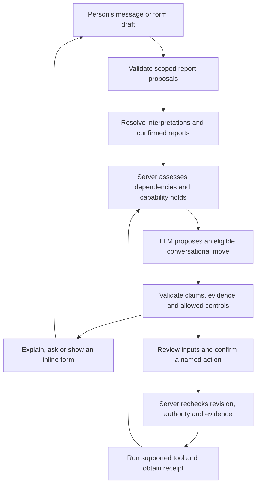

# LLM first hybrid UI plan

**Natural conversation follow-up · October 30:** The owner rejected per-message report summaries and acceptance cards, requested generated contextual responses with accurate automatic consolidation, and directed **planning only, no UI changes**. The [natural advisor flow plan](NATURAL_ADVISOR_FLOW_PLAN_2026-10-30.md) supersedes blanket interpretation/form acceptance in the proposed :8893 flow. It separates clear reports from ambiguity, resolves profile changes before composition, defines permissioned context and retains optional profile inspection plus named-action authorization. Current runtime behavior remains unchanged pending implementation.

**Layout correction · October 30:** The owner clarified that the substantive question-flow/text changes must use the accepted :8891 chat layout. This overrides the separate centered/two-column composition proposed below. :8893 now reuses the wide chat shell, compact progress, conversational type and one Send control while retaining the new opening, narrative, inline forms, review/edit and preparation. :8891 remains untouched. [Restoration evidence](../../audit-evidence/advisor-ui-restore-20261030/README.md).

**Implementation authorization · October 30:** The owner subsequently approved implementing this plan on a new localhost and continuing through verification. The separate [advisor-first variant](../../alternatives/advisor-first/README.md) is the implementation target on :8893; [delivery evidence](../../audit-evidence/advisor-first-20261030/README.md) records actual results and remaining limits. The planning baseline below is retained as the design rationale. Its planning-only language does not override the later scoped implementation authorization or supply source/recommendation acceptance.

October 30, 2026 · D86 · Audience-specific opening · Proposed separate UI · Planning only

Build a separate Daylight experience in which the LLM helps the person make sense of their situation, chooses among supported next steps and explains the result. Recommended opening: **“What has you thinking about Medicare today?”** Keep the four existing goals as optional starting points beneath the open text entry. Use embedded forms for precise, related details. Make the language shorter throughout.

**Latest owner direction:** Open with the person's circumstances, with language appropriate to Daylight's Medicare audience. The owner asked for a critical wording assessment after the earlier literal “Tell Daylight what’s happening in your life.” proposal. The recommended question below preserves the open invitation while giving it a clear Medicare purpose. Exact wording remains a design recommendation to test. T01 remains available for optional goal clarification and traceability. This revision changes the plan only; :8891 retains its existing opening.

Start with the hybrid experience described as condition C in the [October 30 thesis](STRATEGIC_THESIS_2026-10-30.md#three-interface-conditions). A first implementation should demonstrate this complete interaction, including review and recovery, before expanding the conversational scope. Whether it improves on an excellent adaptive form remains a question to test.

The owner requested this evaluation and plan, preserving :8891. Proposed implementation choices below are recommendations, not approved runtime changes. The attached thesis supplies strategic context; it does not authorize its roadmap actions. The dated thesis and current applications remain unchanged.

## Assessment of the current 8891 experience

The existing system has much of the difficult foundation: task-specific dependencies, multiple facts per reply, explicit unknown/defer, corrections, entity identity, source holds and separate saving/AI permission. Retain that investment.

The gap is that the conversation still mostly serves the field collection system. The thesis asks for a service that recognizes the situation, explains what matters and does supported work. Changing the chat styling or adding warmer acknowledgments will not supply that capability.

| Current implementation | Strategic implication | Proposed change |
| --- | --- | --- |
| `assess()` builds a task-specific list and returns the first missing question. | Branching is already conditional, but the next field usually determines the narrative. | Return eligible useful actions and their dependencies; let the LLM propose a suitable conversational move within that set. |
| The language adapter extracts reports and selects reviewed teaching blocks. Its validated `reflection` is discarded, and it has no tools. | It cannot yet synthesize a grounded account of why this person's circumstances matter or investigate through tools. | Add a bounded narrative planner and a server-controlled research interface, with claim/evidence checks before rendering. |
| UI2 sends all typed answers through one composer; structured options remain near the current question. | This reduces input fragmentation, but several precise values must still be expressed as prose. The full mini-form → review → named action pattern is absent. | Add compact forms for genuinely related missing values, while keeping natural replies available. |
| In the inspected opening, the question and choice row lead; the composer sits well below them. | The person encounters a questionnaire presentation before experiencing contextual understanding. | Bring the current explanation, input and action into one readable working area. |
| The inspected Find coverage route asks recipient, then desired start. | These are relevant facts, but the person has little opportunity to describe the transition before the sequence takes over. | After identifying the person if needed, invite the situation once, reuse the supplied facts, then ask only consequential gaps. |
| Teaching is rendered largely as text blocks in the active renderer. | The visual teaching ambition needs an explicit place in the new composition. | Put a compact relevant diagram, timeline or comparison beside the explanation, with optional depth. |

Evidence: [controller](../../alternatives/chat-first/cms-slice/scripts/adaptive_flow.py), [language adapter](../../alternatives/chat-first/cms-slice/scripts/adaptive_agent.py), [renderer](../../alternatives/chat-first/cms-slice/apps/chat-alternative/adaptive-app.js), [journey presentation](../../alternatives/chat-first/cms-slice/scripts/conversation_journey.py), and [D79 delivery history](../../alternatives/chat-first/docs/product/ADAPTIVE_CONVERSATION.md). On October 30, :8891 refused a connection. An isolated :8892 fixture using the canonical source was inspected through the opening, Find coverage, recipient and start question, without paid AI or customer records. This establishes those rendered states, not live-model quality or full-flow certification.

## The proposed narrative

The sequence is **life situation and intent → what matters → useful work → decision or next action**. The person can express circumstances and purpose together; Daylight clarifies the goal only when needed. It should feel like one continuing piece of work. The four established phase labels stay: Your goal, Your situation, Your options, Your next step.

### 1. Invite their reason for looking into Medicare

After the preserved landing and Get started, lead with:

> **What has you thinking about Medicare today?**
>
> For example: turning 65, leaving work, reviewing your coverage, or helping someone else.
>
> A sentence or two is enough.

This audience may know what is happening but not which Medicare question to ask. Name Medicare in the invitation and let the person use ordinary language. The question accommodates a first transition, existing coverage, a helper's concern or simple curiosity. “Today” is conversational context, not a reported enrollment date or evidence of urgency.

The earlier phrase “Tell Daylight what’s happening in your life” is too broad for the task and unnecessarily refers to the assistant by its brand name. “What’s happening with your Medicare?” would assume existing enrollment. “What would you like help with?” stays useful as an optional clarification, but can ask a newcomer to define the very task they need help understanding. The recommended question invites context without requiring Medicare vocabulary, a particular life event or a long personal story.

Use an adult, respectful tone across the audience; turning 65 is one example, not an age-based assumption about knowledge or digital skill. Short, clear wording follows [W3C cognitive accessibility guidance](https://www.w3.org/WAI/WCAG2/supplemental/objectives/o3-clear-content/). That guidance supports the language principles, not a claim that this exact sentence is optimal. Test whether people understand what to share, can start easily and provide useful context with manageable effort.

Place the open text box immediately below the invitation. Under it, show **“Need a starting point?”** with four optional shortcuts: **Understand Medicare · Find coverage · Review my coverage · Something else**. Preserve the existing goal meanings. These shortcuts are secondary to the invitation and remain visible without a collapsed menu. Something else uses the same text box.

One deliberate Send submits the narrative. A person choosing a shortcut can use Continue without writing a story; selection alone does not advance. Show one prominent submission action for the active input mode. Preserve uncertainty/defer, partial replies and no default selection. A typed reply may supply both intent and circumstances; do not then require a goal selection or repeat the situation invitation. Ambiguous intent gets one focused clarification using T01 when useful.

Use the small identity label **Daylight · AI Medicare guide**. Remove the opening paragraph about building a profile. The task should come before an explanation of the intake mechanism.

### 2. Respond to the situation and resolve only what is missing

The first reply should demonstrate understanding of the consequential context and identify a useful next step. For a personal task, clarify **“Who is this for?”** only if the opening has not identified the person. If a person used a goal shortcut and context would help, invite **“What’s happening with your coverage?”** once. Skip that invitation when the goal or existing facts already support useful work. Never require a second life story after the opening.

For learning, answer the question immediately. If the person only selected Understand Medicare, begin with what Medicare is and one small visual. Do not require a beneficiary, ZIP or situation story. For direct browsing, collect only missing reference scope. For experienced people, accept a specific request immediately without returning them to broad intake.

### 3. Show understanding, then request the useful gap

Reflect the consequential facts briefly and explain the next step. Distinguish reported circumstances from verified findings. A hypothetical transition exchange:

> **You’re leaving work in March 2027 and want coverage in April. Your work insurance end date is still open.**
>
> **When does that insurance end?**
>
> The job and insurance can end on different dates.

Show a month/year control with I don’t know and Check later. If both job end and insurance end are missing, group them; if one is already supplied, ask only the other. Never derive either from retirement or invent a day.

The first useful response should contain an answer, a meaningful organizing insight, or a concrete research step. Avoid generic praise, a repeated welcome, or “I need a few more details” followed by unrelated questions.

### 4. Embed a form when precision makes it easier

Use natural conversation for context, uncertainty and explanation. Use structured controls for dates, bounded choices, repeated items and other precise values. Often two to four related missing fields will suffice; one is appropriate, and three to five is not a quota.

Examples: the two transition dates; a medicine's missing strength and form; fill quantity with units, days supply and pharmacy/channel when a requested price check actually needs them. Keep first doctor/prescription entry natural; never require a product-catalog selection without a trusted connected source.

Only one form is active. Its heading names the person's task. Known reports appear as editable context, not unanswered fields. Do not preselect new answers or AI guesses. Partial submission is allowed with explicit per-field unknown/defer. Each medicine/provider keeps its own identity.

During form entry, **Continue** stages inputs. **Ask a question** offers the same conversation while preserving the form. A person who types the values instead should reach the same underlying report state. Switching input modes must not silently concatenate drafts and selected values into a new interpretation.

### 5. Review, then authorize the named work

After form submission, show a compact summary of the captured inputs with **Edit**. Label any interpretation separately. Immediately before a workflow executes, provide its meaningful action: **Prepare my next steps**, or **Run this comparison** only when that exact comparison is released and supported.

Form submission stages data; confirmation authorizes the named operation. An ambiguous interpretation gets an earlier targeted check. A clear direct choice needs no redundant yes/no turn. Do not ask people to reconfirm unchanged facts after every message.

Bind action authorization to the subject, input revision, evidence/capability version and action arguments. An edit invalidates the affected summary/action until refreshed. Saving, AI transfer, sharing and enrollment remain separate permissions.

### 6. Return something useful

The primary output is a manageable account of **what matters, what the supported work found, what remains open and the next useful action**. Show evidence near material claims. Offer the underlying sources and other options without making everyone read them first.

In today's supported scope, the useful output may be education, an editable preparation checklist or questions for a benefits office. The UI can organize reported facts while an external finding remains held. Do not portray intake completion or a simulated research receipt as completed investigation.

When policy comparison becomes supported, explain coverage paths before individual policies. Use consistent costs/access/restrictions/flexibility dimensions and the current-coverage baseline. Keeping coverage, learning more and deferring remain legitimate outcomes.

## Composition and shorter language

Keep the existing sun/name, sole tagline, approved landing/photo, warm palette and type. This is a new interior interaction within the Daylight identity. It combines Operate mode for completing tasks and Read mode for understanding tradeoffs.

Desktop: a readable central conversation/work area, with a quiet adjacent reference area only when a visual or current facts help. Keep the current form immediately below the explanation and its action immediately below its fields. The composer follows the current work; it should not float far away across an empty page. Avoid a permanent dashboard of profile, transcript, lesson and form competing at once.

Tablet and phone: one column, relevant compact visual near the question, then fields/action and composer. Use bounded reference disclosures, not a full second panel. Preserve an explicit Show/Hide teaching preference, Back, edit, privacy and exact return/draft recovery. Keep older exchanges available while making the current work unmistakable. Introduce no decorative animation.

Proposed copy rules are design targets to test:

| Element | Target |
| --- | --- |
| Routine assistant turn | One short answer/reflection and one next ask, usually 30–60 words total. Longer only for a meaningful tradeoff or necessary qualification. |
| Question | One literal sentence, generally under 12 words where meaning permits. |
| Why asked | One specific sentence; omit generic purpose statements. |
| Input guidance | Put examples at the input. Do not repeat “type below” after every question. |
| Limitations | State the precise hold at the affected finding/action. Keep a visible scope label; avoid repeating the entire sample disclaimer in every exchange. |
| Additional teaching | Optional Explain more, sources, or a compact visual. Essential conditions stay visible. |

Example changes: “We’ll build your profile from the answers you share” is removed; “We’ll keep the coverage details focused on that person” is unnecessary under “Who is this for?”; “This missing detail can help prepare the specific check you requested” becomes a specific reason or is removed. Shorten presentation without weakening the meaning of a question, condition or uncertainty.

## How the existing branching fits

Keep the **41 reviewed IDs, 78 original field records, 14 additive report paths and 14 named gaps** as traceability. Preserve all seven field-map dimensions and the original inventories. The proposed narrative is a presentation and orchestration layer over capability-specific dependencies; it does not replace them with a new universal questionnaire.

| Existing IDs | Treatment in the new conversation |
| --- | --- |
| T01 | Optional goal shortcuts or focused clarification after the open invitation; reuse explicit text intent. No required goal-selection screen. |
| T02 | Optional explanation preference, editable at any point. No new knowledge gate. |
| RC01 | Identify the beneficiary only when unclear and needed. Helper facts remain separate. |
| T03, RC02, RC03, T04 | Shared location/period context only when consequential. Reference location, permanent home, review year and desired start retain distinct meanings. |
| T05, RC04, RC07, RC09, RC26 | Reuse one current-coverage account across parts, delivery, job relationship and named military/program context; clarify only the missing distinction. |
| RC05, RC06, RC10, RC11, RC11.C1, RC12, RC13 | Open only for an actual supported timing/coordination consequence. Group related missing dates. Keep applicable employer definitions, drug-creditability and family-benefit effects scoped. |
| RC16, RC16.C1, RC16.C2, RC17 | Medigap/Advantage episode and replacement context when necessary. Reuse parent/child fields without repeating the history. |
| T06, RC21 | Natural provider entry; clarify only unresolved exact office/identity. No participation claim from a name. |
| T07, RC22, RC23 | Natural prescription entry; item-specific identity form if needed, then fill details only for a supported requested price/fill check. |
| T08, RC20 | Reuse travel/care context; ask actual routine-care location when consequential. Seasonal travel does not establish a new permanent home. |
| T09, T10, RC25 | Optional priorities and cost discussion in context; no universal budget interview or fabricated numeric weights. |
| RC18 | Named program information only when a supported adjusted-cost/qualification check requires it. No universal assistance screen. |
| RC08, RC14, RC15, RC19, RC24, RC27, RC28 | Internal event, contribution, rights, qualification, medicine-setting, continuity or correction checks. Surface only the specific necessary missing fact under the reviewed treatment. |

Every proposed ask must carry the requested outcome, trigger, missing dependencies, reason it can help now, reuse provenance, unknown/conflict treatment and source/release hold. A model cannot make an internal-only item into routine intake or upgrade a proposed/source-held branch into accepted policy.

Change `assess()`'s interface conceptually from only `nextQuestion` to a **capability assessment plus eligible moves**: answer a supported question, introduce a relevant concept, clarify a conflict, request a missing group, prepare a supported artifact, or return a useful scoped stop. Preserve deterministic priority and a stable fallback. The LLM may choose presentation/order among eligible moves; mandatory dependencies and acceptance gates remain server-owned.

The model can notice a possible issue the person did not know to ask about. It should explain and propose a relevant check from the supported set. A recognized circumstance is not consent to expand research, collect unrelated sensitive facts or execute a new action. This requires a deliberate extension to today's explicit-request-only check contract, rather than silently relaxing it.

## What LLM reasoning requires

The important technical change is a grounded planning loop, not a larger prompt around the current missing-field queue.

Separate three responsibilities:

1. **Conversation planner:** understands the stated goal, proposes report patches, identifies a useful eligible next move and selects explanation depth/control type. Its structured output includes a goal reference, permitted move ID, report/claim references and a short user-facing rationale.
2. **Deterministic capability service:** owns field meaning, applicability, dependencies, entity/person/time scope, unknown/stale/conflict handling, tool permissions and recommendation/source admission. It supplies valid options and rejects unsupported moves.
3. **Evidence and operation layer:** supplies reviewed teaching, accepted exact-source facts and actual tool receipts. Distinguish user reports, derived references, verified findings and unavailable operations. Fixtures are labeled simulations.

Introduce bounded synthesis gradually. First allow brief grounded links between reported circumstances, dependency reasons and reviewed concepts. Later allow supported research synthesis only through capability-scoped tools and accepted evidence. Every material insurance claim must bind to an allowed claim/evidence record and its period/scope; invalid output gets a useful local clarification or reviewed explanation without an automatic model retry. Expose concise reasons and sources, not private model deliberation.

The current model context intentionally excludes previous sensitive values and the raw transcript. Preserve that boundary. Construct a minimal service-owned brief from permitted context, known/missing markers and reviewed evidence. If a task needs an earlier sensitive value sent to AI, obtain the applicable scoped permission or perform that part in the deterministic service. Do not silently attach all prior dates, providers, medicines or chat to make the narrative seem more capable. Saving and AI context remain separate.

Connect to the D85 answer service only through its actual capability/release interface. Preserve research-only and held states; having fifteen imported layers does not make every query consumer-ready. No paid model call is required for a direct structured answer, edit, unknown/defer or save. Keep the shared $1/UTC-day cap, existing model/pricing guards and no automatic retries; measure additional narrative cost/latency before expansion.

## Isolation and delivery sequence

Recommended future source: `alternatives/advisor-first/`. Recommended local port: **8893**, subject to an availability check when built. Neither is created by this plan. Reserve :8892 for temporary fixtures; leave :8890 and :8891 at their existing sources/runtimes.

Use an independent guest-cookie namespace and data directory for the new variant. Do not import customer records or copy a live database. Reuse version-pinned contracts and shared read-only evidence through explicit interfaces; avoid modifying :8891 files as part of shared-code extraction. Any future paid calls must use the same aggregate budget ledger. Start in fixture mode with synthetic records.

| Increment | Deliverable | Exit evidence |
| --- | --- | --- |
| 1. Contract and copy | State/transition contract for the open life invitation, optional goal shortcuts, intent/context reuse, eligible moves, form staging, review/action authorization and recovery; concise copy/content inventory. | Exact mapping of every reviewed ID/field and named gap, plus explicit scope of proposed semantic extensions. |
| 2. Separate interactive prototype | Full synthetic first-transition journey, learning-only route and direct browse/review entry; responsive conversation, forms and visuals. | Desktop/tablet/phone and keyboard walkthroughs; no production tools or customer-store writes. |
| 3. Real controller integration | Versioned report adapter, capability assessment, pending form/review revisions, entity-safe edits and compatible unknown/stale handling. | Same synthetic inputs produce the same reports/holds across narrative, forms and mixed input; old variants/source remain unchanged. |
| 4. Grounded LLM and supported work | Bounded narrative planner, permitted context brief, claim validation and tool receipts. Begin with education/preparation; keep unavailable comparisons held. | Controlled model-output tests, permission/canary checks, budget/latency measurement and bounded authorized real-model verification. |
| 5. Comparative evaluation | Matched scenarios against :8891; then the thesis's A/B/C comparison with equivalent tools/evidence and review standards. | Observed comprehension, omission/correction errors, effort and useful task outcomes; report failures and participant differences. |

Do not build all three research conditions before proving this new hybrid journey is coherent. The existing :8891 is a valuable incumbent comparison, but neither :8891 nor the fixed ten-question :8890 automatically constitutes condition A's excellent adaptive form. Hold evidence depth fixed in the interaction study and test richer evidence separately.

## Acceptance and unresolved work

Before calling the new UI implemented, demonstrate the following with meaningful branch tests and rendered walkthroughs:

- The Medicare-specific open invitation leads. Text, optional goal shortcuts and mixed entry work without preselection or a required story. First-time, already-enrolled, helper and just-learning visitors can each understand what to share without knowing insurance terminology. A clear narrative does not trigger another goal-selection screen or situation invitation. A multi-fact reply avoids re-asking known facts and receives a useful response before extensive intake.
- Learning and direct browsing avoid personal intake. Experienced, helper, review/current-coverage and job-transition paths preserve their differences. Visual concepts grow with relevance and remain inspectable.
- Job end, insurance end, desired start, actual Part B start and Advantage episode start remain distinct. Corrections invalidate only affected dependencies/results.
- Unknown, none, deferred, partial and conflicting values remain distinct. Unchanged unknowns do not loop; all-unknown sessions cannot authorize recommendations.
- Two same-name medicines with different strengths remain separate, helper facts cannot overwrite beneficiary facts, and an ambiguous correction targets no arbitrary entity.
- Form drafts survive side questions, Back, input-mode changes and failures. Review/edit works without restart. Changed inputs cannot use an old action confirmation; duplicate submissions cannot execute twice.
- Source-held checks stop unnecessary collection and return the specific unresolved finding with useful preparation. Sample browsing is explicit, scoped and separate from personal comparison. Preserve the current deferred 2026/2027 sample-year issue visibly rather than substituting years.
- Model or validation failure preserves work and offers a specific recovery. No-AI use retains supported structured input and reviewed education without pretending a live reasoning reply occurred.
- Profile/AI permission, sensitive omissions, storage isolation, shared budget and economic independence survive every route. No raw transcript persistence is introduced.

The October 28 [edge assessment](../../audit-evidence/edge-profiles-20261028/README.md) records medicine-identity loss, an omitted unknown and blocked legitimate replies. The inspected source now contains relevant identity/unknown safeguards, but this planning review did not establish whether every case is resolved or deployed. Re-run the exact counterexamples before basing the new variant on that code. RC08/RC16 source-rule precision, RC19/21/24 source-dependent branches, broader language coverage and human/assistive-technology testing remain explicit work; a narrative redesign does not close them.

Success is observable understanding and less work: time to the first useful answer, consequential omissions, capture errors before/after review, successful correction without restart, reading/typing burden, active and elapsed time, completion/abandonment and staff intervention. Assess whether the open invitation elicits useful context and reduces follow-ups; accept a short reply or shortcut as readily as a paragraph. Include retained-coverage and deferred outcomes. Set study thresholds before testing; do not infer success from preference, confidence, fewer screens or longer answers alone.

## Requirement and strategy review

| D73 review item | Plan response and current status |
| --- | --- |
| Consumer task | Situation-led understanding and supported work for independent transition researchers; existing audiences retained. Proposed, untested. D49/D73/D86. |
| Consequential intake | Reuse the 41-ID contract; eligible moves require an answer-dependent purpose; no universal profile completion. D41/D52/D79. |
| Coverage paths and tradeoffs | Teach relevant concepts, then fairly compare Original with optional Medigap/Part D and Advantage before policies; retain keep baseline. D01/D26/D29/D47/D55. |
| Two gates and honest scope | Report sufficiency, source/rule acceptance and actual operation receipts remain distinct. No recommendation or data release. D22/D23/D56/D64. |
| Independence and challenge | Commercial economics excluded from planner/retrieval/ordering; inspectable reasons, evidence and correction. Existing I01–I10 obligations remain. D64/D73. |
| Permission and control | Separate AI/save/share permissions, bounded context, revision-bound action authorization, new isolated guest scope. D53/D54/D75. |
| Actual capability | First live scope is supported education/preparation; later tools require their own accepted capability and receipts. D48/D56/D85. |
| Proof and stage | Planning completed; prototype, model verification, responsive/accessibility checks and consumer comparison remain future work. D24/D36/D57/D73. |

The direction worth pursuing is an LLM that organizes the work around the person's circumstances, with precise forms available at the moment they help. Its advantage must appear in understanding, useful work and recovery from mistakes. This plan preserves the existing decision logic while changing what leads the experience.
