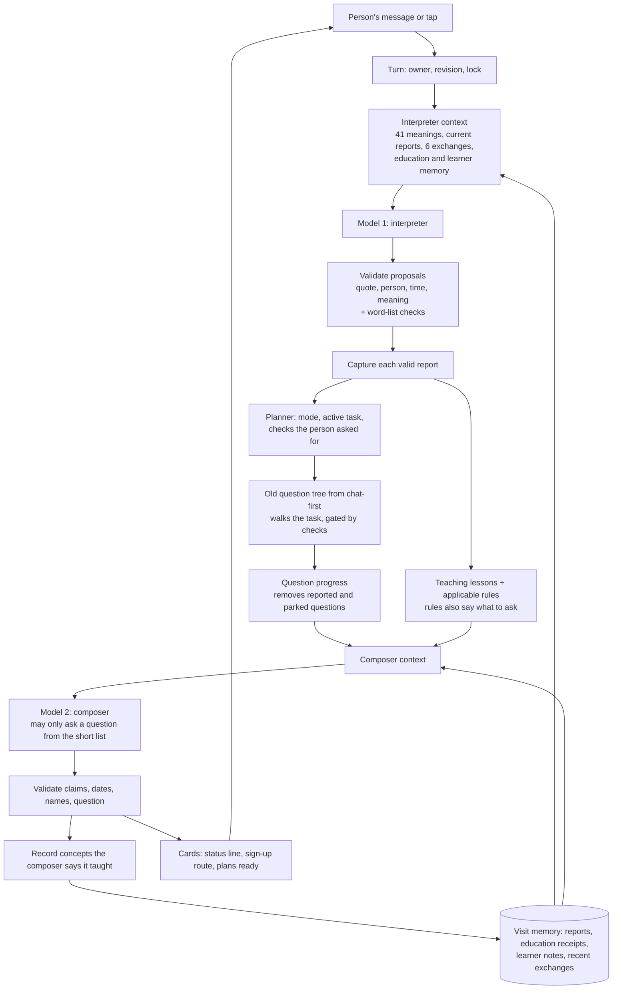
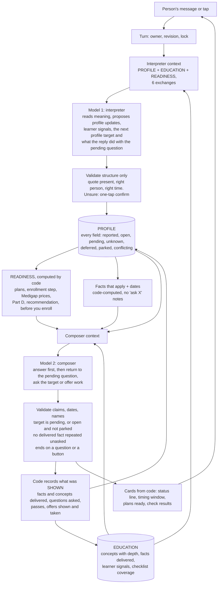

# Profile and education records (D183)

Repo copy of the approved spec (Brain: `Inbox/Profile and education records 2026-11-17.md`), plus the
implementation status on :8895 at the end. Product authority: DAYLIGHT_REQUIREMENTS D183.

# Profile and education records: what exists, and how they should drive the conversation

Approved by Chris on November 17, 2026 (all five calls; see the Brain's Decisions). Written by Claude after reading the :8895 code (repo `~/daylight`, `alternatives/advisor-first`), the profile contract and the turn log. It is the core section of the Brain's 02 UX playbook. This repo copy is the implementation spec for D183; keep the two in step.

Updated November 18, 2026: Chris approved four additions after a conversation asked for the same dates twice (section "Pending questions, passes, single-field targets and offers"; the proposed diagram and the five steps include them). Recorded in this repo as D188. Implementation status is at the end.

## The idea, in Chris's words

Daylight keeps two records that fill as the conversation goes:

- **The profile**: what Daylight has learned from the person.
- **The education record**: what Daylight has explained to the person.

Every follow-up reads both, so Daylight never asks again for something it already knows and never explains again something it already explained, and it pitches each explanation at the level the person has shown. The profile must hold everything a recommendation, an enrollment step and the pre-enrollment checklist need. Not every field needs an answer; the conversation fills as much as the person's goal needs. Fixes must work for everyone, never for one case (Chris, November 17, 2026).

## Architecture we're working from

I could not search earlier chats. The only conversation-plumbing diagram I found is the D180 flow in the repo's `docs/product/CONVERSATION_PLUMBING.md` (November 15). Nothing turned up in the Brain, Drive or published artifacts. If other diagrams exist in Codex or claude.ai chats, they need to be dug up and compared with this one.

### As built (condensed from the D180 diagram; same nodes, same names)

### Proposed (same pipeline; the two records move to the center)

What changes, node by node:

| Node | Today | Proposed |
|---|---|---|
| Validate proposals (V1) | Structural checks plus word lists (`situation.supported_choice`, `situation.observations`, word capture in `enrollment_flow`) that reject correct readings | Structural checks only; when unsure, the existing one-tap "Yes, that's right" (D112) |
| Next question | Planner mode + model-requested checks + the old chat-first question tree produce a short list; in "discuss" or "suggest" mode the list is empty | Every open, unparked profile field is available. The interpreter proposes the next target from the person's goal and the readiness views; code checks it's open and not parked |
| Readiness | Exists in pieces (plan readiness's 11 areas, Medigap and Part D views, recommendation inputs, status line, Before you enroll); used to gate cards | Same code, shown to both models together as the goal of the conversation |
| Applicable rules | Pick facts that apply and also tell the model what to ask and say | Pick facts that apply and compute dates. No flow instructions |
| Education ledger | 17 overview concepts; delivery is whatever the composer reports | Concepts plus every accepted fact; code records delivery from what was actually shown |
| End of turn | No question when the list is empty ("never manufacture a question") | A question about an open field, or an offer of work as a button, unless the person paused |

## The profile record: everything in it today

Sources: `infrastructure/daylight-data/config/profile-contract.2026.json` (41 question meanings, 78 fields), plus fields added since: Medigap pricing (`medigap_profile.FIELDS`), life situation (`situation.FIELDS`), enrollment (`enrollment_flow`). Every field carries provenance, who it's about (person or helper), when it applies (current, planned, past) and a state (reported, unknown, deferred, conflicting).

"Used by" means code that reads the answer today. "Nothing found" means I found no screen, calculation or rule that reads it beyond question bookkeeping and older hold logic.

**Proposed level**: **Core** = try to fill in every conversation that goes past general learning. **When relevant** = fill when the person's situation makes it matter; the model judges this from the field's purpose. **Optional** = take it if offered, never ask. **System** = never a question.

### 1. Who and why

| What we learn | Code | Used by | Proposed level |
|---|---|---|---|
| Who the coverage is for (self or someone they help) | `subject.role` (RC01) | Every personal fact; plan readiness | Core |
| What they want help with | `intent.goal`, `goalDetail` (T01) | Plan readiness; task | Core, usually read from their words |
| How familiar they are with Medicare | `knowledge.general` (T02) | Tone only | **Move to the education record** as a learner signal; never ask |

### 2. Where and which year

| What we learn | Code | Used by | Proposed level |
|---|---|---|---|
| Home ZIP | `comparison.scope.zip` (T03), `RC02.zip` | Every plan view; recommendation | Core |
| County | `comparison.scope.county`, `RC02.county` | Plan views when a ZIP spans counties | When relevant |
| Permanent home | `RC02.homeStatus` | Nothing found | When relevant: seasonal residents are common in Collier |
| Coverage year | `RC03` (choice, year) | Plan readiness; closing | Defaults to 2026; ask only if they raise 2027 |
| Where the location came from | `comparison.scope.locationEvidence` | Provenance | System |

### 3. Age and eligibility

| What we learn | Code | Used by | Proposed level |
|---|---|---|---|
| Birth month and year | `coverage.birth` (+ `firstDay`) | Medigap age only | **Core: make this the single anchor** |
| 65th birthday month | `situation.age65` (S_AGE65) | Timing card; rules; status line | Derive from birth month; stop asking separately |
| Age for Medigap prices | `medigap.ageOn20261110` (MG_AGE) | Medigap prices; recommendation | Derive |
| How they qualify (age, disability, ESRD, ALS) | `RC06` choice + `ageBand` | Rules; journey; Medigap | When relevant. For 65 and older, show "by age" as the default with a one-tap change (lesson 26) |
| First eligible | `enrollment.firstEligible` | Medigap trial right; recommendation | Derive |
| Getting Social Security benefits | `coverage.socialBenefits` | Status line (automatic enrollment) | When relevant: near 65 |

Today age lives in three places that don't talk to each other. That's why "I'm 68" filled Medigap age but no rule saw an age, and why the HSA rule never fired.

### 4. Medicare already in place

| What we learn | Code | Used by | Proposed level |
|---|---|---|---|
| Parts A and B now (and status: applied, approved, start date) | `RC04`, `enrollment.partA`, `enrollment.partB` | Status line; timing; rules; plan readiness | **Core** |
| Part B start month | `RC05.month` | Medigap window rule | When relevant: Part B in place and Medigap in play |
| Original Medicare or Medicare Advantage now | `RC07` | Rules | When relevant: already on Medicare |
| What they already have (e.g. Plan G) | `coverage.reported` | Plans steps ("You have Plan G") | Core for anyone already on Medicare. **Extend** to Medicare Advantage and Part D plan names |
| First Medicare Advantage plan history | `RC16` (start, prior Medigap) | Trial-right card; rules | When relevant: in Medicare Advantage |
| Replacing a Medigap policy | `RC17` | Nothing found | When relevant |
| Event behind a Medigap purchase | `RC15` | Nothing found | When relevant |

### 5. Other coverage now, and changes

| What we learn | Code | Used by | Proposed level |
|---|---|---|---|
| Current coverage types (job, retiree, COBRA, Medicaid, military, none…) | `coverage.current` (T05) | Almost everything; recommendation | **Core** |
| Whose job (mine, spouse's, family's, retiree, COBRA) | `RC09` | Rules; journey | When coverage is from a job |
| Employer has 20 or more employees | `RC10` | Rules (who pays first, delaying Part B) | When job coverage and 65 or older |
| Job end and coverage end | `RC11` (jobEnd, coverageEnd) | Rules (window note); phone guide | When job coverage is ending. Ask only if code uses it for dates (C46) |
| Drug coverage counts as creditable; any gap | `RC12` (choice, gap) | Rules (Part D window, penalty) | When job, retiree, COBRA or military coverage |
| Whether a change affects anyone else | `RC13` | Nothing found | Reword or drop (its shown question and stored meaning disagree) |
| HSA contributions | `RC14` | Rules | When job coverage |
| Military or VA coverage | `RC26` | Rules | When military coverage |
| A coverage change and its date | `RC08` (+ eventDate) | Rules | When relevant |
| Retiring, retired, still working | `situation.retirement`, `situation.working` | Rules | Read from their words |
| An interruption needing help now | `RC27` | Nothing found | System; only if they report one |

### 6. Costs and help

| What we learn | Code | Used by | Proposed level |
|---|---|---|---|
| Help with costs now (Medicaid, Extra Help, Medicare Savings Program) | `RC18` | Recommendation (Medicaid); rules; plan views | When costs are a worry or Medicaid comes up |
| Monthly payments vs. costs when using care | `needs.costPreference` (T09) | Recommendation; plan readiness | Core |
| Monthly budget | `RC25` (amount, includes) | Rules; plan filters | Optional |

### 7. Care needs

| What we learn | Code | Used by | Proposed level |
|---|---|---|---|
| Doctors and hospitals to keep (status + names) | `needs.providersStatus`, `needs.providers` (T06) | Plan readiness; recommendation; doctor checks | **Core** |
| Each doctor's practice and town | `RC21` items | Doctor checks | When a named doctor is ambiguous |
| Medicines (status + names) | `needs.medicinesStatus`, `needs.medications` (T07) | Plan readiness; recommendation; drug checks | **Core** |
| Each medicine's strength, form, brand | `RC22` items, `needs.medicationDetails` | Drug checks | When a drug check needs it |
| Fill amount, days' supply, pharmacy, mail order | `RC23` items, `needs.pharmacies` | Drug costs | When pricing drugs |
| Given at a clinic or filled at a pharmacy | `RC24` | Nothing found | When relevant (injectables) |
| Routine care away from home | `needs.travel` (T08), `RC20.location` | Recommendation; plan readiness | Core (yes or no) |
| Medigap price details: sex, tobacco | `medigap.pricingSex`, `medigap.tobaccoCategory` | Medigap prices; recommendation | When Medigap is in play |
| Special Needs Plan qualification | `RC19` | Nothing found | When they explore one |

### 8. Preferences and decisions

| What we learn | Code | Used by | Proposed level |
|---|---|---|---|
| What matters most | `needs.priorities`, `priorityOther` (T10) | Recommendation; plan readiness; closing | **Core** |
| When they want Medicare to start | `coverage.requestedStart(+Month)` (T04) | Timing | When relevant; never once Parts A and B are in place |
| Coverage path: chosen, leaning or undecided | `intent.coveragePath` | Plans; closing | Core, recorded from their choices |
| Parts of the path decided | `intent.components` | Plans dashboard steps | Recorded from choices |
| Where they want to start looking | `intent.pathStart` | Closing | Recorded |
| How they'll contact Social Security | `enrollment.contact` | Sign-up guides | Recorded |
| **The plan they chose** | none | Needed for Before you enroll and the application | **Add** (issue 30) |
| Conflicting reports | `RC28` | Correction step | System |

### Additions I recommend

1. **One birth month and year field** as the anchor; 65th birthday, Medigap age, age band and first eligibility derived from it. Chris's call, given "no personal details before checkout": month and year only, asked when timing or Medigap prices need it.
2. **The plan they chose.**
3. **What they already have, by name**, for Medicare Advantage and Part D as well as Medigap.
4. **Move familiarity (T02)** out of the profile into the education record.

### Readiness: the profile's goals, already in code

The profile is filled toward these outcomes. Each already exists as code; today they only gate cards. The proposal shows them to both models as the conversation's goal.

| Outcome | Fields it needs | Where it lives |
|---|---|---|
| Plan comparison | Goal, person, ZIP and county, year, current coverage, Parts A and B, doctors, medicines, travel, cost preference, priorities (11 areas) | `plan_review.readiness` |
| Deterministic recommendation | ZIP/county/year, Medigap age, sex, tobacco, first eligibility, doctors, medicines, travel, cost preference, priorities, current coverage, Medicaid | `recommendation_engine.inputs` |
| Next enrollment step (status line, sign-up route) | Parts A and B, current coverage, birth month, how they qualify; for job coverage: whose job, employer size, end dates | `enrollment_journey.status` (job coverage is "unsupported" today: C46) |
| Medigap prices | ZIP, age, sex, tobacco | `medigap_profile` |
| Part D plans | ZIP/county, year, medicines (and pharmacy for costs) | `part_d_profile` |
| Before you enroll | The chosen plan, plus the 12 checklist topics (see the education record) | `cms_checklist` |

## The education record: what exists

### Today

- **17 concepts** (`education.py`, `education-v1`), each with 2 to 4 aspects, a depth (introduced, explored, needs clarification) and a reason (new, deepen, asked again, clarify). A receipt means delivered, never understood. The concepts: what Medicare is; Part A; Part B; the two coverage paths; Original Medicare; Medicare Advantage; where prescription coverage fits; where Medigap fits; checking doctors and hospitals; checking medicines and pharmacies; monthly costs and costs when using care; medical spending limits; dental, vision and hearing; sign-up timing and coverage start; why current insurance matters to timing; Medigap switching rights; what still needs checking.
- **Learner signals** (`learner_state.py`): unfamiliar, says familiar, uncertain, misconception, applied, skip. Tentative, per concept.
- **Delivery** is recorded when the composer reports it taught a concept and cites a matching lesson.
- **A separate "already said" list** (`ux_pass`): nine teaching points found by word patterns. On :8895 it's passed to the model as advice; nothing enforces it.

### What the education record misses

Teaching text comes from four places, and the record only follows the first:

| Source | Size | Tracked by the education record? |
|---|---|---|
| Lesson library (basics, parts, two paths, Medigap, dates…) | About 20 lessons behind the 17 concepts | Yes |
| Accepted rule statements (`pilot-rules` r1, r3, r4) | 18 (r2's 15 still unsigned) | No |
| Reviewed Medicare facts (`pilot-knowledge` r2) | 74 in 11 topics; 71 approved, 3 Florida facts held | No |
| CMS pre-enrollment checklist | 12 topics | Separately, in Before you enroll |

So the 20-employee rule, the 8-month window and "Social Security confirms your start date" can repeat. They're facts, not concepts, and the record never sees them.

## Proposed education record: concepts and facts together

Chris's direction: explain the core concepts, and dive into detail when needed, against a real source of truth. That's a two-level record:

- **Concepts** are the teaching map: what someone needs to understand. Each has one **core fact** (the plain explanation) and **detail facts** (the precise rules, with sources).
- **Facts** are one library: the lessons, the accepted rules and the reviewed Medicare facts, each with its source, year and conditions. Every fact belongs to one concept.
- **Depth comes from facts.** A concept is *introduced* once its core fact was shown, *explored* once a detail fact was shown, and *needs clarification* when a learner signal says so.
- **Code records delivery** from the facts each shown reply block cites (`evidence_refs`), not from the model's own report.
- **Repeat rule:** a delivered fact isn't restated unless the person asks, is confused, or their situation changed; a later reply refers back in a clause. Offers to explain a delivered concept are filtered out too.
- **Checklist view:** each of the 12 CMS topics maps to facts, so Before you enroll knows what the conversation already covered and shows the rest.

### Draft concept map (for Chris to edit)

The 17 concepts stay; four are added (marked **new**) so every accepted fact has a home. Fact IDs are from the catalogs above.

| Concept | Core fact | Detail facts |
|---|---|---|
| What Medicare is | pk_parts | pk_disability_eligibility, pk_esrd_eligibility, pk_ssa_disability_definition |
| Part A | pk_part_a_benefits | pk_part_a_premium, pk_snf, pk_custodial |
| Part B | pk_part_b_benefits_premium | |
| The two coverage paths | pk_routes | pk_costs, pk_travel, original_nationwide |
| Original Medicare | lesson `original` | pk_access |
| Medicare Advantage | pk_part_c_premium | pk_ma_approval, pk_snp, ma_trial_right |
| Where prescription coverage fits | pk_part_d_optional | pk_part_d_cap, pk_creditable, pk_formulary_tiers |
| Where Medigap fits | pk_medigap | pk_medigap_standard, pk_medigap_premium, pk_medigap_drug_exclusion, pk_fl_rating |
| Medigap switching rights | pk_medigap_window | pk_medigap_window_scope, pk_medigap_underwriting, medigap_window (+ held Florida facts) |
| Checking doctors and hospitals | lesson `checks` | pk_access, pk_ma_approval |
| Checking medicines and pharmacies | pk_formulary | pk_pharmacies, pk_drug_rules, pk_transition, pk_formulary_exception, pk_tiering_exception, glp1_prior_authorization |
| Monthly costs and costs when using care | lesson `costs` | pk_costs |
| Medical spending limits | lesson `medical_limit` | |
| Dental, vision and hearing | lesson `extras` | |
| Sign-up timing and coverage start | pk_iep | pk_start, pk_first_day_birthday, pk_gep, pk_enrollment_windows, pk_join, pk_initial_plan_window, pk_new_part_b_plan_window, initial_enrollment_window |
| Working past 65 and other coverage | pk_work_sep | pk_work_sep_start, pk_payer_order, pk_hsa, pk_cobra, pk_other_coverage, pk_plan_coverage_loss_window, pk_payer_retiree_cobra, pk_payer_disability, pk_payer_esrd, pk_payer_injury, working_coverage_sep, hsa_medicare, cobra_initial_window, cobra_pays_second, cms_current_coverage |
| Late sign-up penalties (**new**) | pk_penalties | pk_penalty_a, pk_penalty_b, pk_penalty_d, partd_penalty |
| Help paying costs (**new**) | pk_extra_help | pk_extra_help_auto, pk_msp, pk_qmb, pk_medicaid_governance, pk_fl_help, pk_shine, extra_help |
| Reviewing coverage each year (**new**) | pk_aep | pk_annual_changes, pk_ma_oep, pk_ma_oep_effective, pk_move, annual_enrollment, cms_plan_year_eoc |
| Your rights (**new**) | pk_appeals | pk_complaints, cms_complaints, cms_right_to_cancel |
| What still needs checking | lesson `checks` | lesson `next` |

Checklist topics map onto these concepts: plan type and network → checking doctors; drug list → checking medicines; other benefits → dental, vision and hearing; premiums and cost sharing → costs; out-of-network rules → Medicare Advantage; coverage outside the U.S. → two paths (`cms_outside_us`); effect on current coverage → working past 65; yearly changes and the Evidence of Coverage → reviewing coverage each year; complaints and right to cancel → your rights; Special Needs Plans → Medicare Advantage.

## How the two records drive the conversation

Each turn does the same five things.

1. **Read.** The interpreter reads the message against both records. It proposes every profile field the message answers, even when the answer is hidden in a reply to another question. It also proposes learner signals, what the person wants right now, and **the next profile target**: the open field that best moves toward the person's goal, chosen by meaning, not by a list in code. When a question is pending, it also says what the reply did with it: answered, detour, passed or does not know.
2. **Check and compute (code).** Structural validation; unsure readings become a one-tap confirmation. Code updates the profile, recomputes readiness, picks the facts that apply, and computes any dates, prices and checks. A pending question stays the target until it is answered, passed or parked, unless the person raised a new subject. Otherwise code confirms the proposed target is open and not parked; if not, it falls back to the open field the readiness view needs next. A target with two open fields of the same kind is narrowed to one field.
3. **Speak.** The composer answers the person first. It teaches only what's needed now: the core fact of an untaught concept, a detail fact when the person goes deeper, never a delivered fact unasked. Then it leads with the target as a question, or offers work as a button when the person is exploring. After a detour it answers and returns to the pending question in the same reply, and no offer is made while a question is pending.
4. **Check the reply (code).** Claims grounded; dates and amounts only from code; target pending, or open and not parked; no repeat of a delivered fact without a reason; ends on a question or a button unless the person paused.
5. **Record (code).** Profile updates committed; facts and concepts recorded from what was shown; the delivered question marked pending; passes counted (a question passed twice is parked); offers recorded as shown and as taken.

What stays code, per "code decides, the AI explains": eligibility, dates, windows, prices, checks, the recommendation, readiness and the records themselves. What moves to the models: what to ask next and how to teach it. What goes away: word-list vetoes, model-requested "checks" gating questions, planner modes that empty the question list, and rules that tell the model what to ask.

**Where the next-question choice lives.** I recommend the interpreter. It already reads everything, it keeps the turn at two model calls, and code gets the target before the composer writes, so the right card can be attached. A separate planning call would add 7 to 15 seconds against the near-instant goal. If the interpreter's choices turn out poor, test a separate call as an experiment on its own branch, like today's interpreter-notes experiment.

## Pending questions, passes, single-field targets and offers (approved November 18, 2026)

Chris approved these four additions after visit `12b0f11de2` on :8895, where Daylight asked for the job and insurance end dates twice, did not save the date when it came, and showed the same offer button twice. The cause was that neither record held a question that had been asked and was still waiting for an answer. All four changes live in the records and the code around them. None adds a model call, a word list or a rule for one case.

What the turn log showed:

| Turn | What happened | Gap |
|---|---|---|
| 2 | The end-dates question (RC11) was asked on top of an answer the claim check had cut | See "Not included" below |
| 3 | The person asked what drug coverage is. RC11 fell out of the candidate pool and the turn ended on an offer button | Nothing remembered the question was waiting |
| 4 | The person took the offer and RC11 was asked again as if new | The only check was "open and not parked", and parking counted times shown |
| 5 | "Nov 30 2026" was set aside as tentative, no timing card appeared, and the same offer came back | One question covered two dates, and offers were not recorded |

### 1. A pending question is a state in the profile record

- When a question is delivered, code marks its field **pending**. There is at most one pending question, because a turn asks one question.
- On the next turn the interpreter says what the reply did with it, by meaning: **answered**, **detour** (the person asked or raised something they need first), **passed** (they declined or moved on) or **does not know**. This is one small code in the interpreter's existing output.
- Code checks that by structure. "Answered" needs a saved value or a queued one-tap confirmation for that field; without one, the turn is treated as a detour.
- A pending field stays the target until it is answered, passed or parked, whatever its level. The one exception is when the person raises a new subject: that target wins, and the pending question goes back to open with no pass counted.
- On a detour the composer answers the person and returns to the same question in the same reply, as a return and not as a new question. No offer button is shown while a question is pending.

### 2. Park on passes, not on shows

- Chris's November 13 decision was "parking a question passed twice". The code parked a question once it had been shown twice. It now counts passes.
- A detour, an unclear answer and an answer waiting on a one-tap confirmation never count as a pass, and a field with a confirmation waiting is never parked.
- To keep the loop bounded, a question is also parked after four deliveries in total. That number is a proposed default for Chris to confirm.

### 3. One target, one field

- A question never asks for two values of the same kind at once (two dates, two names, two amounts). Code narrows such a target to one field with the narrowing that already exists. A status with its detail stays one question, because the answers are different kinds.
- The order of fields within a question is data, taken from what the readiness views read first. For the job-coverage dates that is the insurance end, then the job end.
- A direct answer to a pending single-field question fills that field. The interpreter keeps "uncertain" for real doubt in the person's words.
- The other field is filled if the person offers it, and is asked on its own only when a readiness view needs it.
- This applies to every multi-field question in the profile, not only to the job-coverage dates.

### 4. Offers go through the records

- Code records each offer when it is shown and when it is taken. The button's tap carries the task, so acceptance does not depend on the interpreter's reading.
- An offer that was taken is not offered again, and it sets the task so the next turn goes to that task's first open field. An offer shown twice and not taken is not shown a third time.

### Not included, for Chris to decide

- **The turn 2 cause.** When the claim check cuts the answer to the person's own question, the turn still leads with a new question. That is where this visit went wrong first, and no change is approved for it yet.
- **The delivery cap of four** in item 2.
- **One model call on an offer tap.** The tap is a known control, so the interpreter call could be skipped. Noted as a speed option, not built.

## My earlier recommendations, checked against what exists

| Earlier recommendation | What already existed | Now |
|---|---|---|
| Turn rejected readings into a confirmation; narrow the word-list check | Interpreter already reads meaning with quotes; one-tap confirmation exists (D112) | **Gut the word lists** (V1 node). Keep structural checks. Unsure goes to confirmation |
| Feed rule-required questions into the list; derive checks from state; enrollment "missing inputs" view | Profile, question progress and readiness views exist | **Withdrawn** (it added rules). Replaced by: the profile is the goal; all open fields available; the interpreter proposes the target |
| Code computes dates for job coverage | Window math already in `applicable_rules`, but only as a note to the model; `enrollment_journey` marks job coverage unsupported | **Kept.** Dates on a code-built card. Chris's call (C46) |
| Planner dead ends: offers as buttons, keep questions during detours | Planner modes exist | **Folded into the new flow:** no mode empties the list; every turn ends on a question or a button |
| Say-once by cited facts | Education record exists for 17 concepts; separate word-pattern list | **Reframed:** extend the education record to facts; code records delivery from what was shown; retire the word-pattern list |
| Fix the two-part question's meaning; month-only date bug; HSA keyed on 65th-birthday month | n/a | **Kept as small fixes.** Age becomes one anchor (profile addition 1) |

## Chris's calls

1. Approve the two records as the core of the UX playbook (the "idea" section above).
2. The profile additions: birth month and year as the anchor; the chosen plan; plans already held by name; familiarity moved to the education record.
3. The concept map: the four new concepts and the fact assignments.
4. Next-question choice inside the interpreter, with a separate call only as an experiment.
5. C46: code computes the window when job coverage ends.

## How we'll check it

- Offline first, no paid calls: turn the November 17 job-coverage conversation (visit `ea3c981c3c`) into a test.
- That visit's log is the baseline: Parts A and B and employer size never asked; current coverage and whose job asked after the first message already answered them; three turns with no question available.
- Pass means: the first message fills current coverage and whose job; Parts A and B and employer size are asked by turn 3; nothing is asked or explained twice; every turn ends on a question or a button.
- Then the 15 test profiles offline. Then one live run, only with Chris's clearance.

- Added November 18: turn visit `12b0f11de2` into a second offline test. Pass means: the insurance end date is asked as one field; the drug-coverage detour is answered and the same question is returned to in that reply, with no offer button; the date is saved from the first answer; the timing card is ready once the dates it needs are in; no question is asked as new twice and no offer repeats.

## Sources

- Repo: `infrastructure/daylight-data/config/profile-contract.2026.json`; `alternatives/advisor-first/` `education.py`, `learner_state.py`, `question_progress.py`, `plan_review.py`, `recommendation_engine.py`, `enrollment_journey.py`, `applicable_rules.py`, `conversation_planner.py`, `conversation_tasks.py`, `situation.py`, `cms_checklist.py`, `pilot-rules*.json`, `pilot-knowledge-review-8895-r2.json`; `docs/data/pilot-knowledge-2026-11-12-r2/catalog.json`; `docs/product/CONVERSATION_PLUMBING.md` (D180 diagram)
- Turn log: `alternatives/advisor-first/var/demo-8895/turn-trace.jsonl`
- Brain: AGENTS, 02 UX playbook, Decisions, Open questions (C46)

## D183 implementation on :8895 (November 17, 2026)

Switch: `conversation_records.enable(flow)`, called by `demo_server.py` for :8895 and its fixtures;
`DAYLIGHT_RECORDS=0` turns it off on :8895 alone. :8893 and :8894 do not call it and are unchanged.
Evidence: `audit-evidence/profile-education-records-20261117/README.md`.

| Spec item | State (November 17, second pass) |
|---|---|
| One code-owned profile view: id, group, label, state, value, level, purpose (contract `decision_affected`), used_by | Implemented, offline verified |
| Age anchor: birth month and year, else reported age; 65th birthday, Medigap age, band and "65 or older" derived; readers of `situation.age65` get the derived month | Implemented, offline verified |
| S_AGE65 asked as "What month and year were you born?", only when timing needs a birth month | Implemented, offline verified; wording on the owner-review list |
| `intent.selectedPlan` from the Plans page "Choose this plan" (server keeps it; Before you enroll readiness reads it) | Implemented, offline verified; Before you enroll display unchanged pending sign-off |
| `coverage.reported` holds Medicare Advantage and Part D plan names and carrier as reported | Implemented, offline verified |
| Familiarity (T02) never asked; a learner signal | Implemented, offline verified |
| Capture without word lists on :8895 (interpreter `updates` and `coverage_reports`, structural and grounding checks, one-tap confirmation when unclear) | Implemented, offline verified; kept safeguards listed in the evidence packet |
| Readiness bundle shown to both models | Implemented, offline verified |
| Candidates from every open, unparked field; optional fields only when raised; confirmations and corrections first | Implemented, offline verified |
| Interpreter `next_target` (≤2 IDs + reason), validated by code | Implemented, offline verified |
| Rules state facts and conditions only (`confirm_with` → `depends_on`) | Implemented, offline verified |
| RC13 one proposition (stored meaning), asked only when raised | Implemented, offline verified |
| Education record v2: 21 concepts, one fact map, code records what was shown | Implemented, offline verified; every accepted fact maps |
| Say-once per block from the facts each block cites (`block_refs`); offers to re-explain filtered | Implemented, offline verified |
| Job-coverage window (C46): journey status, status line and timing card; day-precise end dates | Implemented, offline verified; wording on the owner-review list |
| Every turn ends on a question or a button (enforced in code) | Implemented, offline verified |
| 16-profile wording breadth, offline | Run: see the evidence packet |
| Live verification | Not done (needs Chris's clearance) |
| Owner acceptance | Open (Chris only) |

## Pending questions on :8895 (D188, November 18, 2026)

Built offline behind its own switch under the records switch: `demo_server.py` calls `conversation_records.enable_pending`, and `DAYLIGHT_PENDING=0` turns it off on :8895 alone. :8893 and :8894 never enable it. Not run live; not owner accepted. Evidence: [packet](../../audit-evidence/pending-questions-20261118/README.md).

| Approved change | Where it lives |
|---|---|
| A pending question is a state in the profile record | The delivered question's receipt in the question-progress ledger carries `pending` (`question_progress.delivered` → `conversation_records.mark_delivered`); `field_state` reports `pending`. The interpreter returns one code, `pending_disposition`; `conversation_records.resolve_pending` checks it by structure. `candidates` puts the pending question first and, on a return, makes it the only candidate. `conversation_planner.pending_enforce` ends the turn on it. |
| Park on passes, not on shows | `conversation_records.should_park`: two passes (`PASS_LIMIT`), or four deliveries (`DELIVERY_CAP`, a proposed default). A field with a confirmation waiting is never parked. |
| One target, one field | `VALUE_KIND` (field kinds) and `FIELD_ORDER` (order within a meaning); `_one_field` narrows with the existing `flow.question(id, [field])`. Only RC11 is narrowed today: the insurance end, then the job end. |
| Offers go through the records | `next_offer`, `record_offer`, `accept_offer`. A tap is recognized because the message equals the button's own words issued on the last turn; the UI is unchanged. |

Differences from the text above, for Chris:

- On this visit the person has Parts A and B, so the existing window code (`work_window`) gives no timing card. The card is ready from the one date when Parts A and B are not both in place.
- "Does not know" with nothing saved sets the question aside for the visit (as the "I don't know" control does); no pass is counted.
- With a question pending, a new subject wins only when the interpreter marks its target `person_raised`.
