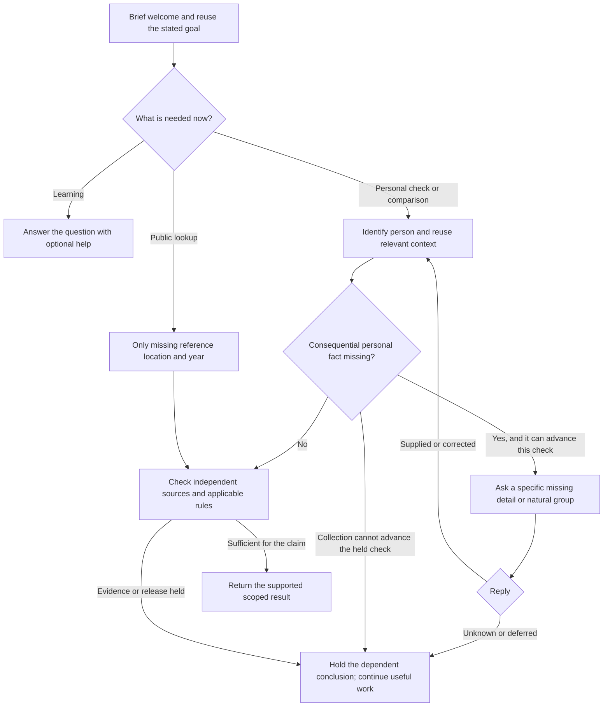

# Shortest sufficient conversation · consolidated design draft

October 25–27, 2026 · D79, D52/D64/D73. **Design for review, not runtime changes or accepted Medicare policy.** The owner reaffirmed both tasks together: complete the critical information map and remove unnecessary asks. Individual prompt approval must not become approval of a long interview. Existing project inputs are reused; no new questionnaire or customer database is created.

The **41 IDs remain a traceability inventory**: 10 baseline, 28 conditional parents, three documented children. A person's conversation is a capability-specific subset, with several fields often supplied by one reply. There is no fixed minimum or universal ten-question opening. The protected current UIs retain their contracts until a separately authorized implementation. T00 remains a brief welcome, not another required answer.

The [full field map](CRITICAL_INFORMATION_FIELD_MAP.md) and [JSON](CRITICAL_INFORMATION_FIELD_MAP.json) record all seven dimensions for **78 existing paths**, plus separately identified semantic/representation gaps. The [owner review record](CRITICAL_INFORMATION_MAP_REVIEW.md) preserves prior approvals. Full table coverage is not professional approval or proof that all personal conclusions are supported.

## Consolidated flow after the 41-entry review

**Owner decision, October 27:** RC16.C2 stays within RC16 and asks only for missing details. All 41 inventory entries have now completed individual product review in their recorded scopes. The flow below assembles those decisions; examples of contextual wording are not a new questionnaire or approval of previously proposed exact copy. T00 inclusion is directed; its exact wording/placement remains proposed. T10's routine menu is removed; exact targeted copy remains contextual/proposed.

**The routing rule:** Start from what the person wants to accomplish. Reuse what they already said, ask the next missing fact that changes that result, then reassess. A personal comparison needs consequential care and transition facts; a learning question or public fact lookup does not inherit that intake. There is no fixed required opening battery or mandatory sequence through these groups.

Corrections and scope changes can occur anywhere. An unchanged unknown is not automatically re-asked through another ID. A new goal can open a new branch. A blocked/deferred stop is recorded separately from completing the original requested conclusion.

### Opening and shared context

**T00, proposed welcome:**

> Hi, I'm Daylight, your AI Medicare guide. I can help you understand Medicare, explore coverage choices and figure out what to check next.
>
> We'll take it at your pace. You can ask questions, change an answer or say “I don't know.”

No separate required Start answer. If the request already names a task, begin helping. Otherwise T01 asks **What would you like help with today?** with the four approved options: **Understand Medicare · Find coverage · Review existing coverage · Something else**. T02 familiarity remains optional when useful; choosing a goal does not establish familiarity.

| Conversation group and existing links | What the person sees when needed | What is reused or skipped |
| --- | --- | --- |
| Recipient · RC01 | A short clarification of whose situation is being discussed, only if unclear. | Explicit self/helper context; no beneficiary interview for general learning. Never merge helper and beneficiary facts. |
| Relevant location · T03 + RC02 | **What ZIP code do you live in?** Ask only a still-missing county/home detail if required. | Already supplied beneficiary home; uniquely sourced county relationship with provenance. Public browsing can use an explicit reference location without claiming residency. |
| Intended period · T04 + RC03 | **When do you need Medicare coverage to start?** Choose start month / Already on Medicare / Not sure. For existing coverage, clarify only the relevant review period. | An explicit month and year or review year; desired start never substitutes for actual enrollment dates. |
| Current coverage · T05, RC04, RC07, RC09, RC26; intention RC17 | **What health coverage do you have now?** Accept free text or the reviewed multiple coverage choices, with uncertainty/help. | Extract the explicit A/B, Original/Advantage, job-linked insurance, program and intention facts from one reply. Ask only what remains needed; current, pending and former coverage stay distinct. |
| Doctors · T06 + RC21 | **Which doctors or hospitals would you like to keep?** Free text, followed by a compact echo of actual available identity/office matches for confirmation. | Existing names/offices and confirmed matches. Resolve only ambiguous items. None to check, unknown and defer have different meanings. Identity does not establish network participation. |
| Medicines · T07 + RC22 | **What prescriptions do you take?** Free text. Resolve only a consequential missing product detail, with sourced selections when available. | Explicit product/strength/form; echo consequential interpretations. No automatic fill, pharmacy or administration interview. None, unknown and defer stay distinct. |
| Away care · T08 + RC20 | **Will you need routine care away from home?** Local only / Elsewhere in the U.S. / Outside the U.S. / Not sure. | Known relevant care need/destination, including same-state away care. Ask only missing place/care meaning, and duration only if a source condition requires it. |
| Preferences · T09, T10; optional RC25 | **How would you prefer to balance monthly payments and costs when you get care?** Lower monthly payments / More predictable costs / No preference yet. | Explicit preference already given. Clarify a must-have or numerical limit only if useful to the requested comparison; no routine closing menu or budget request. |

These are reusable groups, not eight required turns. Ask only the subset needed for the task, in an order that follows the person's reply. Before an unqualified personal fit comparison, unresolved relevant doctors/medicines/away-care or transition scope cannot silently mean no needs. General path teaching and partial factual comparisons can continue with clearly stated limits.

### What unlocks additional details

Each row describes a dependency, not an automatic follow-up to the previous row. Exact examples name the known policy/person/medicine and omit facts already supplied.

| Branch | Actual unlock and targeted follow-up | Suppressed asks and limits |
| --- | --- | --- |
| Enrollment and work transition · RC05, RC06, RC08–RC11 + RC11.C1 | A requested timing/coordination finding needs a missing actual part start, eligibility basis, event or job/insurance date. Example: **When does your job end, and when does the health insurance through that job end?** Ask only one if the other is known. | No age/diagnosis/date battery. Employer size is asked only for the applicable unresolved coordination rule. Job end, notice, medical coverage end, drug coverage end and desired replacement start are not interchangeable. The child never repeats the parent. |
| Keeping other benefits · RC12, RC13 | A specific deferral/change decision needs a missing report from the named plan/employer about drug coverage or effects on the person's/spouse's/dependent's benefits. Ask what they were told; offer help and unknown. | No expert equivalence quiz, blanket document request or household interview. A brief reason names the contemplated change and benefits at issue. |
| HSA · RC14 | Only an actual supported timing/contribution dependency that missing information can help resolve. | Out of routine intake. Retirement or a target month alone does not trigger it. External holds do not justify extra financial collection. |
| Medigap buying/return rights · RC15, RC16 + RC16.C1/C2, RC17 | A specific requested protection still needs state/event/history. Ask the missing relevant Advantage episode start or **Did you leave a Medicare supplement (Medigap) policy to join [plan]?** only when that fact matters. | No blanket three-part history interview. Reuse known dates/history or another sufficient protection. No to that transition is not never owned Medigap. No answer alone guarantees return, price or issueability. |
| Assistance or special coverage · RC18, RC19, RC26 | A requested program/adjusted-cost/particular special-plan check needs missing current program status or subtype. RC18: **Do you currently receive benefits from any of these programs?** Relevant named programs, several positives/unknown/none known/decline; program-specific help. | No routine income, service-history or diagnosis screen. RC19 is internal until a concrete candidate/type/year makes a missing qualification fact useful. Reports do not independently prove eligibility. |
| Medicine price or specific fill/network fact · RC23 | A requested exact fill price needs missing quantity/units, days, actual pharmacy/service and channel. A narrower restriction/network check asks only its own needed fact. | Days use unselected 30/60/90/another/unknown dropdown; quantity numeric with units; actual sourced pharmacy search; channel only if needed. No default fill/store or annualization, and no full price interview for coverage alone. |
| Medicine administration · RC24 | An exact applicable rule needs a still-missing method/device/type or who/where detail. | Internal check; no routine injectable/clinic/pharmacy interview or diagnosis inferred from a medicine. Missing source evidence is a source hold. |
| Continuity and integrity · RC27, RC28 | Internal checks detect a specific consequential unresolved issue/date or true conflict. Clarify only that detail; acknowledge and apply clear corrections directly. | No generic urgent-gap menu, full re-interview or unchanged-unknown retry. Human help can be offered without a complete profile; a preference for help is not a completed referral or contact permission. |

Sensitive or unusual asks receive one local reason, such as **“I’m asking about that insurance end date to check the timing of your transition.”** Optional “What's the difference?” / “How can I tell?” help supports discovery without adding a required lesson or answer. A long explanation cannot rescue an unnecessary question.

### How the missing-fact gates behave

The capability table below gives the full branch-by-branch dependency and external gate. In ordinary language:

- Unknown required home geography/year holds the affected local/year claim, not Medicare education.
- Unknown relevant A/B status, exact actual date/basis or consequential event holds only the dependent eligibility/timing/coordination conclusion. Desired start is not proof of eligibility or enrollment.
- Unknown provider identity/office holds that provider check. Confirmed identity without plan/year network evidence still cannot establish access.
- Unknown exact medicine identity holds that product check. Known identity but unknown required fill/pharmacy facts can permit a pharmacy-independent coverage finding while holding the price estimate.
- Unknown necessary drug-creditability/benefit-change/history facts hold the corresponding deferral or benefit-preservation assurance; they do not make the alternative path automatically unsuitable.
- Unknown necessary Medigap history/event/state facts hold the particular buying/return-right finding; they do not prove no purchase route.
- Unknown program status/level holds the dependent adjusted-cost or special-plan qualification claim. It is not an ineligibility finding.
- Unknown total-cost scenario/components or numerical limit meaning holds a comprehensive cost/budget-fit claim. An omitted optional budget or explanation preference does not block other supported work.
- A consequential unresolved conflict holds only dependent findings. Check person, policy, period and meaning before treating two reports as contradictory.
- Missing independent sources, accepted rules, model applicability or release authority holds the dependent claim even if every personal question is answered. Stop intake that cannot help resolve it.

**Return state:** Explain what was established, what remains unknown, the specific conclusion withheld and a useful next action. Keep user reports, confirmed interpretations and externally verified facts distinct. A person can correct or return later; do not present ten unknown answers as readiness or a partial result as completion of a blocked recommendation.

### Consolidation example and measurement

Synthetic example: **“I’m retiring in December 2026 and need Medicare in January 2027. I have health insurance through my job.”** Reuse the task, intended start and job-linked coverage. Do not ask T01, T04/RC03 or the known portion of T05/RC09 again. If the requested supported timing check needs exact job and insurance ends, ask those together once. A reply can establish both; if insurance end is unknown, keep that timing dependency open without replaying the child. Do not infer that December retirement supplies December 31 or an insurance end.

That targeted message is **one prompt and two atomic detail requests**, not zero because it shares a screen or two consumer steps because it has two IDs. Any help, confirmation or correction turns count. Actual end-to-end counts vary by task and prior knowledge; human elapsed time remains unmeasured. Use the metrics and declared synthetic trace limitations below before claiming an improvement in time to a sufficient result.

## Governing question

**Owner necessity-first correction, October 27:** Before wording or mapping a consumer ask, recommend whether it should exist at that point: ask, consolidate/reuse, defer to a concrete decision, internal check or suppress. Show the actual requested result, known facts, missing dependency, how answers change the result and whether collection can advance useful supported work now. Assess intrusion, terminology/document burden, added turns and elapsed time; optional help or a long explanation does not justify unnecessary collection. Preserve all seven field-map dimensions and explicit task-specific blockers even when an ask is suppressed. Do not turn an unasked fact into no/not-applicable or demand owner approval of every original prompt's retention. RC14 is not approved by this correction.

**Current collaborative review format, owner-directed October 27:** Present the critical necessity recommendation first, then the existing ID, verbatim original question/options and separately labeled proposals. Include concrete prior-answer flow, reuse/skip behavior and all seven parts per field. Continue showing the actual question on revisits. This supersedes the earlier original-first ordering; it changes the review display, not the consumer sequence or 41-ID inventory. RC14 is approved out of routine intake and RC15 as an internal missing-detail check; RC16 is approved conditional/missing-details-only; RC17 is approved consolidated/missing-details-only; RC18 is approved conditional with direct program wording/missing details only; RC19 is approved internal/missing-details-only; RC20 is approved T08-consolidated/missing-details-only; RC21 is approved T06-consolidated/missing-details-only; RC22 is approved T07-consolidated/missing-details-only; RC23 is approved conditional/dropdowns/missing-details-only; RC24 is approved internal/specific-missing-details-only; RC25 is approved optional/cost-conversation/missing-details-only; RC26 is approved conditional/T05/missing-details-only; RC27 is approved internal/specific-missing-details-only; RC28 is approved internal correction/unresolved-details-only; RC11.C1 is approved within RC11/missing-dates-only; RC16.C1 is approved within RC16/missing-dates-only; RC16.C2 is approved within RC16/missing-details-only. All 41 inventory treatments have completed this product review pass in their recorded scopes. Dropdowns/searchable selections and related structured controls are owner-directed for medicine/fill follow-ups, with typed/unknown/defer routes and no preselection; T07 initial entry stays free text.

Before asking anything: **Which requested conclusion or next useful action needs this fact, why can the existing confirmed facts not supply it, and what exactly will remain unresolved if the person does not know?** If there is no concrete answer, do not ask merely to complete a profile field.

Useful learning or an answer can precede personal intake. Compare coverage paths before individual policies. Keep, defer and neutral external research remain valid outcomes. Commercial economics never affect questions, candidate inclusion, explanation or priorities.

**Medicine-detail control direction, October 27:** Dropdown/searchable controls reduce effort for bounded missing facts; they do not establish mandatory asks or justify splitting a natural reply into many screens. T07 initial free text is preserved. RC22 name/strength/form options require actually available trusted product data; RC23 pharmacy options require actual branch/service sources. Days/channel can use bounded unselected options with another/unknown; quantity uses numeric entry with the relevant unit rather than arbitrary exhaustive menus. Accept direct text that supplies multiple fields. Reuse known values with edit, confirm consequential new interpretations only, and retain raw text/status/provenance. No typed fallback or source outage may become a guessed match. RC23 conditional/dropdowns/missing-details-only use is approved; other exact controls/copy retain their individual review status. No runtime is implemented by this review.

## Conversation loop

1. Establish the requested task from explicit entry/reply. Combine T00 welcome with T01 only when the task is not already clear. Do not require a four-option answer after a sufficiently specific question has already stated the task.
2. Identify the person before attributing personal coverage facts; reuse an explicit self/helper report. Education and public browsing need no personal beneficiary profile. Helper role is not permission to share or act for someone.
3. Extract **all explicitly supplied relevant facts** from the reply across the existing inventory. Retain person, time, entity, original meaning, confirmation, source and revision. Separate direct reports, tentative interpretations, derived references and external verification.
4. Compute the unresolved facts for the **requested capability and actual branch**. Remove adequately known facts and demonstrably non-applicable facts. Record the evidence/reason for non-applicability; an unknown parent does not close its branch. Optional preferences, report controls and internal entity references never become universal asks.
5. Confirm consequential interpretations, new provider/drug identity matches and ambiguous changes before relying on them. Combine related confirmations when clear; preserve per-item uncertainty. A clear direct choice needs no redundant confirmation. No match is silently preselected.
6. Ask the next consequential missing information in a natural, manageable group. Explain sensitive/unusual asks in one sentence. Do not merge unrelated dates, medicines, financial facts and family issues into one long prompt to improve the counter. Name the specific missing details instead of replaying a whole parent question.
7. Accept corrections, none, unknown and defer distinctly. Recompute affected dependencies only. An unchanged unknown is not repeatedly queued. A new task, changed fact or genuinely different material ambiguity can justify a new ask, with its reason.
8. Return a useful scoped result or an explicit limit. Separate **reported-input sufficiency** from **external source/policy/release readiness**. Stop unnecessary intake when the remaining obstacle is external. Do not call a narrower result completion of an originally blocked personal recommendation.

No silent defaults: no standard premium applicability, no current-year assumption, no inferred birthday, no employer threshold applied to the wrong basis, no usual pharmacy, no default drug strength/fill, no inferred clinical diagnosis, no assumed home from seasonal travel, and no numeric preference weights. A declared transformation from a specific confirmed reply into a report disposition is traceable reuse; a value invented without that reply is a default.

## Consolidation across all 41 existing prompts

This is the consumer treatment of the inventory, not a new screen order. Every row links to the full field map and its source/unknown/readiness rules.

| Existing ID | Proposed consumer treatment | Ask only for the remaining consequential information |
| --- | --- | --- |
| T01 | Task opener or reuse explicit request | Goal only if genuinely unclear; optional relevant detail for an ambiguous request. |
| T02 | Optional explanation adjustment | Familiarity only when useful and not already stated; never expertise inferred from goal. |
| T03 | Shared geographic scope | Home location only when needed; reuse with RC02 and any exact source-derived county. |
| T04 | Shared intended period | Desired timing only when consequential; use its explicit year with RC03, never as actual A/B dates. |
| T05 | Shared current-coverage narrative | Reuse explicit categories/parts/delivery/work/program details in RC04/RC07/RC09/RC26 without duplicate questions. |
| T06 | Free text plus explicit identity echo | All named providers together; RC21 only for missing identity/office detail. |
| T07 | Free text plus consequential confirmation | Reuse exact products with RC22; RC23 only for missing facts needed by requested pricing or a specific fill-restriction/pharmacy-network finding; RC24 only when consequential. |
| T08 | Shared away-care need/location | Broader U.S. option includes same-state away care; reuse meaningful location with RC20. |
| T09 | Optional cost-tradeoff clarification | Reuse a literal matching explicit preference; do not equate premiums and total spending. |
| T10 | **No routine closing menu** | Targeted clarification only for an actual unresolved priority/tradeoff/custom meaning affecting the requested conclusion. This revised wording remains a proposal. |
| RC01 | Early recipient clarification; conditional/context-reuse rule owner-approved | Use clear conversational context without a duplicate ask; clarify only missing, tentative or conflicting recipient context before consequential personal use. |
| RC02 | Consolidated with T03; owner-approved missing-details-only rule | Ask only consequential missing ZIP/county/home context; reuse known details, with no second home interview or separate Add-details question. |
| RC03 | Consolidated with T04; owner-approved missing-timing-details-only rule | No routine Which-year menu. Reuse intended coverage start/change or review period and extract its year. Ask only the missing detail in context (for example January of which year). Current-coverage review needs its relevant period, not an invented future start. A known requested year with unavailable sources creates a source hold, not a repeat ask. |
| RC04 | Consolidated with T05; owner-approved missing-A/B-status-only rule | Reuse explicit A/B status. Ask only the missing consequential part, without repeating known A or B. Preserve partial/pending/unknown status and period distinctions; the single existing choice cannot faithfully encode mixed active/pending statuses. |
| RC05 | Owner-approved conditional month/year clarification at point of need | Identify the requested check that needs actual B start and explain why; ask only missing details after reuse. B-active status or inventory order alone never triggers it. No separate Add-details control or retry on unchanged unknown; desired/future start is distinct, and month storage cannot invent a required day/history. |
| RC06 | Owner-approved independently conditional qualification-basis / age-range use | At the relevant check, collect only the specific missing basis or age range that can change it. Reuse each separately; no universal diagnosis/age screen or automatic follow-up from RC05. First/expected basis and current age remain distinct; unknown and representation/precise-anchor gaps block only dependent conclusions. |
| RC07 | Owner-approved conditional clarification within T05, with both help options | Only missing consequential current Original/Advantage or current-versus-future meaning. Offer What's the difference and How can I tell help; keep I'm still not sure and return to the same answer state. No routine repeat after T05/RC06. Pending alone supplies no current arrangement/effective date; preserve current alongside unverified future reports. Record non-applicability where no relevant current arrangement exists. |
| RC08 | Owner-approved internal event check with specific follow-ups only when needed | Use known insurance-ending/move/plan/program reports. Only a requested timing check needing a missing event fact/date opens a precise purpose-specific ask. No generic coverage/needs-change question or routine menu; known enrollment intent and care needs remain in their branches. Skip when known facts/reviewed route resolve timing. Keep notice/job/coverage/move/desired-start dates and A/B versus MA/PDP versus Medigap policy scopes distinct. |
| RC09 | Owner-approved missing-detail check within T05 | Name the specific known job-linked insurance and show the preceding T05 reply plus requested timing consequence. Reuse current-job/retiree/COBRA classifications and ask only consequential missing whose-job or current-work status. Place beside that reply or later explicit employment-timing task, never automatically after RC08. No unanchored this coverage question. Preserve unknown parents, policy/period/relationship bindings and optional help. |
| RC10 | Owner-approved conditional applicable size category, responses and help | Show known beneficiary/age-basis, current-job plan/worker and requested coordination consequence before the named-employer 20 question. Reuse size facts; no automatic RC09 follow-up. Offer the three responses/help only within the applicable branch; no quiz/counter unlock. G10 holds other thresholds/definitions/multi-employer exceptions; direct payer evidence is not a size value. |
| RC11 | Owner-approved conditional missing-dates-only clarification | Open only for a requested transition needing the still-missing date(s), never automatically after RC10. Group job end plus insurance end when both are needed/unknown; otherwise ask only one or none. Derive disposition from the reply without a status control. Preserve ongoing work, scheduled/estimated dates, policy/coverage basis and precision; do not interchange active-employment and COBRA/retiree ends. Deduplicate RC11.C1. |
| RC12 | Owner-approved conditional use with help and I don't know | System identifies an actual requested finding or contemplated deferral/transition needing creditability/history, reuses bound evidence/reports, then explains the consequence before a targeted plain-language follow-up. Omit the rejected standard-comparison parenthetical. Optional practical help accompanies the ask; no prerequisite terminology/document gathering or mandatory helper/menu turn. Unknown/defer permits other useful work and return/correction; name the dependent finding still open and any evidenced material timing limitation, with no global incomplete-profile message or unchanged-unknown retry. No blanket notice request for other insurance, retirement or plan browsing; frequency and abandonment/time effects are unmeasured. Ask what the named employer/plan told them, not their expert judgment. History is independently conditional and bounded by the applicable period. No medicines is not no insurance; medical-end dates are not automatically drug-end dates; no user day-count arithmetic. |
| RC13 | Owner-approved conditional contextual use, simple spouse/dependent examples, help/unknown | Name the person/insurance/action already known; show a short relevant example of a wife/child keeping work insurance when the user leaves it, or both spouses keeping work insurance when one adds Medicare drug coverage. Reuse the actual plan/employer's scoped answer. RC12 creditability does not establish consequences; no automatic next question or household interview. Include the person's own relevant benefits. Accept not-checked/unknown/defer and offer optional Help me check; continue other useful work with the precise finding open. Bind reported effects to policy/action/people/period and preserve mixed effects/representation gaps; no automatic route exclusion or cancellation authority. |
| RC14 | Owner-approved out of routine intake; internal dependency retained | Necessity first: show the actual supported timing result, how answers change it and whether collection can advance useful work now. Target month/employment alone is insufficient. Reuse reports; defer unhelpful collection under an external hold. Unasked remains unanswered/not required for this task with a reason. G02 actual A chronology and G07 contribution periods/allocation remain explicit; no stock HSA ask or personal tax finding is approved. |
| RC15 | Owner-approved internal check, missing details only | Suppress broad relevance/notice menu, reuse prior state/B/event/end-date reports and derive report disposition internally. Ask only a still-missing fact that can change the supported personal purchase-rights result. Another established applicable protection can make event asking unnecessary. No-known-event/letter is not no rights; preserve exact notice/end/claim dates, policy bindings and independent evidence/release gates. |
| RC16 | Owner-approved conditional missing-details-only history | Independently assess first-entry, actual start and prior Medigap for the specific supported protection; reuse existing reports/another sufficient protection and ask only the necessary missing fact. No blanket three-part Yes/No interview. Preserve current-product versus first-entry, actual versus application dates and prior ownership versus dropped-to-join distinctions, G01/G04 gaps and child shared-field deduplication. Child editorial approvals remain separate. |
| RC17 | Owner-approved goal/current-coverage consolidation, missing details only | Reuse the actual goal and named current Medigap policy. Preserve exploring/undecided versus a change commitment; comparison can retain the existing policy. Clarify only consequential target/intention ambiguity, with broad review/both supported. Keep richer intention and G04 binding gaps explicit rather than forcing keep/replace. No cancellation authority or acceptance/return-right finding follows. |
| RC18 | Owner-approved conditional direct program-receipt wording, missing details only | Ask whether benefits are currently received from relevant named programs with short descriptions, unknown/none-known/decline and several positives where needed. Reuse known statuses and target actual missing facts. Preserve partial per-program/person/state/period and G09 gaps; No for one is not no assistance and current status is not new financial eligibility. No routine income screen or automatic plan qualification. |
| RC19 | Owner-approved internal check, missing details only | Reuse known program/A-B/location and establish exact candidate/type/year/requirements. Keep evidence availability separate from explore/decline preference and unknown separate from ineligible. Ask only a consequential missing fact/binding that can advance supported verification/referral; no broad proof menu or diagnosis/financial intake to compensate for held detailed matching. Reported confirmation is not independent approval. |
| RC20 | Owner-approved T08 consolidation, missing details only | Reuse known care meaning/destination/intended-provider reports. Ask only necessary missing place/care details; preserve broader U.S., multiple-place/period G06 gaps and unknown versus emergency-only. Duration only if a specific source condition needs it; no itinerary/home substitution or source-failure re-ask. |
| RC21 | Approved T06 consolidation; missing distinguishing details only | Suppress broad Add details/menu and remove unavailable network evidence as a personal-question trigger. Reuse confirmed provider/office reports and ask only a genuinely missing distinguishing fact, with free text/unknown or actually sourced candidates. Group consequential new match confirmations within T06; never preselect or invent candidates. Entity ID and disposition are internal, removal is item-specific, and G05 exact source/office binding is separate from identity/participation. Source failure keeps access unresolved while other work continues. |
| RC22 | Approved T07 consolidation; missing exact product detail only | Suppress broad name/strength/form/preference menu. Reuse reported label details and confirmed exact products; ask only actual missing discriminators needed for a supported check, grouping them when shorter. Actual branded/generic product identity can be necessary; brand preference stays optional and never authorizes substitution or blocks a known-product check. Strength is not dosage/fill quantity; RC23 and RC24 remain independently staged. Internal ID/disposition are not consumer asks, no match/source failure is not stopped/uncovered, and exact L05/L06/G05 evidence remains independently held. |
| RC23 | Approved conditional/dropdowns/missing-details-only fill group | Reuse T07/RC22 and ask only amount/units, days, exact store/service or channel needed for a supported requested result. Use days/channel dropdowns, searchable sourced pharmacies and numeric quantity with relevant units; no preselection or duplicate legacy/status/ID inputs. Typed/another/unknown/defer remain available. Narrow quantity-limit/pharmacy-network requests reuse only relevant facts; original pricing-only capability metadata remains an explicit G05 gap. Preserve actual versus agreed hypothetical scenarios, item-specific scope and independent L05/L06/L07 gates; source outage earns no more personal intake. |
| RC24 | Approved internal rule-specific check; specific missing details only | Reuse T07/RC22/RC23 and identify the actual source-specific missing method/device/type/who/where discriminator before asking. Insulin DME-pump versus other-method coverage illustrates why a generic self/professional answer can still be insufficient. Suppress stock clinic/pharmacy and who-administers questions; no restriction/injection/source-outage trigger or full RC23 prerequisite. Use relevant unselected options plus typed/unknown/defer; exact product/equipment/condition and benefit evidence remain separate. G11 retains per-item representations and distinct problem facts. |
| RC25 | Approved optional cost-conversation/missing-details-only use | Skip for general lower-monthly preference/total-cost priority alone. Reuse volunteered limits or ask only missing amount/scope for an explicitly requested supported numerical-limit comparison. Number/range entry, scope dropdown with explicit Part B inclusion and care/drug distinction; no Add budget gate/preselection or arbitrary dollar bands. Unknown/decline/no-fixed-limit differ. No automatic RC03/RC18 interview, wealth/eligibility inference, hard cutoff from soft target or unsupported total/affordability promise. Preserve corrections, period/components and G03/G08/G12/G14 evidence/model gaps. |
| RC26 | Approved conditional within T05; missing details only | Ask only necessary missing program precision for supported requested enrollment/coordination/drug/path work; reuse explicit current program reports. Use relevant unselected program dropdown, multiple reports, typed Another/unknown/defer and optional identification help. No routine service/beneficiary/disability interview, A/B/creditability dependency chain, TFL inference from age/military/A-B, or VA/TRICARE/CHAMPVA equivalence. G04/G13/G14 retain mixed status/subtype/person/period/Other representations. Sources/eligibility/personal applicability remain independent. |
| RC27 | Approved internal continuity/priority check; specific missing details only | Reuse actual issue/date/help reports from RC08/T05/medicine conversation; suppress repeated interruption Yes/No. Only a missing affected issue/date that changes supported next-step guidance earns an ask. Rare-condition/disaster/termination mentions alone establish no immediate gap or special right; no universal screen, RC08 menu or full-profile dependency. Human-help is a separate accessible action, not issue status, permission to contact/share or completed referral. Preserve unknown, scoped No, scheduled/actual status, empty-stale-trigger representation gaps and independent L13/L05/L07 evidence. |
| RC28 | Approved internal correction check; clarify unresolved details only | Apply a clear explicit correction to its actual reported target and acknowledge without a second confirmation. Check original meaning/person/period and source/plan/year/result errors before asking. Ask only an unresolved consequential interpretation using relevant unselected options/date/text with another/unknown/defer; the original Original/Advantage chooser is not generic. A/B entitlement versus delivery, different people/periods or actual versus desired dates are not automatically conflicts. Preserve G14 target/revision and external disputes; invalidate/reconsider only affected results, never reset the profile or replay known answers. |
| RC11.C1 | Approved within RC11; missing dates only | Ask only necessary missing named-insurance end/precision after reuse; no parent-known or unchanged-unknown retry. Suppress inherited Add dates/Still working controls and job-end research-label mismatch. Date entry/typed precision plus unknown/no-scheduled-end/defer, without date defaults. Reuse actual worker/policy/current-employment-versus-continuation basis; do not copy retirement end. Parent group collects both related dates once only when both are needed/missing. Track child editorial status separately from approved parent field and independent L13 evidence. |
| RC16.C1 | Approved within RC16; missing dates only | Ask only an actual relevant episode start needed by a supported requested protection after history/state/event reuse; another sufficient protection can remove the need. Replace it/Yes-No/research-first-entry mismatch with named coverage month/year entry, unknown/defer and precise date only if consequential. First-ever entry is distinct from current product/renewal, application, Part B or desired switch; no assumed day/year or recent-start-as-right. Known/unchanged-unknown parent dates earn no new ask. Preserve G01/G04/G14 and separate child versus parent approval/L11-L13 evidence gates. |
| RC16.C2 | Approved within RC16; missing details only | Ask only the actual prior-policy/left-to-join detail required for a supported requested protection after reuse. No routine lifetime policy interview or first-eligibility-branch prerequisite. Use named Medicare supplement (Medigap)/relevant Advantage episode with unselected Yes/No/unknown, typed explanation/defer and optional identification help. A scoped No denies only that link, not all prior ownership; Yes guarantees no return/same price. Minimal former policy identity only if needed; source/carrier verifies actual availability. Preserve G04/G14 distinctions and separate child review/L11-L13 gates. |

The 11 runtime wording variants and 31 detail controls remain overlapping implementation forms. They are not 42 additional information requirements. RC29 is an external-source guard, RC30 a held future application review; neither is another intake prompt.

## Capability-specific shortest paths and blockers

These are proposed demand rules for design review, not an approved executable insurance policy. The full field map specifies each leaf. Unknown never satisfies a consequential required fact, but a missing preference does not block otherwise supported work.

| Requested work | Smallest relevant input family, including conditional expansion | Missing facts block which conclusion | Independent external gate |
| --- | --- | --- | --- |
| Explain a Medicare concept or general path tradeoffs | The actual question; optional T02 only if useful. | Only an ambiguity preventing an accurate answer; no personal profile gate. | Accepted general source scope; no implied personal fit. |
| Browse published local/year facts | Required home/reference geography and explicit year from T03/RC02, T04/RC03 or a known fact. No T05–T10 by default. | Exact local/year claim if required scope is unresolved. Unique ZIP derivation stays sourced, not verified residence. | Exact service area/year and source acceptance; sample browsing remains explicitly labeled. Current ZIP/county gate compatibility must be reviewed before any narrower geographic rule is implemented. |
| Prepare a personal path comparison | Clear task/person, relevant current coverage/parts, scope/year, consequential intended timing, explicit doctor/medicine/away-care scope; expand only material transition/rights details. | An unqualified personal fit/path conclusion that depends on unresolved facts. Specific Medigap issueability/transition conclusions need their own branch. | Market scope, rules, exact benefits, independence/comparison acceptance; never supplied by intake completion. |
| Check a named provider | Relevant person/task/year/path/plan, T06 name(s) and confirmed RC21 identity/office; T08/RC20 only for consequential care geography. | That provider/office result and an all-requested-providers claim. Other independently supported results remain visible. | Trusted identity source plus path-appropriate access/network evidence. Identity confirmation is not coverage. |
| Check a named medicine's coverage | Relevant exact plan/year and T07/RC22 name/strength/form; RC24 only if the requested coverage issue needs it. | That product's exact coverage/restriction result and an all-medicines claim. Missing fill/pharmacy facts do not automatically block a pharmacy-independent coverage check. | Trusted product identity, exact formulary/restrictions and reviewed applicable policy. |
| Estimate a specific fill's cost | Drug identity plus RC23 quantity/units, days supply, exact pharmacy/location and channel; relevant assistance only for adjusted costs. | Exact affected fill/annual estimate when its required scenario input is missing. | Pharmacy identity/network and accepted exact pricing/model/source evidence. No default fill scenario. |
| Personal enrollment/transition timing | Requested period, relevant actual parts/date/basis and only consequential event/work/end-date/notice/HSA/program facts (RC04–RC14/RC26/RC27). | The particular deadline, start, payer-order, deferral or contribution consequence depending on the missing fact. Precise anchors/Part A/HSA gaps are not closed by ageBand/B date/yes-no. | Official enrollment/notice evidence and qualified reviewed timing/coordination policy. |
| Personal Medigap rights/replacement | Relevant state/basis/age/B start, actual event/notice and only material Advantage/prior-Medigap/replacement history (RC15–RC17). | A specific buying-right, issueability or safe-replacement conclusion. | Reviewed federal/state policy, official history and actual issueability evidence where required. |
| SNP qualification | Relevant exact type, ordinary scope/parts and minimal specific RC19 program/qualification report; RC18 only where pertinent. | That type's eligibility/fit claim. Unverified is not ineligible or an automatically omitted option. | Actual program/plan qualification and accepted policy. |
| Personal total cost or budget fit | Exact requested scenario, period/components, relevant coverage/fills/use and any material assistance; optional RC25 amount/basis only if actually applied. | Comprehensive personal total/savings/affordability or budget-fit claims missing components/meaning. | Accepted components, applicability, model and evidence; published premiums/IRMAA tables alone cannot close this. |
| Priority-specific explanation | Explicit relevant preference/constraint from prior reports; T09/T10 only for a real remaining ambiguity. | Only a claim that an unclear or unverified stated priority is honored. | Any factual claim of satisfaction requires its independent evidence; no numerical weights or economic steering. |

RC02/RC03 and internal item references are data requirements, not automatic consumer questions. A control field can be derived from an explicit report under a declared mapping, without asking the person to confirm the same substance twice. A “details supplied” flag cannot replace the actual details.

### Optional self-discovery help · owner direction, October 26

When a consequential question uses unfamiliar terms, offer concise optional conceptual help (for example What's the difference) and practical answer-finding help (How can I tell / Where can I find this). RC07 is the reviewed example; adapt the wording and evidence to the actual field rather than adding universal help questions. Keep explanations local to the current question, preserve known answers and return to the same unresolved selection/free text with I'm still not sure available. No mandatory lesson/quiz, new primary question ID or automatic capability readiness follows from reading help.

Help interactions count as user/assistant turns and elapsed reading/response time; count any actual additional Daylight information requests normally. No-question explanatory content introduces no extra required profile fact, but its burden cannot be hidden by screen counts. RC07's official comparison/card/account links are general education and user-directed ways to inspect coverage, not Daylight account access, verified enrollment or permission to collect identifiers. Keep exact copy and evidence scope in the owner review.

## Natural groups, not mandatory stages

- **Welcome/task:** T00 with T01 when needed. If the person opens with a clear question, answer it and reuse that intent.
- **Relevant scope:** recipient before personal facts; location/year together when the requested source needs them. Ask only missing pieces.
- **Current situation:** a natural current-coverage/intended-change reply can supply T05, T04 and explicit RC04/RC07/RC09/RC26 facts. Do not infer the unprovided ones.
- **Provider identity:** T06 free text → one compact candidate echo → confirm clear matches together, resolve only ambiguous items. Reuse office details for RC21.
- **Medicine identity:** T07 free text → confirm consequential name/strength/form interpretations. A supported requested price task opens only still-missing RC23 fill/pharmacy facts. A specifically requested quantity-limit/pharmacy-network finding reuses only its pertinent facts; no full pricing interview follows, and capability metadata remains a review gap.
- **Consequential exceptions:** relevant employment, Medigap history, assistance, events or unusual cases open only their missing branch, with a brief reason.
- **Tradeoff clarification:** no routine T10 closing menu. A targeted clarification is optional and only useful when an actual unresolved priority affects the requested output.

Grouped wording is assembled from the existing IDs, not a newly numbered questionnaire. Count the constituent information requests even when a single message collects several facts.

## Questions, turns and time

Three measures are mandatory; none is a proxy for the others.

1. **Questions asked:** count displayed information-request prompts, including confirmations and repeats. Also count **atomic information requests** within them: one prompt asking employment end and health-coverage end is one prompt and two detail requests. Internal IDs, derived dispositions and source lookups are not customer questions. Per-doctor confirmations remain distinct requests even when grouped.
2. **Conversation turns:** count every submitted user response and every assistant message, including help, confirmations, correction and recovery. One multi-fact reply is one user turn; clicking several inputs before submitting is not several replies. Keep system processing separate. Screens/clicks alone do not measure the conversation.
3. **Elapsed time:** wall-clock from task entry/T00 to the useful scoped outcome or explicit blocked/deferred stop. Distinguish active interaction, user pauses, system/external waiting and the reported-input milestone. Do not relabel a blocked recommendation as completion of the original task. Define inactivity segmentation before human measurement; no elapsed times are invented here.

Evaluate equivalent requested outcomes and comparable case complexity. Report unfinished/unknown cases, correction rates, repeated asks, source holds and staff work alongside completed cases. A shorter message count that increases reading/recall/correction burden is not an established improvement.

The [synthetic trace audit](CONVERSATION_TRACE_AUDIT.md) counts declared prompts, atomic requests and turns for representative design examples. It is not a running app, consumer test, validated policy evaluation or measured human completion time. Every human elapsed-time observation remains **not measured**. Its purpose is to catch duplicate asks, unknown loops, internal-control questions and pricing-only data collected for coverage-only tasks before implementation.

Future instrumentation should aggregate counts/reasons and minimized references under the existing privacy rules; this design does not authorize raw transcripts, health-name telemetry, new retention, paid AI calls or outreach.

## Limits and next review

The field map's G01–G14 gaps explicitly cover precise eligibility anchors, Part A/contribution chronology, personal premium applicability, exact current policy, trusted entity bindings, multiple care locations/needs, total-cost scenarios, assistance detail, payer-order context, per-medicine setting, nuanced constraints, unlisted coverage and generic corrections. Each has a question/known-report link, all seven mapping parts and the conclusions withheld. They are not silently added fields or new universal questions.

Keep separate the non-intake permissions for AI transfer, saving/sensitive notes, family sharing and any supported human/fulfillment action. RC01 helper status grants none of those. Source guard RC29 and held application boundary RC30 cannot be cleared by answers. No independent source acceptance, enrollment, recommendation release or implementation is claimed.

Review **consolidation/path decisions** one at a time against this whole map. An individual prompt is reviewed only in its path, with its incremental missing facts, reuse and measured or unmeasured burden visible. All 41 individual product treatments have now been reviewed in their recorded scopes. This consolidated presentation, exact proposed copy, unresolved semantic/evidence gaps and any implementation retain their separate review status. The ten baseline items are not the completion denominator for either task.
