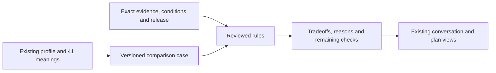

# Plan comparison built on the existing Daylight profile

November 1, 2026 · D87 · **Design proposal. No runtime, profile migration, database change or capability release.**

Daylight already has the profile foundation this needs. Reuse the existing guide/readiness aggregate and the newer advisor's capture/provenance layer. Add a versioned comparison view that connects a person's reported circumstances to exact plan evidence, produces inspectable tradeoffs and identifies the next useful check.

The owner requested this design after the local fifteen-layer database build, explicitly excluded implementation, and directed that the comparison response and decision rules be designed together with all 41 question meanings. The [question crosswalk](QUESTION_CROSSWALK.md) and [machine-readable map](question-decision-map.json) account for every ID. They specify conditional dependencies, not a new interview sequence.

## What is already there

| Existing contract | What it supplies | Design consequence |
|---|---|---|
| [Profile template](../../../alternatives/chat-first/cms-slice/config/profile/customer-profile.template.json) and [schema](../../../alternatives/chat-first/cms-slice/config/profile/customer-profile.schema.json) | An empty aggregate with field envelopes and existing guide/readiness storage | Reuse the aggregate. The JSON schema describes the empty template; it is not a complete validator for populated comparison cases. |
| [Adaptive contract](../../../alternatives/chat-first/cms-slice/config/profile/adaptive-flow.json) and [question inventory](../../../alternatives/chat-first/cms-slice/config/profile/question-map.json) | 41 IDs, 78 baseline paths, 14 named gaps, conditional dependencies and unknown handling | Keep 38 primary meanings and three child aliases. Preserve eleven wording variants and RC29/RC30 guards separately. |
| [Infrastructure profile export](../../../infrastructure/daylight-data/config/profile-contract.2026.json) | Exact metadata snapshot of that baseline | All five source bindings still match on this review. It contains definitions, not customer profiles, and does not include all later advisor extensions. |
| [Advisor natural state](../../../alternatives/advisor-first/natural_state.py), [situation adapter](../../../alternatives/advisor-first/situation.py) and [D86 direction](../NATURAL_ADVISOR_FLOW_PLAN_2026-10-30.md) | Natural capture, truthful provenance, scoped circumstances, corrections and bounded priority context | Normalize their references through an explicit adapter; do not discard these additions or infer facts from conversation metadata. |

This is a strong conversation and input model. It already distinguishes absence, explicit none, unknown, deferred, uncertainty and conflicting reports. It keeps reported inputs separate from external verification. Its main remaining work is representing a **comparison case**: exact coverage episodes, resolved care-item identities, cost scenarios and dependencies between reports, evidence and conclusions.

## The proposed product behavior

Start with the requested task and the existing profile. Explain coverage paths before comparing policies when that distinction matters. Display the current arrangement beside alternatives; keep and defer remain possible outcomes with their own unresolved transition checks.

Each comparison uses the same dimensions: coverage structure, costs and their basis, doctors/hospitals, medicines/pharmacies, routine care away, eligibility/transition, and any expressly requested benefits. Findings carry conditions and say whether the evidence supports the requested need, conflicts with it, or leaves it unresolved. Missing evidence never becomes poor fit, zero cost or ineligibility.

Use expressed priorities to emphasize tradeoffs and choose useful research. T02 changes explanation depth only. T09 does not establish risk tolerance. T10 is an unordered set unless the person explicitly supplies an order. Listing a doctor does not automatically make that doctor an absolute constraint. RC25 needs a defined cost scope before a budget comparison means anything.

The initial algorithm is a deterministic, rule-based comparison of these dimensions. It can explain supported differences, preserve ties and show where the answer changes under stated scenarios. It does not assign an invented fit percentage. Default catalog order remains source order; explicit supported sorting is separate from a personal recommendation. [Decision rules](DECISION_RULES.md) define the evaluation and question-selection procedure.

The UI would receive one [comparison response](COMPARISON_RESPONSE.md), including a compact summary, current coverage, comparable alternatives, material tradeoffs, evidence and remaining work. Its internal dependency record links every result back to question IDs, exact report revisions and source/release identities. A user question and an external research task are different objects; repeatedly asking the person cannot repair missing network evidence or an unaccepted rule.

## What to build next, after design review

1. A local adapter over existing profile records, including advisor extensions and provenance. No second customer database.
2. A narrow typed serving projection over exact, accepted evidence. Keep the immutable research archive and all fifteen layers intact; do not put a request-time join across raw research tables in the page path.
3. One comparison service returning this response contract, with a versioned rule registry and deterministic reasons. The language model can explain supplied findings and choose among service-eligible conversational moves.
4. A fictional vertical slice exercising baseline, two comparable alternatives, one unresolved provider, one prescription, a correction and a deferred question. Only subsequently connect genuinely released real evidence to its exact permitted consumer purpose.

These are proposed implementation increments, not authorization to execute them now. No cloud decision is required to complete this design or the future fictional local slice.

## Review and boundaries

Read [profile mapping and gaps](PROFILE_MAPPING.md), [response contract](COMPARISON_RESPONSE.md), [decision rules](DECISION_RULES.md), the [41-ID crosswalk](QUESTION_CROSSWALK.md), and [review scenarios](REVIEW.md). The JSON examples contain fictional objects only and are not API implementations or released plan advice.

The current infrastructure [consumer API](../../../infrastructure/daylight-data/src/daylight_data/api/app.py) is held; the [release migration](../../../infrastructure/daylight-data/migrations/004_release_boundaries.sql) explicitly does not implement authority replay/promotion. A populated research database is not a consumer release. Preserve the exact accepted L01/r4 scopes, full frozen L03 r9 obligations, all source stops and D64/D73 independence. Neither this design nor a technical review accepts Medicare policy, personal calculations, ranking or recommendations.
