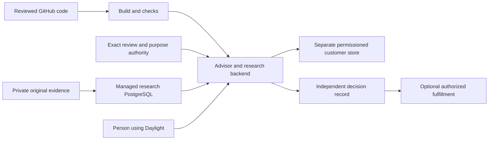

# GitHub and cloud handoff

**Code-publication increment · November 2, 2026:** The current advisor/dependency baseline, fictional tests, data-infrastructure implementation and selected contracts are now the curated code-handoff target, with [portable fixture setup and explicit test limits](DEVELOPMENT.md). Required repository CI and branch protection are active. The original organizational review below predates these publication increments; its cloud, archive, customer-data, restoration and purpose-acceptance requirements remain open.

Prepared November 2, 2026 for the owner's existing **[cpuglis1/daylight-medicare](https://github.com/cpuglis1/daylight-medicare)** repository and **2026 controlled Collier pilot**. GitHub metadata confirms the destination is public. No push, visibility change, cloud provisioning, source upload, database migration or customer migration was performed by this review.

**Recommended shape: one code repository, private immutable evidence storage, one managed PostgreSQL evidence backend, and a separately controlled customer-data boundary.** Keep the existing Python/JavaScript implementation and relative source layout for the first reproducible handoff. Moving to a new frontend framework or splitting into fifteen services would add work without resolving the current bottlenecks.

Proposed separation; these boxes do not imply deployed services:



## What goes where

| Material | Destination and access | Current location and treatment |
| --- | --- | --- |
| Deployable code, source adapters, tests, SQL migrations, schemas and locked dependencies | Public GitHub only after explicit content/privacy/rights review | `cms-slice/`, both `alternatives/`, `infrastructure/daylight-data/`; curate files, not entire directories. :8893 depends on the hash-pinned :8891 engine. |
| Product/company documentation and runbooks | Reviewed public documentation in GitHub; commercially sensitive material stays private | Root authority files and selected `docs/`. Document status/date and exact scope. A Markdown extension does not imply public suitability. |
| Raw CMS/carrier bytes, PDFs, bulk extracts, large SQLite/JSONL/CSV stores and sealed revision packets | Private object archive with checksums, lineage, source-use state and retention | `plans/`, `docs/data/`, raw/report/archive areas. Preserve local originals and exact immutable paths/hashes until a verified relocation is complete. |
| Observations, identities, conditions, relationships, jobs, review/release metadata | Managed PostgreSQL behind the backend; private research roles | Current approximately 58 GB combined local database; typed domain models and consumer authority are still incomplete. |
| Database backups, role/config recovery inputs and object manifests | Separate private backup policy and recoverable off-machine copy | The existing roughly 5.214 GB logical dump is integrity checked but not clean-restored; it excludes external source objects and cluster-global roles. |
| Guest/customer profiles, consent, future decision/action journals | Separately authorized private customer store and roles | Current variant-specific SQLite stores stay local. A cloud evidence migration does not authorize transferring them or retaining raw dialogue. |
| Conversation, learning and identity choice state | Explicit ephemeral-state design with current permission/TTL behavior | Currently RAM in the advisor process. Restart and multiworker behavior need review; do not solve scaling by silently persisting transcripts. |
| Credentials and production configuration | Provider secret service and restricted environment injection | Existing ignored `.env` and machine configuration are not repository artifacts. No browser receives research credentials. |
| Audit screenshots/exports, scratch files, old checkpoints, original bundles | Classified private artifact/history archive; select small sanitized examples for Git when justified | Preserve before deleting or deduplicating. Older packages are not active application roots. |

The [storage map](storage-map.json) records the initial routing and preservation rules. It is a destination design, not a completed checksum inventory or upload receipt. The [publication policy](publication-policy.json) is deliberately conservative: evidence packets default to archive review, including small receipts. Publicly needed schemas/manifests can be selected through a separately reviewed policy change.

## Repository readiness

The review began with only **219 tracked files** and approximately **60,700 nonignored untracked files**. The current advisor, infrastructure, evidence and tests are largely outside committed history. The [metadata inventory](../reviews/2026-11-02-project-readiness/inventory.json) gives logical bytes and counts; it excludes Git objects and the sibling :8891 runtime. The approximately 124 GiB whole-folder disk figure is a different measurement and must not be used as the proposed upload size.

Git's object store also reports temporary/garbage objects. Preserve and investigate that state separately; this review did not prune, reset or repair it. Because the workspace is actively changing, a successful historical test receipt is not a certificate for today's combined tree.

GitHub warns above 50 MiB and blocks ordinary Git files above 100 MiB; its documentation also advises against storing large SQL databases in Git. Daylight's preflight uses the stricter **50 MiB** ceiling for any candidate. Large evidence belongs in the private artifact plan, rather than treating Git LFS as the default database or evidence backup. [GitHub file guidance](https://docs.github.com/en/repositories/working-with-files/managing-large-files/about-large-files-on-github).

### Executable preparation

From the repository root:

```sh
python3 tools/project_readiness.py
PYTHONDONTWRITEBYTECODE=1 python3 -m unittest discover -s tools/tests -v
python3 tools/project_readiness.py --check-paths /private/tmp/daylight-selected-paths.txt
```

The selection file contains one exact repository-relative file path per line. The tool reads Git metadata and file names/types/sizes, not selected file contents. It blocks ignored/private paths, path escapes, symlinks, bulk artifacts, oversized files and unclassified paths. It neither stages nor uploads. Exit 0 for a selected set means **eligible for content review**, never approved or safe to publish; `safe_to_publish` stays false. Inventory mode is informational.

A reviewed push candidate still requires:

1. A settled source snapshot, exact selected path/size/hash manifest and preservation of the local uncommitted work. Do not use a blanket `git add -A`.
2. Credential/personal-data review, source-use and asset-license review, and inspection of outgoing Git history as well as the selected files. No content-level secret scan of all existing material was completed in this organizational review.
3. A dependency-closure manifest: pinned shared engine, schemas, teaching files, source/acceptance verifier dependencies and test fixtures. Do not copy only `advisor-first/`.
4. A clean temporary checkout/export that runs the selected no-network tests without `/Users/cep4u`, the sibling runtime, real guest stores or unrecorded files. The full research corpus can be retrieved privately later; fictional development must have its own small fixture bundle.
5. Explicit reviewed commits/PRs to the confirmed public destination, with required reviews and checks configured. CI and repository rules are still work to do; this task did not enable them or publish a claim that the remote is current.

Use separate logical PRs for advisor source/dependencies, infrastructure/migrations, data contracts/fixtures and documentation. Build each on the same agreed baseline; avoid four people staging from this shared working tree. The [contributor guide](CONTRIBUTING.md) defines review responsibilities.

### Isolated developer rehearsal completed

A [local source bundle](../../outputs/daylight-team-handoff-20261102/daylight-developer-rehearsal.zip) now contains **185 exact source/dependency files**, all **58 pinned engine dependencies**, an execution guard and manifests. All **74 selected offline advisor tests passed** from that isolated copy with no original-workspace reads, network, model, server or database operations. The [rehearsal report](../reviews/2026-11-02-project-readiness/DEVELOPER_REHEARSAL.md) records initial failures, resolved dependencies, hashes and limits.

The rehearsal exposed a real packaging issue: `docs/data/integration-review-2026-10-29/review-catalog.json` is a hash-bound profile-contract dependency. It was inspected and copied as an explicit **local-only metadata exception**; default public publication policy still classifies it as archive evidence. A reviewed public metadata export or deliberately versioned fixture contract must resolve this dependency. The approximately 1.9 MB ZIP is a narrow developer rehearsal, not the complete project, full source archive, cloud deployment or publication-approved bundle.

## Supabase or AWS

The durable choice is **PostgreSQL plus private object storage**, which already matches the implementation. Choose one managed database for the first target. There is no need to make Supabase and RDS simultaneous writers or introduce two data models.

| Option | Fit for this project | Required proof before choosing |
| --- | --- | --- |
| **AWS RDS PostgreSQL + private S3 + backend compute** | My architectural preference for the existing backend-owned research platform if a responsible AWS operator is available. It keeps large retained evidence separate from relational serving and matches the existing archive interface. | Actual account/region, IAM/network ownership, supported database/version/roles, measured query/import load, encrypted storage, backup retention, isolated restore and a priced configuration. More infrastructure decisions remain with the team. |
| **Supabase managed PostgreSQL + private object storage + Python backend** | Viable if managed database/team tooling and later identity features reduce work for the chosen team. The present Python service still owns research and acceptance logic. | Rehearse nine migrations, roles, extensions, connection pooling, research isolation and restore against the actual target. Decide exposed schemas and policies explicitly; do not expose the research tables merely because an autogenerated API is available. Customer identity remains a separate product/privacy implementation. |

Supabase documents RLS for safe access to exposed tables, production capacity/recovery checks, and that database backups exclude Storage API object bytes. Therefore a database backup alone would not preserve Daylight's complete evidence archive. [RLS](https://supabase.com/docs/guides/database/postgres/row-level-security), [production checklist](https://supabase.com/docs/guides/deployment/going-into-prod), [backup scope](https://supabase.com/docs/guides/platform/backups).

RDS supports automated backup retention and point-in-time recovery, but those services still need configuration and a tested restore. S3 Versioning can retain prior object versions and adds storage charges for each version; it is not itself a complete disaster-recovery or immutable-retention policy. [RDS backups](https://docs.aws.amazon.com/AmazonRDS/latest/UserGuide/USER_WorkingWithAutomatedBackups.html), [S3 Versioning](https://docs.aws.amazon.com/AmazonS3/latest/userguide/Versioning.html).

Neither provider is selected or deployed by this document. No real project/account/region/cost configuration was found in the inspected local setup; that is not a claim that the owner has no accounts elsewhere. Retain the existing [cloud decision receipt](../data/infrastructure-execution-2026-10-29/CLOUD_DECISION.json) as dated evidence.

## Capacity and cost inputs

Use actual separated measurements, not the whole-folder size:

- Combined research DB: approximately **58.0 GB** at the retained completed build, plus growth, indexes, WAL and operational headroom.
- Logical backup: **5,214,333,924 bytes** in the retained backup receipt; no roles or external source bytes included.
- Source-closure audit: approximately **30.9 GB logical files / 28.7 GB unique content** in that particular audit, not the exhaustive current workspace or a proof all bytes were archived. The selected archive ledger covered only **185 objects / 6.656 GB**.
- Additional storage: new evidence revisions, backup retention, staging/restore copies, application assets and any separately authorized customer data. Measure each once to avoid confusing duplicate local copies with unique storage.

The budget worksheet should include managed compute, provisioned disk/IOPS, database backups/PITR, object storage/version retention, staging/recovery capacity, network transfer, backend hosting, logs, secrets, model spend and human source-review/support effort. Obtain a current quote for the actual provider/region and expected workload; this review supplies no invented monthly price or paid-resource authorization. The existing local $5/day :8893 allowance is not a cloud operating budget.

## Migration sequence and acceptance receipts

1. **Freeze a reviewable candidate.** Select exact source/code revisions; retain before-images, untracked work and existing acceptance/STOP records. Prepare a complete dependency and source-closure manifest; resolve or explicitly disposition outside-root/unrecovered historical edges.
2. **Choose target details.** Record account/project, region, database version, private endpoints, runtime owner, service roles, storage encryption/retention, backup objectives and cost. Separate development, internal research/staging and any later production/customer environment.
3. **Prove a small synthetic round trip.** Deploy an isolated schema/API/archive target, upload fictional objects, verify digest/length/conditional-write behavior, permissions and source-stop handling. Existing S3 code is not actual-account proof; multipart upload remains unimplemented.
4. **Copy evidence additively.** Use content digests as object identities, with original locator, source/layer/revision, length, permission, role and retrieval/build time. Keep original source paths as provenance; add a relocation lookup rather than rewriting sealed manifests. Verify every transferred object and the full closure before local cleanup is considered.
5. **Restore the database and dependencies.** Restore roles/config through a reviewed target-compatible path, execute the logical restore on a clean isolated target, then validate counts, keys, amounts, conditions, lineage, object references and read permissions. Preserve the original database. Include a rollback/rebuild exercise and measured recovery time/data-loss window.
6. **Create a new target binding.** The current research repository deliberately pins a local Unix socket, database/build identity and receipts. A DSN substitution is insufficient. Add a separately reviewed cloud binding; prove that the old exact reference authorities, expiry/revocation and source STOP remain enforceable. Do not weaken the local guard.
7. **Package the advisor for the target.** Replace machine-specific launch configuration without touching protected runtimes. Start with an explicitly bounded single-instance internal service or design reviewed shared ephemeral state; do not enable multiple replicas over process-local state and SQLite budgets. Test reload/restart, retries, duplicate actions, caps, session/owner boundaries and deletion.
8. **Run the exact integrated release checks.** Verify current merged code, real retained research under internal purpose, source and method acceptance boundaries, explicit human roles, recovery, observability and no personal-data leakage. Consumer held routes must remain held until their own acceptances exist.
9. **Cut over only the approved capability.** Record image/code/config/evidence/authority versions and rollback route. Hosting an internal research service does not activate personal recommendations, migrate guests, authorize external outreach or establish enrollment.

## What is ready and what remains

The organization, capability assessment, destination split, contributor process, metadata inventory and selected-path preflight are prepared. The current source implementation is substantial enough to begin a curated collaboration baseline.

A **publication-ready clean clone**, complete verified evidence transfer, target deployment configuration, clean restore, cloud recovery, CI and consumer release remain unfinished. Treat them as concrete work items P01/P02/P03/P09/P12 in the [pilot backlog](COLLIER_MVP.md), not as tasks completed by writing this handoff.
