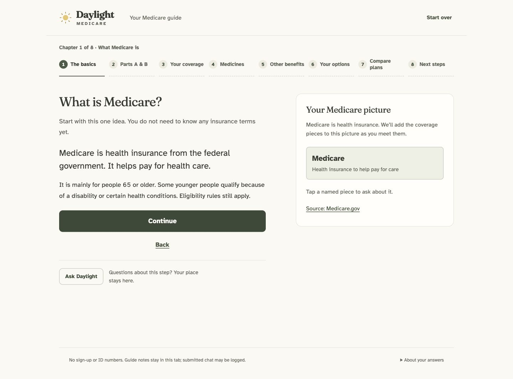

# Daylight repository and UI review — October 21, 2026

The conservative cleanup is complete. All original file content is retained; the active UI, backend, data, reports, release pointer and existing work remain unchanged. The selected release's pre-existing mismatch and incomplete consumer acceptance remain unresolved and visible.

## Scope and authority

Read `AGENTS.md`, `PRODUCT.md`, and D01–D38 before work. Recorded owner requirement **D39**: no deleted files/data, no broken or redesigned UI, preserved existing work, archive history with rollback evidence, and leave commit/push/publish to the owner. The cleanup also preserves D01/D02 content, D21 behavior, D23 data/privacy gates and D24 verification limits.

Used the Impeccable audit guidance for bounded UI/source inspection. Its initial context-launcher fallback path was unavailable, so existing product/requirement context was read directly. No automated design detector result or accessibility certification is claimed. No external upload, model request, source refresh, inquiry, release selection, commit, staging, remote change or push was performed.

## Inventory and organization

Initial HEAD: `cbb19332fd4c7453559659a8d77f8440d5e3d024` on `main` (see the local Git baseline for the authoritative full value). The repository initially had 17 modified tracked paths, 156 tracked files, 802 untracked files and 4,148 ignored files. It contained **5,106 project files**, **434 directories**, **7,408,319,313 logical bytes** outside `.git`, including caches and ignored data. Inventory read errors: zero. `.git` itself is excluded from content hashing; HEAD/status/diff/staged state were separately captured.

| Change | Paths / treatment |
| --- | --- |
| Five genuine historical-document moves | Root `DAYLIGHT_AESTHETIC_PLAN.md`, `DAYLIGHT_DESIGN_BRIEF.md`, `DAYLIGHT_LEVELS_PLAN.md`, `DAYLIGHT_GUIDE_REDESIGN.md`, `DAYLIGHT_JOURNEY_PLAN.md` → `docs/archive/product-history/`; only relative navigation links adjusted where needed |
| Five edited originals | Root `README.md`, `PRODUCT.md`, `DAYLIGHT_REQUIREMENTS.md`, `.gitignore`, and `cms-slice/README.md` |
| Current synthesized guides | `docs/README.md`, `ARCHITECTURE.md`, `DEVELOPMENT.md`, `DATA_INVENTORY.md`, `CURRENT_STATUS.md`, `GIT_READINESS.md`, `REPOSITORY_ORGANIZATION.md` |
| Review/preservation additions | This report, migration ledger, full local manifest/Git checkpoint, exact before-images, verification/rollback scripts, logs, source/gate checks and local browser screenshots |
| Retained in place | All active app code/assets/fonts, scripts/config/tests/fixtures, source registries/raw data, evidence reports, collector STOP, releases/pointer, original v1.2 bundle, audit outputs, scratch/tool environments, and action/current operational plans |

The older action/dependency plans remain in place because existing evidence and a hashed historical audit refer to them. Other historical docs are grouped by date/topic through the new index rather than moved away from their relative consumers. The [one-page objectives PDF](../../planning/collier-mvp-2026-10-21/collier-mvp-plan.pdf), HTML and supporting files remain unchanged and prominently linked.

The [migration ledger](migration-ledger.json) records original/new paths, before-images, original hashes, Git classification and reasons. These five plans were initially untracked, so Git's diff against HEAD cannot recognize them as renames; the ledger and hashes establish the moves. Original bytes are available in `archive/cleanup-2026-10-21/originals/`. Full original manifest/status/diff/lists are in ignored `archive/local-checkpoints/cleanup-2026-10-21/`, also protected by a nested ignore rule.

## Retention and diff evidence

[Retention verification](retention-verification-final.json) checked every original hash, including ignored data and symlinks: **5,096 unchanged at original paths, five edited versions preserved before editing, five moved originals preserved; zero failures; zero original directories missing.** All original content is accounted for. This does not duplicate or promise a backup of the entire 7.4 GB; unchanged data is retained in place and still needs an independent backup.

No pre-existing app/backend/test edits were overwritten. The [final scope check](final-scope-check.json) confirms unchanged HEAD/index/remote configuration, no tracked deletions, and unchanged original runtime/config/test hashes; the full retention checker covers all remaining source/evidence bytes. `git diff --check` passes. A tracked-only diff does not represent all the user's work, and changes against HEAD include the existing work from before this sweep.

## Baseline and final verification

| Check | Before | After / interpretation |
| --- | --- | --- |
| Python suite (`unittest discover -s cms-slice/tests -v`) | 201 pass, 87.394 s | 201 pass, 87.395 s; includes temporary release build/bundle, actual source cases, HTTP and admission tests |
| Current frontend regression tests | 54 pass | 54 pass |
| Archived prototype tests | 22 pass | Original package byte-preserved; historical component only |
| WP1 source/code/config/report hash verifier | Pass | Pass |
| JavaScript syntax check | Pass | No runtime changes; final check pass |
| Selected release `verify current` | Fails: runtime differs, first report `apps/chat/app.js` | Same failure; independent check finds `app.js`, `index.html`, `styles.css` differ from selected release runtime hashes |
| Selected-release data hashes | Separate read-only check | Every listed packaged data file matches its manifest; 61 network files intact |
| Actual consumer HTTP gate | Suite coverage | Separate loopback server: status pending, model absent, catalog count zero; catalog/live/conversation/resources return 503 without facts |
| Current documentation links | Checked during preparation | 146 current navigation links pass the [final link check](documentation-link-check.json); historical before-images intentionally retain original source context |

The active app has no npm/frontend compile step. Portable-release tests exercised build and bundle in temporary locations; no active build/select was used to force a green result. Tests use temporary disposable fixtures, while all original repository file bytes were verified afterward. [Python before](python-baseline.log), [Python after](python-final.log), [frontend before](frontend-baseline.log), [frontend after](frontend-final.log), [WP1](cms-verify-baseline.log), [prototype](prototype-baseline.log), [data checks](data-state-check.json), [HTTP gate](http-gate-check.json).

## UI walkthrough and equivalence

Used isolated agent-created Chrome tabs, leaving existing user tabs and the running static server on 8766 alone. Checked **desktop 1440×1000**, **tablet 834×1112**, and **phone 390×844**. Temporary viewport overrides were reset. The added synthetic fixture server and actual pending-gate test server used separate loopback ports and no model credentials. Both review servers were stopped after verification; the owner’s 8766 preview remains running.

| Flow | Observed outcome |
| --- | --- |
| Arrival → beginner start | One header identity; clear guided route and experienced shortcut; starts with Medicare itself |
| Caregiver beginner path through all eight chapters | Recipient → goal → ZIP/county → unknown A/B → job coverage → unknown birth timing → unknown medicines/extras → priorities → routes → Medigap → options → unavailable comparison → final checklist |
| Progressive teaching | A/B, Part D, costs, routes and Medigap arrive at their respective steps; complete picture is not shown to a newcomer at the start |
| Fresh questions and unknowns | No personal answer chosen in advance; Continue requires relevant input; unknown/failed work remains marked as needing attention |
| Contextual help | Named piece opens literal question and source-linked answer; follow-ups visible; Return to guide restores place; unsent synthetic draft survives reopening |
| Keyboard/focus sample | Tab from Return to guide moves to visible follow-up inside help; automated tests separately cover inert guide and return release |
| Static experienced shortcut | Takes required recipient/location inputs, skips beginner teaching, preserves unentered answers as unknown; API unavailable notice/retry and official fallback stay explicit |
| Synthetic catalog only | Seven invented records load; MA-PD filter shows four; premium order A/C/B/D puts conflict D after known values; two saved records compare correctly; final checklist lists records as saved, not enrolled |
| Failure and checklist | Failed comparison is explicitly blocked; checklist asks for unresolved facts and does not infer Part B dates or personal fit |
| Phone controls | Inspected coverage state has scroll width = viewport width (390 px); sampled visible input/button targets are at least 44 px high; choices are 62 px and Continue 60 px high |

The [capture comparison](ui-equivalence.json) shows **byte-identical before/after screenshots** for desktop arrival, desktop basics and phone coverage. Tablet location captures were inspected as visually equivalent, with differing JPEG bytes; no pixel match is claimed there. Every original frontend file/asset is unchanged by the cleanup. Browser error log reads returned empty for the inspected static/synthetic tabs; HTTP service availability was checked separately.

### UI technical assessment

The implementation expresses a coherent, product-specific guide: sequential teaching, warm established typography, explicit actions, sources/unknowns, and focused help. No UI redesign or polish was applied.

| Dimension | Provisional score | Evidence and limit |
| --- | --- | --- |
| Accessibility | 3/4 | Real headings/labels, focus treatment, sampled keyboard/help behavior and generous targets. Full contrast, screen-reader, zoom and real older-user testing not performed. |
| Performance | 3/4 | Plain static app, self-hosted fonts/assets, no frontend dependency bundle. No benchmark under slow devices/networks. |
| Responsive design | 3/4 | Three sizes, no observed page clipping/overflow in inspected states; narrow layouts remain long. Real iPad/touch hardware and all branches untested. |
| Theming | 3/4 | Established light palette and CSS tokens are coherent; legacy overrides remain. No dark-mode requirement or new theme introduced. |
| Implementation integrity | 3/4 | Progressive content, explicit controls and factual/service boundaries intact. Release/runtime mismatch predates cleanup; source-only paths preserved. |
| Total | 15/20, provisional | Bounded review judgment, not WCAG certification or owner/participant acceptance |

No verified P0/P1 UI regression was introduced. Two **P2 review concerns** remain: caregiver goal/priority labels still use some first-person wording (`Understand my choices`, `Keeping my current doctors`) despite a third-person recipient; and the phone's eight-chapter navigation plus explanatory content creates substantial scrolling before Continue on longer questions. The latter must be tested with older participants rather than “fixed” by deleting content or crowding controls. Sources: `app.js` recipient/goal/priority screens and `styles.css` journey/task layout, observed in phone walkthrough. No WCAG violation is asserted from those observations alone.

If the owner later requests interface work, use `$impeccable clarify` for caregiver wording and `$impeccable adapt` for measured phone issues, then `$impeccable polish` after evidence-backed fixes. Preserve D07/D09 breathing room and D01/D02 content. A new audit or test score must not substitute for formative sessions.

## Data re-verification and release risk

The [read-only data check](data-state-check.json) reloaded current verified workspace evidence: **70 records, 61 drug-bearing plans, 61 packaged networks, 24 rating contracts**. Every selected-release data hash matches. Ratings retain rated and official nonnumeric states. It also records all three frontend runtime differences from the selected release.

The saved validation packet has **2,036 required claims, zero accepted claims**, 1,680 core-benefit cells, 3,876 illustrative annual Medigap rows and zero confirmed clinical participation. Saved inquiry status is not a newly checked external response. Adequate personal 2027 pricing, Medigap form/date/rate replay, complete benefit/availability/participation validation and named Medicare acceptance remain open. The source checkpoint deadline `2026-10-21T01:33:00.069116+00:00` is past. Source capture and packaging are not consumer approval. The collector's saved HTTP 403 STOP was never cleared or retried.

The static UI preview is intentionally distinct from the actual Python service. The latter displayed validation pending on a separate test port and exposed no facts. Do not make deployment/readiness claims from the screenshots, temporary tests or source-shaped catalog.

## Git readiness and risks

No remote was configured. The requested GitHub URL was queried read-only after sandbox DNS was unavailable; the allowed read completed with no refs. No write-access test was performed. Reachable committed blobs were below 20 MiB, while `.git` has about 663 MiB of loose objects; no history cleanup was attempted.

The retained generated ZIP `outputs/daylight-audit-20261019/daylight_raw_audit_export_2026-10-19.zip` is 140,628,478 bytes and initially unignored/untracked. A narrow generated-ZIP ignore prevents accidental staging; nothing was deleted/untracked. Local checkpoint and design-hook local/cache files were also narrowly ignored. Source evidence is not blanket-hidden. A bounded local credential-pattern scan found no matching key strings in reviewed versionable text; `.env` exists and is ignored. This is not a binary/history/PII security audit.

Ignored multi-GB sources/releases and local logs will not travel with a normal push. Preserve them independently and inspect source redistribution/sensitive headers/binary exports before staging. See [Git readiness](../../GIT_READINESS.md). No GitHub action is blocked by this task; remote setup, staging selection, commit and push are intentionally left to the owner.

## Review and rollback

Start at [root README](../../../README.md), [docs index](../../README.md), and [organization guide](../../REPOSITORY_ORGANIZATION.md). Inspect the migration ledger and final retention result before staging. The baseline patch represents the user's earlier work and is private/local.

From repository root:

```sh
python3 docs/reviews/2026-10-21/verify_retention.py
python3 docs/reviews/2026-10-21/rollback.py
# Only after reviewing that dry run:
python3 docs/reviews/2026-10-21/rollback.py --apply
```

Rollback verifies before-images and unchanged HEAD, copies current cleanup-authored versions into a new timestamped local folder, then restores the five edited originals and five historical root paths. It leaves archived copies/new docs in place and never deletes, cleans, resets or changes Git. If HEAD changed, use the verified ledger/before-images for a reviewed manual copy-first restore. No rollback was applied to the real repository. The [isolated rollback simulation](rollback-simulation.json) restored all ten original documents, retained current/archive/new versions, protected the local checkpoint and refused a second application. A missing receipt-directory guard found in the first isolated attempt was fixed before the successful replay.

## Screenshots

Desktop and phone guide captures show actual unchanged UI. Catalog captures are conspicuously synthetic QA, not coverage facts.



[Desktop arrival before](screenshots/before-desktop-arrival.jpg) · [after](screenshots/after-desktop-arrival.jpg) · [tablet before](screenshots/before-tablet-location.jpg) · [after](screenshots/after-tablet-location.jpg) · [phone before](screenshots/before-phone-coverage.jpg) · [after](screenshots/after-phone-coverage.jpg) · [focused help](screenshots/before-phone-help.jpg) · [unknown checklist](screenshots/phone-beginner-unknown-checklist.jpg) · [synthetic catalog](screenshots/synthetic-desktop-catalog.jpg) · [synthetic comparison](screenshots/synthetic-desktop-comparison.jpg) · [synthetic final checklist](screenshots/synthetic-phone-next-steps.jpg) · [actual backend pending](screenshots/actual-backend-validation-pending.jpg).
