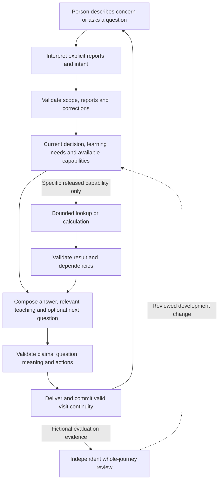

# Conversational capability and flow review for :8893

November 2, 2026 · D49/D50/D52/D54/D55/D57/D64/D73/D79/D86/D87

**Daylight has a useful conversational foundation. Its next improvement should make every turn serve an understandable decision: answer the current concern, teach the distinction that matters, and ask only for information the person can meaningfully supply.** Deterministic logic should govern factual authority, state changes and actions. Conversational judgment should govern explanation, pacing, clarification and which useful question comes next.

This review responds to the owner's request to examine conversational capability, project flow, agentic loops and deterministic gates, with dynamic conversation and education as the priority. It builds on the ongoing advisor and comparison work; it does not restart those programs. Recommendations below are proposals, not implemented changes or new acceptance. Application code, runtime, models, permissions, guest stores, budget and source releases were not changed.

## What the existing evaluation establishes—and misses

The pasted plan is a thorough inventory of interaction mechanics and proposed research. Its acknowledged limitations are sound. The decisive gap is that its strongest executed evidence concerns valid state transitions, preserved controls and selected successful captures. Those do not establish that Daylight chose the most helpful next question, resolved confusion or reduced the person's research burden.

The [final retained caregiver trace](../../../audit-evidence/advisor-curriculum-20261102/live-results.json) demonstrates correct helper/beneficiary separation, a direct Part B answer and a birthday correction without an invented year. It also asks **“When would she like Medicare coverage to start?” on all three turns**. The middle user message explicitly starts “Before I answer…”. Preserving the return point is useful; immediately presenting it again is not evidence that the user is ready to answer it. The current four quality criteria reward the former without evaluating the latter.

That opening introduces Original Medicare, Advantage, A/B, separate drug coverage and Medigap in one paragraph. The scripted test deliberately follows that overview with a Part B clarification. The opening carries substantial vocabulary; this trace tests responding to clarification but does not establish that the opening caused confusion. A shorter explanation can still be demanding if it introduces six unfamiliar labels, which remains a usability hypothesis to test with people.

The [curriculum evidence](../../../audit-evidence/advisor-curriculum-20261102/README.md) explicitly records three final-build live turns and no uninterrupted six-turn journey entirely on that final revision. Earlier failures and continued prefixes remain valuable diagnostic evidence. They should not be assembled into a final-build reliability result. No new paid model evaluation or human study was performed in this review.

## Five findings that should guide the next increment

### 1. Source references and phrase guards do not establish meaning

The composition validator checks allowed references, literal dates/amounts, selected personal-claim patterns and question keywords. Its own comment distinguishes these from semantic entailment. See [natural_agent.py](../../../alternatives/advisor-first/natural_agent.py), especially `_validate_composition_core` at line 1213 and `_valid_question` at line 1316.

Six network-forbidden probes used the full production validator, actual question constructors and the actual reviewed `basics` teaching fact, with fictional in-memory reports. [Script](probe_gates.py) · [results](gate-probes.json).

| Probe | Observed result | Implication |
| --- | --- | --- |
| Report says current coverage is `none`; generated sentence says “You currently have insurance through your employer.” and cites that report | Accepted | A valid report ID does not prove that the sentence agrees with its value. |
| “Medicare Advantage covers every doctor.” cites only the introductory “What Medicare is” fact | Accepted | An available citation does not establish support for the claim. This deliberately unsupported sentence is a test input, not advice. |
| “We may revisit this after you have had time to think.” | Rejected as an unsupported date/amount | Modal “may” can be treated as the month May. |
| “You can leave the application question for later.” | Rejected as an application finding | Ordinary conversational control can trigger a personal-claim guard. |
| A current eligible prescription question target, T07, carries “What kind of coverage do you have?” | Accepted | The displayed question can diverge from the field the service believes it is collecting. |
| T05 carries a coverage question followed by a prescription question | Accepted | A valid target does not enforce one coherent requested detail. |

These are **adversarial validator observations**, not generated model behavior or a measured production incident rate. They nevertheless identify a real boundary limitation with direct consequences for both trust and natural conversation.

Priority: preserve hard authority gates; improve value/claim and question/meaning contracts. Personal findings, amounts, dates and completed actions should come from typed, version-bound findings. Keep general education conversational, grounded in specific reviewed claims and qualifications. Evaluate semantic support independently; another reference field or model critic cannot guarantee it. For high-consequence capture, use a reliable short question core with a natural contextual lead-in until broader generated wording has demonstrated meaning preservation. Do not attempt to solve unrestricted language with an indefinitely growing keyword blacklist.

### 2. Question eligibility is stronger than question usefulness

[`eligible`](../../../alternatives/advisor-first/natural_flow.py) at line 430 previews conditional branches, adds baseline missing fields and supplies up to twelve candidates. This supports flexibility. It also means several valid fields can compete without a concrete representation of the immediate decision being helped. Composition starts its context and recovery question from the first candidate at line 646; validation failure can therefore leave a functional field prompt even though the person's explanation request went unanswered.

The brief already remembers goal, current concern, pending question and pause. Extend that idea cautiously with a bounded **current decision and unresolved obstacle**, derived from the user's concern and actual capability. For example: “understand which existing-coverage facts matter to timing,” rather than just “T04 is unanswered.” This is temporary conversational state, never a personal fact, comprehension score or newly saved record. Any added context must stay within the existing permission and token budget.

Choose questions by their consequence and answerability. Distinguish a missing fact, an unresolved preference, a misconception and unavailable external evidence. Each needs different help. If the person does not know their preferred start date, preserve that uncertainty and help organize the decision. More unrelated intake cannot resolve missing source authority.

### 3. The curriculum's anti-repetition gate is too coarse for adaptive teaching

[`plan_update`](../../../alternatives/advisor-first/education.py) at lines 235–243 permits `deepen` only from `introduced` to `explored`. A later useful aspect of the same broad concept cannot receive another deepening receipt. A current clarification using `reason="clarify"` also requires a previous `needs_clarification` flag; a validated clarification request on the current turn alone does not satisfy that branch.

The [reproducible education probes](probe_education.py) show introduced/new and explored/deepen accepted, a third explored/deepen rejected, and an immediate current clarification rejected with its visual suppressed. [Results](education-probes.json). These checks inspect metadata only. **The explanation normally survives; the learning receipt and contextual visual can be lost.** They do not prove that a particular model explanation contained useful new depth.

Keep separate records for sources, delivered teaching and visual intent. Allow immediate clarification supported by the current request. Represent a bounded teaching aspect or question answered within a concept so that additional useful depth can be distinguished from repeated introductions. Preserve explicit revisits and correction invalidation. Exposure must never become mastery, and the concept map must never become a syllabus to finish.

### 4. Continuity needs a useful return, not repeated prompting

Current [visit memory](../../../alternatives/advisor-first/advisor_memory.py) retains six exchanges, up to 5,000 dialogue characters, with a one-hour TTL. The brief and learning record survive within that visit separately from the rolling text, but they are also temporary. This is a deliberate privacy boundary.

A return point should preserve the unresolved work without obliging Daylight to repeat the same question after each educational answer. Re-engage when the explanation has addressed the obstacle or the person signals readiness. An answer-only turn can be successful. A correction may need only a brief acknowledgment and an adjusted next step. A useful pause is also progress when chosen by the person.

Long-journey evaluation must cross the six-exchange boundary and separately test expiry/restart. Do not solve continuity by silently saving raw dialogue or expanding the existing AI permission.

### 5. The research part of the vision still needs an executable, authorized loop

Current :8893 is a bounded conversational controller: interpret, resolve reports, compose and validate. [`comparison_service.context_status`](../../../alternatives/advisor-first/comparison_service.py) at line 120 supplies held capability markers, with personal findings and completed research false. Composition has no authorized plan-research tool loop. That is an accurate boundary, and no prompt improvement can create the missing authority.

Continue the already active D87 work. When a specific capability is released, connect a narrow request → dependency check → exact lookup/calculation → validated receipt → explanation loop. Bind every result to the person, report revision, source scope, method and permitted purpose. Corrections invalidate only dependent work; source STOP and deletion invalidate authority immediately. An unresolved lookup yields a concrete next step, not an invented answer or a reason to collect every remaining field.

## The conversational design to aim for

The person should experience one coherent advisor. Internally, preserve three distinct loops:



**Conversation loop:** answer the actual concern; infer what explanation may help; capture clear volunteered facts; select a consequential next move; preserve a usable return point. Teaching and asking can share a turn, but neither is compulsory on every turn. Adapt to explicit requests for depth and demonstrated topic-specific confusion without inferring intelligence, preference or mastery.

**Research loop:** pursue a defined user-relevant question through approved tools. Independent read-only work may run together where supported. Stop when the requested result is established, a user fact is necessary, evidence conflicts, permission/purpose is missing, or the authorized resource bound is reached. A tool receipt establishes execution; generated prose does not. This is a future consumer integration, not current permission to expose research rows.

**Development loop:** freeze a build, run complete fictional journeys, inspect each divergence, fix its cause, then rerun the affected full journey plus a held-out variant. Use independent assessments to challenge the outcome. Do not make every consumer turn run through multiple competing model agents. Retain two typed-message stages, at most one finite-answer composition, and no automatic paid repair/retry. This review does not expand any tool or spending permission.

## Put deterministic gates at the appropriate boundaries

| Boundary | Deterministic responsibility | Conversational freedom |
| --- | --- | --- |
| Capturing reports | Person/time/item scope, provenance, supported values, conflict/correction handling | Recognize ordinary phrasing and multiple volunteered facts; clarify material ambiguity naturally |
| Asking | Approved meaning, dependencies, unknown/deferred state, exact item | Choose which eligible uncertainty matters now; explain why; permit answer-only turns |
| Teaching | Reviewed source scope, qualifications, valid delivery metadata | Choose an example, analogy, depth and relevant visual; re-explain differently when needed |
| Research or calculation | Permission, input sufficiency, exact source/method/purpose, result validity | Explain what can be established and which missing detail would change the answer |
| Personal comparison | One end confirmation of material decision inputs plus independent evidence/method authority, following the [November 2 owner clarification](../../planning/ARCHITECTURE_ALIGNMENT_AND_IMPLEMENTATION_2026-11-02.md) | Help the person inspect tradeoffs, reconsider priorities and ask follow-ups |
| External action | Named action authorization, current revisions, recipient and receipt | Explain the choice and preserve context; saving or AI permission never authorizes sharing/enrollment |

Do not gate education on completing intake, treat every missing field as required, infer comprehension from a lesson, or use unknown external evidence as poor fit. Commercial economics stay outside questions, retrieval, explanation and substantive decisions.

## An illustrative journey that would express the vision

This is a product-design example, not an executed transcript or personal Medicare guidance. Substantive teaching must use the reviewed material; personal conclusions remain held until the relevant capability is accepted.

| Person's move | Desired Daylight behavior |
| --- | --- |
| “I'm turning 65, have insurance through work, and I'm lost.” | Give a small orientation tied to the concern. Ask whose job supplies coverage if that remains unknown. Do not ask the person to choose a coverage path before understanding it. |
| “Before that, what is Part B?” | Answer directly with one useful example. Preserve the worker question internally; allow the answer room without immediately repeating it. |
| “So it replaces my work insurance?” | Address the specific misconception with reviewed evidence and conditions. Do not record an intention to replace coverage. |
| “It's through my spouse. The job and insurance end at different times.” | Capture the relationship and distinct dates when supplied. Ask only for a consequential missing detail; explain why the dates differ in the decision. |
| “I don't know when Medicare should start.” | Accept uncertainty. Help identify what must be established; do not force a preferred month or invent a personal date. |
| “Keeping my specialist matters most.” | Connect the priority to a relevant coverage-path tradeoff. Gather provider detail for a defined supported task and state accurately whether a check is available. |
| “Actually, that date was wrong.” | Correct the report, invalidate affected conclusions, preserve unrelated learning and work. Explain a practical implication only when supported. |
| “What should I do next?” | Provide a short useful outcome: what is established, the remaining decision/check and a concrete supported next action. Before a requested personal comparison, use the owner's single editable end summary and confirmation. |

Possible successful endings include useful understanding, a prepared question for an employer, a verified finding when authorized, a decision to keep coverage, or an intentional pause. A full profile and enrollment are not universal success criteria.

## Replace the success criterion in the evaluation loop

Keep the existing regression suite as engineering protection. Add a small **decision-quality journey set** with independently authored acceptable outcomes, forbidden inferences and multiple valid routes. Avoid requiring an exact next field when several moves would serve the user.

Start with these fictional families: first transition with job coverage; uninsured caregiver case; experienced user asking a specific question; repeated confusion/requested re-explanation; unknown desired start; several volunteered facts followed by correction; provider-priority question with held research; pause and return across the memory boundary. Include both typing and finite-answer Send.

For each journey, prewrite: the user's actual goal; consequential facts and misconceptions; questions that would be premature; minimum teaching needed; valid stopping points; and claims/actions forbidden under current authority. A simulated user must respond to the actual displayed question and may remain confused, decline or correct. A fixed answer script can accidentally rescue a poor advisor.

Score answer relevance, educational usefulness, question consequence/answerability, continuity/control and useful outcome using concrete anchors: **0** harmful or materially wrong, **1** largely missed, **2** partly useful with avoidable burden, **3** useful and coherent, **4** useful and well adapted. Score trust separately as a non-compensable boundary: wrong-person facts, unsupported personal findings, unperformed actions and unauthorized transfer cannot be averaged away. Do not call simulated comprehension measured human comprehension.

A stuck episode is repeated pursuit of the same obstacle without added help, accepted uncertainty, new evidence or a user-requested revisit. Returning to an unanswered question is not automatically stuck; continuing to ask for a choice the person cannot yet make is the problem. Measure unnecessary asks and repair turns against meaningful outcomes, not raw conversation length.

Record two results for every affected turn: **what the model proposed** and **what the person actually received after gates**. This isolates interpretation, selection, evidence retrieval, composition, validation and rendering failures. Include permitted context size/packing, elapsed stage times and actual cost. For real users retain only separately authorized, minimized diagnostics; fictional evaluation transcripts can carry the detailed artifacts.

Run free boundary and controlled-journey checks first. Use a pre-costed, small live batch for the remaining model-dependent uncertainty within the unchanged aggregate allowance; reserve for every stage and stop on budget/error without retries. Freeze source/prompt/model/evidence configuration for each run. If a failure is patched, that journey begins again on the new build; a prefix replay is diagnostic evidence with its own label. Include a held-out paraphrase and a complete journey long enough to cross six exchanges. Exhausting the evaluation budget leaves the broader quality claim unproven.

A concrete first evaluation card can use seven semantic events: novice opening; confusion about how the two paths relate; doctor/travel priority; explicit timing deferral plus a medicine question; a misconception about costs or participation; a birthday correction and requested synthesis; then “enough for today—one next step, no more questions.” Keep at most fourteen existing generation stages for that bounded experiment. Adapt responses to the actual conversation using the prewritten fictional persona policy. Proposed success requires the defined educational milestone, no critical boundary failure or stuck episode, and at least 3 on every quality dimension; it is not an implemented release rule. A seven-turn script can probe continuity but cannot establish reliability across the audience.

Once the engineering behavior is stable, observe first-time Medicare users explaining the relevant distinction and next step in their own words, alongside effort, corrections and retained control. Compare with the excellent adaptive experience already specified in D73 using equivalent evidence and tasks. The present review establishes no consumer comprehension or comparative superiority.

## Recommended sequence within the ongoing project

1. **Repair the specific conversation boundaries.** Address the demonstrated value/citation and question-meaning gaps, harmless-language false rejections, and immediate clarification/depth metadata. Close each with independent positive and negative examples and a complete affected journey. Do not weaken source or recommendation holds.
2. **Refine question selection around the current decision.** Use a bounded working objective and obstacle, existing conditional meanings and actual capability. Demonstrate unknown, confusion, correction and answer-only branches without a fixed curriculum or extra routine model stage.
3. **Connect the already authorized D87 work at the capability boundary.** Keep internal research and consumer authority distinct; preserve the single end confirmation. Teach and prepare useful next actions while personal findings remain held. Continue complete L03 work against its unchanged denominator.
4. **Accept exact demonstrated behavior.** Review frozen-build journeys and then observed user outcomes. Technical agent agreement, source inventory counts and regression totals each retain their limited meaning.

The first useful milestone is a complete, coherent newcomer journey that reaches a worthwhile outcome through a detour, uncertainty and correction, while the critical boundaries stay intact. This is achievable as a focused refinement of the current surface and controller; it needs no visual redesign or additional questionnaire.

## Scope, provenance and D73 review

Three agents independently examined conversational flow, evaluation evidence and deterministic gates; the primary reviewer synthesized and checked the findings. The work used the local impeccable skill for interaction-review guidance. This is a source/transcript review with narrow probes, not a complete visual or accessibility audit. The full regression suite was not rerun because application code was unchanged.

The source manifest records inspected implementation bytes. Retained live transcripts belong to their documented earlier execution revisions; they do not certify every currently running file. Probe outcomes establish the narrow boundaries exercised, not overall failure frequency.

The independent interaction/evaluation assessment ran the impeccable source detector against `alternatives/advisor-first/web`: exit 0, `[]`, zero findings. It inspected only the landing screen in a fresh 1280×720 background browser tab and closed the tab without starting a visit or submitting data. Mutable script injection was unavailable, so no live detector overlay/server was started. No ignore file was present, and no browser temporary files required cleanup. Source scan plus native screenshot/accessibility-tree inspection was the fallback. This offers no additional evidence of dynamic conversation, responsive journey behavior or accessibility conformance; heuristic quality scores are intentionally not inferred from that landing-only view.

Reproduction uses only fictional memory and blocked network/model transport:

```sh
PYTHONDONTWRITEBYTECODE=1 python3 docs/reviews/2026-11-02-conversation-flow/probe_gates.py
PYTHONDONTWRITEBYTECODE=1 python3 docs/reviews/2026-11-02-conversation-flow/probe_education.py
```

[Source snapshot](source-manifest.json) records a bounded set of inspected dependencies, not a complete transitive build manifest. These diagnostic programs expose the present behavior; they are not passing regression tests asserting that behavior is desirable.

| D73 item | Review outcome / remaining gap |
| --- | --- |
| Useful task and comprehension | Concrete journey and learning failures identified; actual human understanding remains unmeasured. |
| Consequential intake | Questions tied to an immediate decision; all 41 meanings stay conditional, with unknown/defer and free education preserved. |
| Paths before policies | Teach relevant distinctions fairly and progressively; no ranked or personally recommended plan introduced. |
| Input and external gates | End-confirmed inputs and accepted evidence/method/purpose remain independent requirements. |
| Independence and challenge | No commercial input added; corrections, unknowns, conditions and inspectability remain binding. |
| Permission and control | No saving, AI-context, sharing, action or budget expansion; temporary continuity is not durable recall. |
| Actual capability | Current dialogue separated from held consumer research; adversarial probes separated from live model observations. |
| Proof and stage | Proposed whole-journey and human evidence remain future work; this review grants no consumer/source release. |
