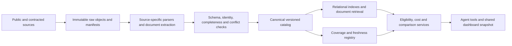
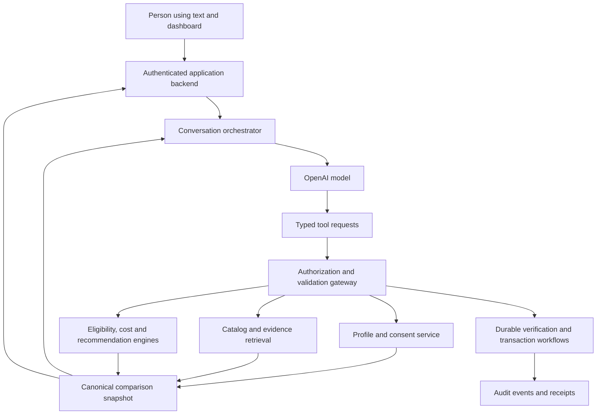

# Aphrodite — autonomous Medicare guidance through text

Version 0.1 · October 16, 2026 · implementation design and evaluation plan

## 1. Product decision

Build a free-to-consumer Medicare navigation service with a persistent AI advisor as the primary interface. A person can begin immediately through text, learn at their own pace, establish their circumstances, compare suitable coverage, make an informed choice, authorize supported transactions, and receive continuing service. No scheduled sales call or human insurance advisor is part of the intended consumer journey.

The initial customer is a Medicare beneficiary or person approaching eligibility who prefers immediate digital help. A caregiver may participate with appropriate permissions. Multilingual guidance is a candidate distribution advantage, validated language by language. Age alone is not a proxy for digital skill or capacity.

The ambition covers the scope of a comprehensive Medicare brokerage: broad comparison, accurate provider and prescription checks, Medicare Supplement quotes, eligibility and switching guidance, enrollment, and year-round advocacy. “Chapter competitor” describes target capability, not access to Chapter's proprietary systems or proof of equivalent accuracy. Chapter publicly describes advisor copilots and real-time workflow support; these are useful capability references, not an architecture specification we can reproduce directly. [Public technical account](https://mastra.ai/customers/chapter), [Chapter's description of its data pipelines and service](https://askchapter.org/magazine/chapter-and-you/medicare-resources/chapter-vs-other-medicare-agents).

**The fundamental architecture:** a conversational agent operates verified software tools over a versioned insurance data platform. The model does not memorize a national catalog, calculate insurance benefits from prose, invent a quote, or turn a confident sentence into transaction authority.

## 2. Deliverables and present implementation

This directory contains a buildable starting point, not the finished brokerage.

| Component | Delivered now | Production work required |
|---|---|---|
| Consumer workspace | Text conversation, profile review, plan cards, comparison, evidence detail, larger text | User research, localization, accounts, adaptive onboarding, production accessibility audit |
| OpenAI wrapper | Responses API tool loop, fixed prompt, subordinate experiment prompt, structured answer, bounded execution, usage and trace export | Streaming, durable workflow/state, policy enforcement, operational telemetry and provider agreements |
| Plan engine | Deterministic comparisons over five fictional coverage options; costs, exclusions, missing-data gates | Licensed/current data, complete benefit simulation, regulatory rules, real quotes and verification |
| Evaluation | Offline contract checks, scenario runner and opt-in live model runs | Expert-labeled cases, independent suitability/comprehension review, statistically powered consumer testing |
| Data ingestion | Canonical-record validator and example manifest | Source-specific adapters, credentials, procurement, reconciliation, national coverage registry |
| Transactions | No real submission, cancellation, provider contact, payment or beneficiary-data integration | Approved carrier/agency arrangements, authenticated user authorization, receipts, reconciliation and legal authority |

The prototype uses fictional people, doctors, drugs, identifiers, products and prices. The scope banner is always visible. “Checks complete” means only stipulated checks in a fixture. The replay is scripted and cannot substantiate model capability. No API key is included. Real health information must not be used in this prototype.

## 3. The autonomous-service constraint

The product objective is **no human insurance agent in the consumer workflow**, including hidden routine recommendation work. Human engineering, data-quality, security, legal and independent evaluation work remain normal company functions. They must not be represented as automated customer fulfillment.

This objective is not a claim that an LLM can hold an individual producer license or that an agency license grants software unrestricted authority. CMS describes state licensing, annual training/testing and marketing requirements for Advantage/Part D agents. Some states regulate recommendations and comparisons themselves; Florida expressly includes them in purchase-directed solicitation. Establish an affirmative, written operating basis for the actual autonomous workflow, by state and product, before public recommendations or transactions. [CMS](https://www.cms.gov/medicare/health-plans/managedcaremarketing/copy-1-of-agentbroker), [Florida §626.112](https://www.leg.state.fl.us/statutes/index.cfm?App_mode=Display_Statute&URL=0600-0699/0626/Sections/0626.112.html).

The application enforces a jurisdiction/product capability registry: `education`, `personalized_comparison`, `recommendation`, `prepare_application`, `submit_application`, `service_action`. Each entry identifies its authority basis, carrier agreement, approved interaction/disclosures, effective dates and owner. Unapproved actions remain unavailable. If a jurisdiction requires a human activity we cannot remove, autonomous launch there is blocked until a lawful model exists. Do not quietly add a human advisor and keep advertising the autonomous promise.

Independent qualified reviewers may evaluate synthetic/consented research cases. That does not establish permission to provide the same service commercially. General education, personalized advice, enrollment, post-enrollment service and clinical advice are separately assessed activities.

## 4. Core journeys and state

1. **Start and understand.** Answer an educational question immediately. Identify whether the person is researching, newly eligible, retiring, switching, moving, losing coverage, or resolving a problem. Collect location, relevant dates, current coverage and priorities progressively.
2. **Establish the right decision context.** Resolve geography and target coverage year/effective date. Determine relevant eligibility, election opportunities and switching rights from executable rules. Explain existing-coverage consequences before proposing change.
3. **Build a confirmed profile.** Match doctors, facilities, medicines and pharmacies. Offer editable confirmation cards. Retain permissioned context rather than asking the same questions repeatedly.
4. **Compare structures and options.** Explain Original Medicare and available supplement/drug combinations, Advantage options, and keeping current coverage. Identify candidates, calculate comparable spending scenarios, verify essential access and present tradeoffs.
5. **Obtain informed selection.** Present a short written decision summary, material restrictions, uncertainty and consequences. Use a short teach-back question if a critical tradeoff remains unclear. Record the person's choice, not an inferred model choice.
6. **Complete supported enrollment.** Revalidate quote and eligibility, collect required details through secure fields, preview the exact application, obtain explicit transaction authorization, submit once, reconcile requirements and acceptance, then verify effective coverage.
7. **Provide continuing service.** Explain letters and bills, track application problems, assist with administrative coverage issues, detect meaningful annual/provider/drug changes, and support authorized updates. No unsolicited plan switch.

Conversation state is distinct from decision and transaction state. Suggested decision states: `exploring → profile_incomplete → profile_confirmed → comparing → verification_pending → decision_ready → selected`. Transaction states: `not_started → application_draft → awaiting_user_authorization → submission_pending → submitted → additional_information_required → accepted_pending_effective_date → coverage_effective`, with explicit `rejected`, `withdrawn`, `cancelled`, `unknown` and `failed` branches. A chat message cannot transition a transaction by itself.

The consumer can skip optional questions, pause, resume, correct information, request deletion/export, compare another structure, or decline a recommendation. Unsupported situations produce useful education and a specific limitation, without pretending the task was completed.

## 5. Define “25,000 options” before ingestion

Treat approximately 25,000 as a planning reference from the competitive discussion, not an audited plan count, a fixed annual constant, or the number available to one person. A count can refer to products, geographic offerings, segments, rate combinations, or bundles. Publish our own taxonomy and measured coverage.

Model these entities separately:

- **Carrier/organization** and legal issuer identifiers.
- **Plan version:** contract, PBP, segment and benefit year for applicable MA/PDP products; standardized benefit type, issuer, state and policy/rate-form version for Medigap.
- **Service area:** county/FIPS, state, region, ZIP mapping, plan-specific residency restrictions and effective dates. A ZIP can span counties; ask rather than choose arbitrarily.
- **Rate cell/quote:** a profile-dependent premium, quote ID, inputs, discounts, assumptions, validity and underwriting status. A quote is not a new universal plan.
- **Coverage option:** an individual plan or compatible bundle. Original Medicare + Medigap + PDP is a bundle, not a single MA-like record.
- **Network, formulary, pharmacy schedule, benefits, document and enrollment channel**, each independently versioned.

Define exclusions explicitly: employer/union group plans, PACE, certain special arrangements, closed products and products unavailable to new entrants. Include D-SNP/C-SNP/I-SNP only when their additional eligibility and service constraints are implemented. The initial product may cover fewer categories; report the limitation before selection.

For each market/year, record `expected_products`, `discovered_products`, `parsed_products`, `quotable_products`, `provider_verifiable_products`, `recommendable_products` and `enrollable_products`. Track counts by category, issuer and geography. “We compare broadly” and “we can enroll you in this plan” are separate claims. No “all plans” claim until reconciliation proves the stated scope.

## 6. Source strategy and procurement

Use a public-data foundation plus contracted current feeds. No single source is assumed to provide complete national Medigap rates, verified networks, drug pricing, eligibility and enrollment.

| Domain | Starting sources | Limitation and procurement decision |
|---|---|---|
| MA/PDP universe and benefits | CMS landscape, PBP benefits, service areas, crosswalks and ratings | Normalize each year's schema; distinguish marketed options from eligibility and enrollment availability. CMS publishes 2027 landscape and PBP JSON resources. [Landscape](https://www.cms.gov/medicare/coverage/prescription-drug-coverage), [PBP](https://www.cms.gov/data-research/statistics-trends-and-reports/medicare-advantagepart-d-contract-and-enrollment-data/benefits-data/pbp-benefits-2027-json) |
| Drug formularies and pharmacy data | CMS monthly formulary/pharmacy files; quarterly pricing; licensed current feeds | Public files are not a guaranteed real-time pharmacy-specific quote. CMS methodology notes biweekly MPF price/network changes can differ from published snapshots. [Dataset](https://data.cms.gov/provider-summary-by-type-of-service/medicare-part-d-prescribers/monthly-prescription-drug-plan-formulary-and-pharmacy-network-information), [methodology](https://data.cms.gov/sites/default/files/2025-10/cf6b8476-ca42-48c6-9fc4-281b08c6ea87/Methodology-SPUF-2026.pdf) |
| Medigap rates and underwriting | Licensed aggregator such as CSG; carrier-specific verified supplements and quote endpoints | Confirm carrier/state/form completeness, household discounts, rate history, API rights and autonomous-consumer use. CSG advertises rate, feature and underwriting access through an API. [CSG](https://www.csgactuarial.com/quoting) |
| Drug vocabulary | NLM RxNorm/RxNav | Identity normalization, not a coverage or price source. Preserve strength/form/route and brand preferences. Confirm API terms and any vocabulary exceptions. [NLM](https://lhncbc.nlm.nih.gov/RxNav/APIs/RxNormAPIs.html) |
| Provider identity | NPPES/NPI, practice directories, user confirmation | NPI identifies a provider; it is not a plan-network assurance or proof of new-patient availability. [NPI registry](https://npiregistry.cms.hhs.gov/api-page) |
| Provider-plan access | Carrier directories/APIs, licensed network data, practice/carrier confirmation | Obtain location- and plan-specific records; preserve conflicting answers. Chapter's public provider API describes such queries but access to it is not assumed. [Chapter API](https://providers.docs.askchapter.org/apis) |
| Benefit documents | Carrier EOC, Summary of Benefits, ANOC, formularies, policy certificates and underwriting PDFs | Original documents are authoritative evidence within scope; parsing and documents can still conflict. Record page/section and effective date. |
| Shopping/transaction integrations | Evaluate ConnectureDRX, SunFire and direct carriers | Contracted API access is a candidate, not secured access. Connecture advertises shopping, quoting, enrollment and dosage-specific cost estimates; negotiate actual endpoints, market coverage and consumer-agent rights. [Connecture APIs](https://www.connecture.com/apis/) |
| Beneficiary history | Optional CMS Blue Button, supported payer FHIR APIs, uploaded documents, direct entry | Consent and production approval required. Confirm current API version, scope, access duration, claims completeness and lag rather than assuming the API is a complete clinical record. [CMS documentation](https://bluebutton.cms.gov/api-documentation/) |
| Medicare/state policy | CMS/Medicare, state insurance departments and approved legal rule sources | Executable, dated rules with jurisdiction and product scope; general web search is not the rule engine. |

Procurement checklist: geography/carrier counts, latency and freshness guarantees, source-of-truth definitions, known omissions, historical snapshots, change notifications, sublicensing/display/LLM-processing rights, storage/cache limits, derived-data rights, autonomous use, downstream auditability, subcontractors, PHI obligations, incident notice, exit/export rights and cost at peak traffic. Do not mistake a vendor's represented-carrier feed for complete market coverage.

Do not automate a protected carrier or government portal without permitted access. Do not use users' passwords, defeat access controls, or assume undocumented website calls are a public API. Procurement and approved integrations are product dependencies, not chores deferred until after the UI works.

## 7. Ingestion and publication pipeline

1. Register a source with owner, agreement, access method, version, effective scope and expected cadence. Download to isolated raw storage with content hash, byte count, manifest and retrieval timestamp. Separate content effective time from ingestion time.
2. Parse structured files deterministically. Use OCR/table extraction and schema-constrained LLM extraction only where necessary for documents. Extraction produces proposed facts with exact provenance, not immediately published truth.
3. Preserve source codes and leading zeros. Normalize monetary values to integer minor units with currency; retain precision for unit drug prices using decimal arithmetic. Distinguish zero, unknown, absent and not applicable.
4. Match canonical identities using stable keys and explicit crosswalks. Never fuzzy-merge plan identities. Fuzzy matching can produce candidates for user-confirmed drug/provider identity, not silent matches.
5. Validate referential integrity, plan years, service-area joins, tier/cost-sharing codes, date ranges and duplicates. Compare counts and meaningful value changes with previous releases. Reconcile against source manifests and secondary feeds.
6. Quarantine missing critical fields, invalid amounts, unexplained mass deletions, conflicting premiums and unexpected schema changes. Publish unaffected partitions only if their dependencies remain coherent.
7. Create an immutable catalog release with source/version map and validation report. Promote an atomic release pointer. A rollback restores a whole compatible snapshot, not a mix of plan benefits from one release and pricing from another.
8. Reindex only changed document chunks; preserve superseded evidence for audit replay. Notify decision workflows whose quotes, costs, eligibility or access changed. Invalidate their readiness, not merely a cache entry.

Use idempotent ingestion keys `(source, source_version, content_hash)`. Replays must yield identical normalized records. Record every rejected row and reconciliation discrepancy with severity and reason. The provided ingestion CLI validates canonical JSONL after an adapter; it is not a CMS/PBP parser or a completeness audit.

**Freshness policy, proposed initial targets:** poll release manifests daily; ingest public/contracted releases within 24 hours of availability; ingest supplier deltas within contractual SLA; refresh live quotes within supplier TTL and immediately before submission; recheck material provider/drug facts at decision time according to source-specific TTL. These are engineering targets, not assertions about source publication cadence. If a feed updates monthly, polling daily does not make its contents daily-current.

Keep freshness as a predicate on each fact. A recently downloaded old document is still old evidence. On outage, show eligible last-known facts with timestamps and limitations for education; block material conclusions and transactions that require fresh data.

## 8. Canonical data model

PostgreSQL is the initial transactional/reference database; partition high-volume drug-price, network and document data by benefit year and source. Use object storage for raw archives and original documents. Add a columnar analytics store when required by measured volume. An approximately 25,000-product catalog is modest; provider-plan-location edges and drug/pharmacy prices drive scale.

| Entity | Key fields and constraints |
|---|---|
| `source_release` | source, content hash, retrieved_at, valid_from/to, license/display flags, manifest, parser version |
| `plan_version` | stable product key, year, issuer, category, contract/PBP/segment as applicable, status, source_release |
| `service_area` | plan version, geography type/code, effective dates; county and ZIP are distinct |
| `benefit_fact` | service category, copay/coinsurance, deductible handling, network level, limits, PA/referral, provenance |
| `provider_location` | individual/organization identifiers, specialty, address, entity relationships, identity confidence |
| `network_assertion` | plan version, provider/location, participation, new-patient status, source, observed/effective times, conflict group |
| `medication` | user-entered text, confirmed concept, strength, form, route, brand, quantity, days supply, confirmation event |
| `formulary_entry` | formulary/version, drug concept/NDC, tier, restrictions, indication, effective dates |
| `pharmacy_price` | plan/formulary, pharmacy identity, network status, supply/quantity, cost inputs, source and expiration |
| `medigap_quote` | carrier/state/form, rating basis, applicant inputs hash, discounts, premium, quote receipt, assumptions, TTL |
| `rule_version` | jurisdiction, product, trigger, evidence requirements, deterministic expression, effective interval, authoritative citation |
| `person_profile` | immutable revisions, confirmed/unconfirmed fields, provenance, consent references and subject ownership |
| `case` | subject, household/caregiver authorization, target dates, coverage baseline, missing facts, workflow state |
| `comparison_snapshot` | profile/catalog/rule/cost-engine versions, candidate universe, exclusions, options, evidence, readiness |
| `authorization` | actor/authority, exact action/payload hash, snapshot, approved disclosures, timestamp, expiry and revocation |
| `application` | payload version, idempotency key, channel, receipt, carrier status, requirements, effective date confirmation |
| `service_case` | issue type, deadline, parties, consent scope, evidence, actions, status and resolution receipt |

Every material claim references a `fact_id` with source record locator, document page/section or API receipt, validity interval, observation time and uncertainty status. An “evidence ID exists” check is necessary but insufficient: production must verify that the evidence actually supports the claim and remains applicable.

## 9. Persistent profile and identity

Collect the minimum needed for the present task. Early education should not require account creation or a Medicare number. Use progressive identity assurance: anonymous education; authenticated saved comparison; stronger verification for claims connections, sensitive documents and transactions. Use secure forms for high-risk identifiers rather than chat transcripts.

Profile domains: residence and travel; dates of birth/eligibility/retirement; Parts A/B and effective dates; current coverage and termination notices; employer/union/COBRA/retiree/VA/TRICARE circumstances; Medicaid/assistance and SNP eligibility when relevant; doctors/facilities; prescriptions/pharmacies; ongoing treatment and planned care when needed; budget and exposure tolerance; network/travel preferences; accessibility/language; contact and consent preferences. Only collect income or health details where needed for a particular calculation or application.

Store assertions separately from confirmed facts. Each field has `entered_by`, `source`, `confirmed_at`, `validity`, `sensitivity` and `consent_scope`. For example: “Dr Lee downtown” is an unresolved entity, not a confirmed NPI. Past claims can suggest a drug or doctor; the person confirms whether it remains relevant.

Profile updates are proposed as a diff, validated, then explicitly confirmed. Use optimistic concurrency: a comparison references profile revision N; accepting an edit creates N+1 and invalidates downstream decision/authorization artifacts. Previous revisions remain auditable under the retention policy. No unconsented learning across unrelated people.

For caregivers, record the beneficiary and helper as separate identities with scoped access. Helping type is not necessarily authority to enroll. Verify any legal representation needed for the specific action. Support revocation, separate spouse cases, session switching and notifications that do not leak health details.

## 10. Eligibility and switching rules

Implement a rule engine rather than asking the LLM to calculate dates or infer legal rights. Inputs include jurisdiction, birth/eligibility basis, Parts A/B dates, enrollment history, residence/move, employer/union coverage, creditable-drug-coverage history, notices, Medicaid/SNP conditions, requested product and effective date. Missing material facts yield `unknown`, not an assumed default.

Cover initial enrollment, general/annual election opportunities, applicable special periods, MA open enrollment, loss/move/termination scenarios, Medigap open enrollment and guaranteed-issue protections, state-specific rules, disability/ESRD cases within supported scope, and applicable penalties or assistance programs. Store evidence required for each path. Do not generalize one state's birthday or switching rule nationally.

Separate eligibility to join from ability to obtain the desired effective date, risk of losing existing benefits, medical underwriting and acceptance. Flag consequences of employer/union coverage changes, incompatible simultaneous coverage, and potential difficulty returning to a former structure. Reconfirm at transaction time. Version annual policy and cost parameters independently; do not hardcode 2026 rules into 2027 comparisons.

## 11. Provider and facility verification

Resolve name, specialty, practice address and individual/organization relationships. Ask a targeted clarification when multiple candidates remain. Assess each essential doctor, hospital, system and relevant facility against the exact plan/network, location, service and effective period.

Represent participation, accepting-new-patients status, referral requirements, facility privileges and out-of-network coverage separately. Provider language preferences may matter independently from the advisor's language. For Original Medicare, check Medicare acceptance/opt-out/assignment as applicable; most Medigap comparisons differ from MA network checks, with exceptions such as Medicare SELECT handled explicitly. Medicare describes standardized Medigap benefits and provider-access considerations. [Medigap coverage](https://www.medicare.gov/health-drug-plans/medigap/basics/coverage).

Maintain source assertions rather than overwriting conflicts. A carrier directory, practice response and contracted data feed may disagree. Material conflicts block a definitive “you can keep this doctor” statement. Digital API/portal confirmations are preferred; authorized verification calls can be asynchronous backend tasks if appropriate, without turning the consumer experience into a human sales call. Record exact question, result, party, date and evidence receipt. Absence of a response remains unknown.

## 12. Prescriptions, pharmacies and cost simulation

Confirm name, ingredient/brand, strength, formulation, route, quantity, days supply, refill pattern, pharmacy location, mail-order preference and ongoing/occasional use. Resolve RxNorm/NDC/formulary mappings with explicit ambiguity states. Package and unit conversions use audited decimal calculations. Do not infer a medication from a pill's color or choose a different formulation silently.

Check coverage, tier, prior authorization, step therapy, quantity limits, specialty/pharmacy restrictions, indication-based rules and relevant Part B versus Part D distinctions. A formulary match is conditional coverage, not approval for a particular prescription. Clinical substitution decisions remain with the person's clinician/pharmacist; an insurance optimization tool must not alter treatment.

Production spending is a monthly chronological simulation using the target year's parameters, fill dates, pharmacy prices, deductible applicability, tier rules, eligible subsidies and benefit-phase transitions. Calculate covered out-of-pocket accumulators and applicable treatment of assistance using verified rules; do not count every cash purchase toward a cap. Include transitions, special cost-sharing categories and partial-year enrollment. Show the model's input schedule and allow correction.

Public averaged unit-price data can support discovery estimates. Decision-stage estimates should use the contracted current, dosage-specific pharmacy source where available. Mark unavailable pricing and restrictions prominently; do not fill gaps with an LLM guess. Payment-smoothing programs can change cash flow without reducing total annual liability. Separate monthly cash flow from annual economic cost.

Validate the calculator against expert-reviewed examples and supplier/official reference results, including boundary fills crossing phases, 30/60/90-day supply, multiple pharmacies, subsidized cases, insulin/vaccines, noncovered purchases and partial years. Measure discrepancies in dollars and causes, not just rank agreement.

## 13. Medigap quoting and underwriting

Normalize standardized plan letters and state-specific structures; verify availability for the person's eligibility dates and state. Rate inputs can include rating method, age, geography, tobacco status and other permitted factors. Track household, payment-frequency and other discounts individually; avoid applying mutually exclusive discounts twice. Display each assumption.

Keep base rate, applied discount, quote expiration, carrier/form, issue-age/attained-age/community rating, premium history and rate-increase uncertainty. Lowest first-year premium is not a guarantee of lowest lifetime cost. A rate-history display must explain selection bias and missing history.

Underwriting rules are carrier/form/state/date-specific and may depend on combinations of facts. Extract rules from permitted carrier material into a proposed rule set, obtain qualified validation, version it and execute deterministically. Maintain evidence for the exact decision path. Never answer an application health question on the person's behalf without explicit confirmation; never coach omission to obtain acceptance. Screening does not constitute final carrier acceptance.

## 14. Compatible bundles and recommendations

Construct feasible coverage structures before ranking carriers. Include the existing plan/bundle when known. Generate compatible Original + supplement + PDP bundles, supported Advantage structures, and other relevant permissible baselines. Avoid duplicate drug coverage or unlawful/incompatible combinations. Compare service access and policy consequences before extra benefits.

The recommendation service applies:

1. **Hard feasibility:** correct market/year, supported eligibility/effective date, valid combination, required doctor/drug criteria and transaction authority where needed.
2. **Uncertainty gating:** unresolved identity, access, pricing, underwriting, important restrictions or coverage gaps create a provisional option. A provisional option may be explained but cannot be called verified or enrollment-ready.
3. **Preference constraints:** confirmed affordability, provider continuity, geographic flexibility, care preferences and exposure tolerance. Distinguish non-negotiable constraints from negotiable preferences.
4. **Pareto comparison:** retain options with meaningful advantages across annual estimate, premiums, downside exposure, access, restrictions and preferences. Explain why a dominated option is not shortlisted.
5. **Transparent ordering:** apply explicit user priorities and deterministic tie-breaks. Offer sensitivity views when preferences or assumptions change. No commission, referral fee, advertising payment or carrier relationship enters suitability ordering.

Show two or three representative options initially: for example, lower estimated spending, more provider flexibility, and more predictable covered-service spending. Do not invent an uncalibrated “97% match.” “12 of 14 required checks completed” is a completeness measure, not a probability the plan is right.

Annual comparison includes base Medicare premiums when comparing all-in spending, any relevant income-related charges, incremental plan premiums, modeled covered medical costs, drug spending and clearly scoped noncovered estimates. If a shared base cost is omitted for clarity, omit it consistently and label the exclusion. Medigap premiums, MA medical MOOP and Part D limits do not describe identical protections. Original Medicare without a supplement must not be depicted as having MA-like medical spending protection. Show normal-use scenarios and serious-illness/downside scenarios with assumptions; estimates are not guarantees.

Every recommendation stores the candidate universe, excluded options/reasons, data coverage gaps, user priorities, cost assumptions, alternatives and material disadvantages. A broad-market research option can be recommended even if we cannot enroll it, subject to authorized scope; disclose the unavailable channel and provide the supported next step. Never silently restrict advice to plans that pay us.

## 15. Shared dashboard for the person and the LLM

**One decision object, two representations.** The backend emits a canonical `comparison_snapshot`. The UI renders it; tools return the same object. The model does not interpret screenshots or scrape its own interface. Both actors refer to stable option, evidence, task and profile IDs.

Desktop composition: conversation on the left, profile summary and options on the right. Mobile: conversation and summary first, followed by cards and a stacked comparison. The dashboard is an evolving workspace, not a form wall before any answer. The person may use controls directly; the agent sees confirmed changes on its next tool read.

Each option shows:

- Coverage structure and included components, benefit year and applicable geography.
- Incremental monthly premium and annual estimate, with expandable inclusions/exclusions and scenario inputs.
- Doctor/facility and prescription results with explicit unknown, stale or conflict labels.
- Important restrictions, meaningful disadvantage and what would change the recommendation.
- Remaining tasks, applicable quote expiration, source details, and whether enrollment through us is available.
- “Compare,” “Explain this,” and a distinct selection action. Comparing or highlighting is not enrolling.

Prefer concrete labels such as “Dr Lee's participation needs confirmation” to abstract red/yellow scores. Avoid hiding important problems in tooltips. Display the current plan alongside alternatives where available. Limit simultaneous columns to three; use row labels, wrapped text and stacked cards on narrow screens. No dense spreadsheet as the default experience.

The agent can propose focus/highlight actions through structured fields, but cannot silently choose the plan or change the profile. UI selections and agent proposals have different event types. Every view change carries a snapshot/version. If user and agent act concurrently, reject stale mutations and explain what changed.

Accessibility targets: WCAG 2.2 AA, readable default body size around 18px, optional larger text, clear contrast, 44px-or-larger practical controls, keyboard and screen-reader operation, 200% zoom/reflow, visible focus, non-color status labels, error recovery and plain-language definitions. Respect reduced motion. Test with actual adults 65–69, 70–74 and 75+, including different vision, literacy and technology backgrounds. Do not infantilize language.

Consumer screens omit prompt hashes, raw JSON, chain traces and infrastructure status. A separate operator/evaluation view exposes those details. Source explanations remain understandable; raw receipts are available in audit tools rather than overwhelming the person.

## 16. Agent and tool architecture

Start with one orchestrating model and explicit tools. Use parallel backend jobs for independent checks; avoid a swarm of conversational agents exchanging uncontrolled summaries. Domain services can use extraction models internally when their outputs are independently validated.

Production tool families:

| Tool group | Representative contracts |
|---|---|
| Profile/consent | `get_case_context`, `propose_profile_patch`, `confirm_profile_patch`, `get_consent_scope` |
| Policy | `assess_eligibility`, `explain_rule`, `get_enrollment_opportunities` |
| Identity | `resolve_provider_candidates`, `resolve_medication_candidates`, `confirm_entity_match` |
| Data/verification | `get_market_coverage`, `search_plans`, `quote_medigap`, `check_provider_access`, `check_drugs`, `get_evidence` |
| Decisions | `simulate_costs`, `compare_options`, `explain_difference`, `assess_decision_readiness` |
| Transactions | `prepare_application`, `preview_application`, `authorize_submission`, `submit_authorized_application`, `get_application_status` |
| Continuing service | `open_service_case`, `prepare_authorized_inquiry`, `track_requirements`, `review_material_changes` |

The model supplies semantic requests and relevant IDs. The server injects subject identity, jurisdiction, consent and permissions from the authenticated session, never from model-supplied authority fields. Validate all arguments, return typed errors, bound time and cost, and reject unsupported mutations. Tool availability itself is filtered by capability state.

Production response envelope: consumer message, supported claim/evidence links, referenced snapshot, candidate focus, next question, proposed profile changes, open tasks, and action proposals. Keep concise rationale, not private reasoning traces. The model can explain a computed result but cannot create a valid quote, evidence status or enrollment receipt through narrative.

## 17. OpenAI API wrapper and prompting

Use the Responses API behind a server-only adapter, with explicit function tools. The delivered implementation sends `store:false`, strict function schemas, and a strict structured answer schema; it manually maintains this local session's context and preserves returned reasoning/tool items within a tool loop. It handles refusals, incomplete outputs, malformed content, unknown tools and bounded execution. [Function calling](https://developers.openai.com/api/docs/guides/function-calling), [Structured Outputs](https://developers.openai.com/api/docs/guides/structured-outputs).

Set `OPENAI_MODEL` to an available model supporting the required features; pin a snapshot when available for reproducible evaluations. Do not infer API availability from the model running in Codex. Compare quality, latency and total workflow cost on our cases before selecting a production model. An expensive model may be justified for difficult reasoning; cheaper extraction/routing is introduced only after separate evaluation.

Prompt layers:

1. Fixed product/grounding/scope instructions, versioned in `prompts/advisor.md`.
2. Approved jurisdiction, privacy and action policy generated from server configuration.
3. Current task/profile/snapshot data, explicitly treated as data.
4. Retrieved evidence and typed tool results, explicitly untrusted as instructions.
5. The person's message and prior relevant conversation.

The evaluation workbench adds a clearly subordinate operator experiment prompt. Production users do not edit system instructions. Prompt changes, tool schemas, model version, knowledge release and cost/rule versions all contribute to an evaluation run's identity.

Instructions alone do not enforce authority. Programmatic gates validate option/evidence membership, profile/catalog versions, readiness, required approvals and transaction permissions. Semantic claim checking requires additional grounded evaluation; JSON validity is not truth. Unsupported output must be withheld or downgraded to a clear request for information.

Production streaming sends progress events such as “Checking your prescriptions” and renders completed facts as they arrive. No half-generated recommendation is actionable. On cancellation/timeout, preserve completed tool receipts and resumable tasks; do not imply completion. Implement exponential backoff with jitter for appropriate transient failures, preserving idempotency for side effects. The starter deliberately surfaces an error instead of silently retrying billed requests.

## 18. Memory, privacy and security

Application-controlled encrypted storage holds durable profiles, consents and workflow state. Model context is a scoped working set assembled per turn. Separate exact structured facts from conversation summaries. Summaries include provenance, unresolved issues and freshness; they never replace original confirmations for transactions. Re-read authoritative state before action.

`store:false` is not a complete data-retention or HIPAA solution. OpenAI documents endpoint-specific retention and account/configuration requirements, including abuse-monitoring and feature exceptions. Before real health information, establish applicable legal roles, agreements, approved endpoints/features, retention controls and subprocessors. Do not assume live web search, every file service or every model feature shares the same PHI authorization. [OpenAI data controls](https://developers.openai.com/api/docs/guides/your-data).

Production controls: tenant/subject authorization, least privilege, secure sessions, step-up authentication, secret manager, per-service credentials, encryption in transit/at rest, scoped decryption, secure uploads and malware scanning, SSRF/egress restrictions, dependency and application security testing, rate limits, abuse/fraud detection, backup/restore testing and incident response. Do not place sensitive profile data into URLs, analytics events, advertising pixels or generic support logs.

Treat plan PDFs, uploaded letters, websites and tool results as injection surfaces. Parse in isolated workers; never execute document instructions or allow arbitrary remote URLs/tool names. Bind any action to server-resolved identity and an allowlisted endpoint. Tests include malicious plan descriptions and attempts to override recommendation ordering.

Offer meaningful controls over storage, reuse, communications, integrations and deletion. Document retention exceptions for required insurance records separately from optional conversation history. Revocation stops new access and scheduled pulls; delete derived embeddings/caches where required. Audit logs should minimize sensitive content while preserving legally required receipts. Consent for analysis is distinct from marketing, caregiver access, provider contact and enrollment.

The starter binds only to loopback, keeps keys on the server, uses per-session cookies/CSRF protection, blocks cross-origin mutation, keeps sessions in memory, and serves a fixed static-file allowlist. These controls support local synthetic evaluation; they are not production authentication, compliance certification or a PHI environment.

## 19. Enrollment and external actions

Production enrollment requires a fully implemented authority/capability path, carrier/API access, required disclosures/consents, application-specific fields and an eligible effective date. An AI-generated form preview is not an enrollment authorization.

Prepare and validate a payload; show the exact plan, premium assumptions, effective date, replacement consequences, required statements and unresolved conditions; obtain explicit beneficiary or authorized-representative approval tied to payload/snapshot hash. Any material change voids that approval. Identity, signatures and attestation mechanisms follow the approved channel.

Submit through an idempotent workflow with a stable key and durable outbox. If a request times out after transmission, reconcile by transaction ID before retrying; never submit a second plan because the first receipt is uncertain. Track carrier requests, acceptance/rejection, start date, payment requirements and ID-card status. Verify activation using an authoritative source and preserve its receipt. Do not cancel existing coverage prematurely or infer acceptance from silence.

For plans outside contracted channels, explain the limitation and support a permitted direct-enrollment path without claiming we completed it. No credential sharing or portal impersonation. Communications to insurers/providers require action-specific authorization and a record of what was sent and returned.

## 20. Continuing service and change review

Retain the person’s goals and evidence, not merely the final plan name. Support coverage-letter explanation, billing questions, provider/drug changes, application follow-up, administrative issue tracking and permitted complaint/appeal preparation. Classify legal/clinical advice boundaries and deadlines; do not invent coverage determinations or promise appeal outcomes.

Annual review is event-driven and permissioned: ANOC, terminated/crosswalked plan, changed doctor/drug, move, retirement, subsidy change, materially different spending or a requested check. Re-run using the new benefit year and current profile; show what changed and whether staying remains reasonable. Do not treat every renewal as a new application or encourage unnecessary switching for commissions.

Schedule notifications only with consent and clearly identify the service. A user can suspend outreach, revoke an integration, close an issue, or leave. Maintain complaint resolution and data-error correction pathways even when no human sales agent exists. If the autonomous service cannot resolve an issue, explain the failure and the legitimate external resource; do not silently mark it resolved.

## 21. Evaluation framework

The main experiment tests whether the service can produce suitable, understood, completed decisions with minimal customer-facing human labor. A persuasive chatbot transcript alone does not validate the thesis.

Maintain separate datasets for extraction, tools/calculators, end-to-end advice, user comprehension, security and transactions. Split development and held-out cases by scenario/carrier/source family, not random near-duplicate messages. Use synthetic profiles first, then consented cases under an approved research/data process. Obtain qualified independent labels for rule validity, suitability and critical omissions.

Each run records case ID, input/profile revision, prompt hash, model/version, tool schemas, catalog/rule/cost versions, evidence hashes, tool receipts/errors, structured answer, latency, token usage, cost and grades. Export concise rationale and trace artifacts; do not collect private chain-of-thought. Keep evaluation data free of real PHI until the environment is approved. OpenAI's evaluation guidance supports task-specific tests, representative cases and continuous evaluation; our local runner is an inspectable starter, not an independent clinical/insurance benchmark. [Evaluation guidance](https://developers.openai.com/api/docs/guides/evaluation-best-practices).

Required scenario families:

- Newly 65, delayed retirement, employer/union/COBRA/VA/TRICARE coordination, disability and supported special eligibility.
- ZIP crossing counties, wrong benefit year, future effective date, move, plan termination/crosswalk and unsupported market.
- Medigap guaranteed-issue uncertainty, underwriting combinations, discounts, state variations and premium-history caveats.
- Same-name doctors, multiple locations, individual/group mismatch, stale/conflicting network assertions, facilities and new-patient status.
- Brand/generic ambiguity, missing strength/quantity, Part B/D ambiguity, pharmacy changes, quantity limits, PA/step therapy and specialty rules.
- Benefit-phase boundaries, partial years, subsidies, noncovered purchases, high utilization, incompatible bundles and double-counted premiums.
- Incomplete user information, contradictory answers, low literacy, changing preferences, caregiver authority, separate spouse identities and multilingual comprehension.
- Carrier-payment pressure, prompt injection, malicious documents, fake evidence IDs, stale approvals, cross-user leakage and tool outages.
- Refusal to switch, no suitable option, existing coverage already preferable, unsupported action, ambiguous consent and duplicate submission risk.

Programmatic graders enforce invariants and exact calculations. Qualified reviewers assess suitability, omissions and whether claims follow from evidence. Model graders can triage errors but cannot be the sole release authority. Measure inter-reviewer disagreement and adjudicate it. Treat abstaining appropriately as success; measure excessive abstention separately.

The delivered scenario runner reports contract/behavior checks for its small fixed dataset. Replay pass rates measure scripted plumbing only. Live model results must be reported separately, with sample size and failure examples. No assertion that these few cases establish production reliability.

## 22. Proposed release gates and experiments

These are initial acceptance targets to refine with legal/domain reviewers, not achieved performance claims.

| Layer | Initial gate |
|---|---|
| Ingestion | All published critical records pass schema/identity/year checks; unexplained universe gaps block the affected market |
| Calculations | Exact agreement on deterministic golden cases; documented bounded discrepancies against independent reference pricing |
| Grounding/authority | No fabricated quote/receipt, unapproved transaction, cross-person leak or unsupported “verified” claim in the critical release suite |
| Eligibility/suitability | All critical cases adjudicated; no known severe error left open; sample size and statistical uncertainty reported |
| UX | Users can identify the structure, expected spending scope, essential access and major downside; test across age/language/skill segments |
| Autonomy | Measure completion without human advisor work; record every exception and blocked category rather than hiding labor |
| Reliability | No duplicate submissions under retries; restore/reconcile drills; degrade safely on stale or unavailable data |

Compare an AI-led experience against a competent human-led experience using the same verified data foundation. Randomize where feasible; measure suitability, comprehension, time, abandonment, requests for human help, service effort, accepted/effective policies, corrections and retention. Separate the benefit of immediate availability from preference for AI by including comparable availability conditions. Independently test visible human backup if relevant to research, without conflating that arm with the intended fully autonomous product.

For language experiments, recruit within one community and test actual understanding of plan terms and numbers, not translation fluency alone. Do not infer AI receptivity from limited English proficiency. Native-language domain validation and locale-specific security/consent testing are prerequisites.

## 23. Performance, operations and unit economics

Filter the national catalog by market/year/eligibility before expensive checks. Batch provider/drug work, cache non-personal reference results within allowed TTLs, and compute detailed costs for feasible candidates. Never send the whole catalog to a model. Do not materialize every possible plan × doctor × drug × pharmacy × person combination.

Initial engineering targets: local indexed candidate lookup under one second at p95; first meaningful chat response within a few seconds; explicit progress for slow vendor checks; interactive comparison refresh under two seconds when facts are cached. These are goals, not promises for external integrations. Long-running verification/enrollment jobs are durable and resumable rather than held inside an LLM request.

Measure source freshness/completeness by market; unresolved provider/drug match rate; quote coverage/latency; eligibility uncertainty; unsupported-claim rate; recommendation correction rate; abandonment; effective-policy conversion; annual retention; complaints; incident rates; and cost per successfully resolved case. Alert on source drift, anomalous rank changes and unexplained increases in cheap-plan recommendations.

Use the economic unit **cost per suitable, effective, retained policy**, with acquisition, data licenses, quote/enrollment fees, models, verification, cloud, regulatory/compliance, exception work, support and commission reversals included. Human effort for backend operations still counts even when no advisor talks to the customer. Distinguish cash commissions from projected lifetime revenue. “Free consumer access” does not remove commercial incentives; disclose compensation and audit recommendation neutrality.

Production operations include data and rules release ownership, security/incident on-call, carrier reconciliation, complaint resolution, transaction pause controls, model rollback and a stop-recommendation switch scoped by market/source/product. A zero-human consumer interface does not mean a company without operational accountability.

## 24. Implementation sequence

| Stage | Work | Exit condition |
|---|---|---|
| A — evaluation foundation | Delivered local workbench, prompt, tool contracts, fixtures; complete technical/domain review | Reproducible runs and honest UI; no live coverage claims |
| B — catalog and source diligence | Secure feed/LLM rights, build CMS and licensed adapters, normalize one market/year, implement coverage registry | Complete stated pilot-market universe and source-level audit replay |
| C — decision engines | Eligibility, confirmed entity resolution, drug simulation, Medigap quotes, bundles, preference ranking, evidence checks | Independent golden-case and adversarial gates pass |
| D — consumer research | Accessible text journey, multilingual pilot if selected, persistent consented profile; limited approved research | Demonstrated comprehension and suitability, measured autonomy and costs |
| E — authorized transactions | Establish autonomous operating basis and carrier integration; application preview/authorization/status reconciliation | No unresolved authority gap; end-to-end receipt and failure-recovery tests |
| F — servicing and expansion | Effective-coverage confirmation, issue workflows, annual change review, additional markets/products | Quality and economics maintained across expanded scope |

Implement the full architecture now, but certify coverage incrementally. Nationwide catalog discovery can precede nationwide personalized recommendations and enrollment. Do not launch a falsely universal service to match a competitor's headline count.

Indicative engineering composition: product/consumer design; backend/data integrations; benefit/rule/cost engineering; agent/evaluation engineering; frontend/accessibility; security/platform. Domain and regulatory expertise are required during design and validation. Staffing, timelines and commercial costs need quotes and integration evidence; this document does not promise that a small prototype can become a licensed nationwide brokerage in a fixed number of weeks.

## 25. Immediate work queue

1. Run the local workbench; evaluate the complete, ambiguous-doctor, missing-drug, switching and no-data scenarios.
2. Configure a server-only OpenAI project/model and run the same held-out cases; compare prompt variants without changing the tools underneath.
3. Obtain actual data/API agreements and coverage matrices from at least one Medigap source and one MA/PDP shopping/pricing/enrollment provider. Confirm autonomous consumer use explicitly.
4. Choose the first market/product/language on data coverage, an affirmative operating basis, reachable customers and evaluation feasibility; no launch state has been assumed.
5. Implement source-specific adapters and golden-case calculators; establish the canonical catalog and evidence release process.
6. Obtain independent evaluation of eligibility, suitability, comprehension and the autonomous legal workflow before connecting real transactions.

## 26. Open decisions and failure conditions

- Can the intended autonomous recommendation and transaction workflow operate legally in the initial market, with acceptable carrier terms? If not, that market's fully autonomous thesis is blocked.
- Can contracted feeds deliver broad enough, accurate enough data with rights to power an LLM consumer service? If not, the catalog/UI cannot compensate.
- Do users complete discovery and understand material tradeoffs? A high satisfaction score with incomplete profiles is insufficient.
- Do verification costs and exceptions erase labor savings? Track the actual full workflow.
- Does a receptive language/customer segment acquire and retain affordably? Demographic need alone is insufficient.
- Can the business retain consumer trust despite commission funding? Keep compensation out of ranking and audit it.
- Can Chapter or another incumbent offer a similar experience? Assume the interface can be copied; accumulate verified workflows, outcomes, trust and distribution.

The design is ready to implement and test. The production service remains contingent on data rights, independently validated decision engines, consumer evidence, transaction integrations and an affirmative autonomous operating model.
