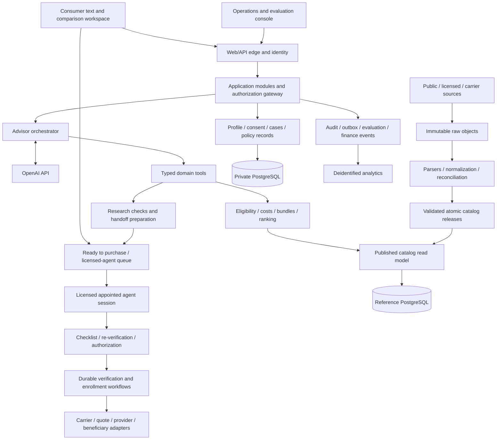

# Medicare company: production architecture

**Company name: undecided.** Version 1.2 · October 17, 2026 · founder/engineering review draft

**Operating model:** self-directed conversational research, transparent deterministic ranking, and a licensed, appointed agent of record at purchase. Primary operating metric: human minutes per effective, retained policy.

**Positioning:** auditable neutrality. Serve caregivers first, then self-directed researchers, then Medigap shoppers. Distribution progresses from direct caregiver content/search to software partners and, after outcome evidence, health systems.

**Data-first constraint:** inspect actual source files, documented layouts, representative vendor payloads and the queries we need before deciding physical tables, constraints, indexes, partitions or infrastructure scale. The entities in this document describe business concepts, not an approved database schema. Start with the smallest working slice of real data and revise the design from observed joins, gaps and performance. No speculative full-company DDL accompanies this proposal.

## What we are building

Build an independent Medicare brokerage and continuing-service company with immediate, self-directed research through a conversational interface to our comparison engine. Reproduce the business capabilities of a comprehensive service such as Chapter: broad market discovery, personal understanding, education, accurate comparison, quote retrieval, provider and prescription verification, supported enrollment, and service after coverage starts. Software handles research, explanation and preparation. When the person is ready to purchase, a licensed, appointed agent of record performs the required review and submits or authorizes the application. The product reduces human work per successful retained policy while keeping that transaction responsibility explicit.

This is the architecture for the company and the production system, starting with its data assets. It is not a specification for the earlier dashboard demo. The prototype is saved separately in [the archive](../archived-prototype/README.md); an unchanged source snapshot is [also preserved](../prototype-code-snapshot.zip).

We do not have Chapter's private schema, contracts, source code, data agreements, or internal procedures. “Rebuild Chapter” therefore means independently build equivalent business capabilities using public data, licensed data, our own software and our own operating agreements. The proposed business concepts and system boundaries below are our design decisions. Chapter's public material is evidence about capabilities, not proof of its internal implementation.

The company will own an **insurance decision and fulfillment platform**: an auditable catalog, a consented customer record, executable rules and cost models, evidence of verification, durable applications and service cases, and an advisor that operates those systems. The LLM is the interaction and orchestration layer. It is not the database, pricing engine, eligibility authority, insurer, or legal license holder.

## Review package

| Document | Read it for |
|---|---|
| **This document** | Company model, architecture decisions, product behavior, operating responsibilities and risk tradeoffs |
| [DATABASE.md](DATABASE.md) | Actual-source inspection, acquisition gaps, proposed minimal data slice and the evidence required before schema decisions |
| [CONTRACTS.md](CONTRACTS.md) | API, agent-tool, event and snapshot contracts that connect the components |
| [BUILD_PLAN.md](BUILD_PLAN.md) | Repository, implementation order, concrete work packages, acceptance criteria and a Codex kickoff prompt |

These documents are a design specification. No production catalog, license, vendor contract, customer database or enrollment integration has been created by writing them. Source inspection is distinct from production ingestion. Proposed targets are marked as targets; unresolved commercial/legal dependencies are named rather than filled in with mock success.

## 1. Founding product decisions

1. **Direct to consumer first.** The service is free at the point of use, with transparent commission funding where the approved operating arrangement permits it. Begin with caregiver-focused content and search, then embed the same research engine through financial-advisor software and publishers; approach health systems after outcome evidence exists. Partner distribution must preserve inspectable rankings, compensation independence and the licensed purchase boundary.
2. **Text is the primary advisor interface.** It works in a browser on desktop and mobile, supports an authorized caregiver, and retains context across sessions. Voice is not required to make the first product valuable.
3. **Broad discovery and contracted fulfillment are different sets.** Discover all products in the explicitly supported market scope, including products that do not pay us. Disclose where our data or enrollment ability is narrower. Do not advertise universal coverage based on a marketing count.
4. **Self-directed research, licensed transaction.** Consumers explore Medicare on their own through a conversational interface to our comparison engine. The AI explains plans, answers questions and presents options ranked transparently by the person's own stated criteria; it does not issue verdicts the person cannot inspect. When the person is ready to purchase, a licensed, appointed agent of record confirms identity and required consents, completes the pre-enrollment review, re-verifies doctors and drugs for the selected option, checks replacement risks, and submits or authorizes the application. Primary operating metric: human minutes per effective, retained policy.
5. **Deterministic decisions before fluent explanations.** Compute eligibility, compatible coverage, premiums, scenarios and readiness in explicit services. The advisor explains their results and resolves missing information.
6. **Preserve a person's existing coverage as a legitimate option.** Staying, deferring and declining are supported outcomes. A conversion metric cannot override suitability.
7. **The person makes the choice.** The engine ranks using the person's stated criteria; the AI explains the result, its tradeoffs and its evidence without telling the person what to buy. Selection opens the licensed purchase process; it is not a signature, consent to switch, or permission to cancel another policy.
8. **Build national data infrastructure; certify markets incrementally.** National discovery does not imply that every state, language, plan type and transaction is approved on day one.

## Competitive position and distribution

**Where we differ from advisor-led services.** Our competitive thesis is that advisor-led companies (e.g., Chapter) put a human at the center and use AI to assist. We put self-directed AI research at the center and use licensed humans to close and protect the transaction. Our edge is not eliminating labor cost; it is serving people the phone model serves poorly and scaling research capacity without hiring research staff in proportion to usage. Licensed transaction and service capacity still need staffing. Human minutes per effective, retained policy remains the operating-efficiency metric, not the entire customer proposition.

**Target segments, in order:**

1. **Caregivers:** adult children researching for a parent, often outside business hours. Prioritize a saved, resumable research case, understandable comparison, permissioned parent/caregiver sharing and a complete-context purchase handoff.
2. **Self-directed researchers:** people who want to explore, ask questions and inspect options without scheduling a call. Research remains immediately accessible; purchase clearly transitions to licensed review under the published seasonal service expectation.
3. **Medigap shoppers:** people comparing standardized plans on price and conditions. Explain quote assumptions, discounts, rating/renewal conditions and underwriting or guaranteed-issue questions rather than equating standardized benefits with identical products or acceptance.

Segment priority guides research, messaging and distribution; it does not select a launch state or imply unsupported products are available. In particular, caregiver research does not itself establish legal representative authority for purchase.

**Why incumbents are unlikely to move first—our hypothesis.** Advisor-centric brands, partner contracts and headcount may make a self-directed AI-first mode a cannibalizing bet. Expect a fast follow once we prove demand; plan for a **12–24 month window**. This is a planning assumption, not evidence about incumbents' private experiments or a guaranteed lead. Track actual launches and revise the assumed window as evidence changes.

**What we build in that window, beyond a feature launch:**

- Brand ownership of the caregiver use case through useful, trusted research and content.
- Embedded partner integrations: financial-advisor platforms and senior content publishers first, patient portals later.
- Self-serve conversion knowledge: why users choose our licensed purchase path versus leaving for Medicare.gov or carrier sites, where they lose confidence and what preserves continuity into an effective policy.
- Published outcome evidence—suitability, complaints and retention—for AI-first research followed by licensed enrollment. State the human role accurately; these are outcomes to establish, not results already achieved.

**Positioning claim: “auditable neutrality.”** Every ranking is reproducible, inspectable and independent of compensation. Do not market “unbiased AI.” Demonstrate the claim through stored inputs/weights/data versions, transparent criteria and exclusions, source evidence, exact AI/engine result agreement, and tests that compensation or partner attribution cannot affect ordering. Explain known data/product gaps and quote uncertainty rather than letting the claim imply omniscience or complete coverage.

**Distribution sequence:** **direct (caregiver-focused content and search) → software partners (financial advisors, publishers) → health systems once outcome data exists.**

Direct acquisition should lead immediately into useful research rather than a lead form requiring a call. Partner entry should preserve the originating research context and return path with appropriate permission, while keeping partner commercial terms outside ranking. Later patient-portal/health-system integrations require their own data permissions, role boundaries and quality evidence; they are not dependencies for the direct launch.

Measure the funnel by segment and channel: useful research, confirmed profile/criteria, completed comparison, saved/returned case, purchase request, licensed review, submission, effective coverage and retention. Record permissioned outbound visits and optional reasons for leaving, but do not infer an external enrollment from a link click. Learning about leakage must not suppress outside resources, hide a better option, pressure a switch or turn an independent comparison into a closed sales funnel.

## 2. Company architecture

The company has six operating systems. They share data but have different owners and controls.

| Operating system | Accountable function | What must exist |
|---|---|---|
| Product and distribution | Founder/product lead | Caregiver-first research/content/search, accessible saved/shared cases, partner integrations, self-serve conversion learning, auditable-neutrality positioning and published outcome evidence |
| Market intelligence | Data/platform lead | Source agreements, public data adapters, carrier coverage matrix, release quality, correction process, current benefits/rates/networks/formularies |
| Insurance authority and carrier access | Insurance operations and counsel | Entity/producer requirements, carrier appointments and contracts, approved digital workflow, product/state authority, E&O arrangements, disclosures, complaints and audit obligations |
| Research and licensed fulfillment | Engineering/domain-quality lead and licensed insurance operations | Rules, calculations, conversational explanations, quote/verification workflows, licensed-agent queue and checklist, enrollment channels, reconciliation and service cases |
| Trust and risk | Security/privacy lead with independent domain review | Security program, role/consent controls, evaluations, incident response, retention, model/source change control, investigation and remediation |
| Revenue and financial control | Finance/operations | Contracted compensation schedules, accepted/effective policy reconciliation, receivables, renewal and chargeback ledger, supplier costs and cohort contribution margin |

One person may initially own several functions. Every function still needs a named owner, an artifact and a review cadence. An LLM does not remove the need for an accountable complaint owner or a data-quality incident owner.

**Proposed entity arrangement for legal review:** a technology operating company owns software and data assets; an appropriately structured insurance entity holds applicable agency relationships and contracts. Whether separate entities are useful, which personnel must hold individual licenses, and whether a responsible licensed producer must supervise particular activities are jurisdiction-specific decisions. NIPR describes the DRLP as an individual connected to the business entity's license; this is not a way to give software an individual producer license. [NIPR guidance](https://nipr.com/help/help-articles/assign-a-designated-responsible-licensed-producer-drlp).

The consumer's contract must identify who provides the service, who is the insurance intermediary, how the company is compensated, which products can be compared and enrolled, what the AI can do, and who is accountable when something is wrong. Research is self-directed; the licensed purchase handoff is visible before the person reaches it. Do not imply government sponsorship. A future public-sector relationship would require its own actual agreement.

## 3. Capability inventory: the actual business to build

| Capability | Production asset | Customer-visible result |
|---|---|---|
| Market discovery | Plan master, service areas, product taxonomy, completeness registry | “These are the types and options we can evaluate for your location and year.” |
| Medicare understanding | Versioned education corpus and policy/rule library | Clear answers with relevant, current sources |
| Personal understanding | Profile revisions, coverage timeline, priorities, consent and representative grants | The customer confirms a reusable record rather than restarting each visit |
| Eligibility and switching | Jurisdiction/date/product rules and evidence requirements | Correct opportunities, deadlines and risks before comparison |
| Prescription evaluation | Confirmed drug identities, formulary/restriction/network/pricing data and simulator | Whether/how medicines are covered and a scoped cost estimate |
| Provider access | Provider/location identities and participation assertions | Exact doctors/facilities checked against the exact option, with unresolved checks visible |
| Medigap shopping | Standardized benefits, carrier products, rating cells, underwriting rules and quote APIs | Comparable rates, discounts, acceptance conditions and dated quote receipts |
| Coverage comparison | Compatible bundles, scenario engine, criteria/weights, full ranked results and exclusions | An inspectable ranking, a shortlist view, costs, disadvantages and the stay-put baseline |
| Enrollment | Licensed-agent handoff, checklist and authority checks, carrier channel adapters, approved forms, authorization and application state | Reviewed purchase, submission receipts, requirements, acceptance and effective coverage |
| Continuing service | Policy ledger, issue workflows, notices, change detection and deadlines | Help with real problems after the sale and permissioned change reviews |
| Distribution and relationship | Acquisition attribution, saved account, communications preferences | Immediate start, secure return, useful follow-up with permission |
| Brokerage economics | Contracts, compensation ledger, persistence and reversals | A viable company without compensation influencing recommendation order |

Chapter publicly says that it searches broadly while holding contracts with many but not all plans. That distinction supports separate catalog, advice and enrollment universes in our design. Its licensing page also identifies different technology and insurance entities. We do not assume that its exact arrangement will authorize ours. [Chapter licensing](https://askchapter.org/licensing).

## 4. Coverage scope and sequencing

The permanent model supports Original Medicare, standalone Part D, Medicare Advantage with or without drug coverage, Medigap, and compatible combinations. Existing employer/union coverage, Medicaid, VA/TRICARE and other arrangements must be represented as context even before we can shop or administer them. An unknown current arrangement blocks replacement advice when consequences cannot be determined.

The first production market is selected after data, legal and carrier diligence. No state or preferred plan structure has been chosen in this document. Begin with categories whose rules, data and transaction paths are actually validated; represent unsupported categories explicitly. SNPs, PACE, employer-group arrangements, Medicare Cost plans, MSA and other special products require separate eligibility and compatibility work rather than being treated as ordinary HMO/PPO choices.

Medicare qualification is not restricted to people turning 65, and age 65 does not alone establish entitlement, exact enrollment dates, subsidy status, or switching rights. The product must handle the individual's actual timeline and supported eligibility categories.

“Approximately 25,000 options” is a sizing premise, not a canonical row count. A plan, a geographic offering, a Medigap rate cell and a combined coverage option are different objects. The logical model must distinguish them; the exact physical representation follows source inspection. **The likely scale problem is the relationship data—providers, locations, drugs, pharmacies, benefit rules and their changes—not 25,000 plan names.** Measure actual volumes before selecting a physical layout or optimizing it.

## 5. System topology and technology decisions

Start with a modular application and separately scalable data/workflow workers. Do not start with dozens of independently deployed microservices. Enforce module boundaries, schemas and service interfaces so heavy components can be extracted when operations justify it.

| Layer | Proposed starting point, subject to discovery | Boundary |
|---|---|---|
| Browser | TypeScript, React/Next.js, accessible semantic components | Presentation; never compute authoritative eligibility or ranking in browser state |
| Application/API | TypeScript on a supported Node LTS, Fastify, OpenAPI/JSON Schema | Modules for customer, catalog query, decisions, advisor, enrollment, servicing and operations |
| Data processing | Python, typed models, SQL, columnar batch processing and Parquet | Explicit adapter packages; no ad hoc notebook becomes a production feed |
| Reference storage | Files/source-shaped staging first; PostgreSQL candidate for the first proven read model | Select physical schema from actual grain, queries and volumes; retain source artifacts |
| Private records | Isolated private application storage; PostgreSQL candidate | Profiles, consents, conversations, quotes, applications and policies; ingestion credentials cannot access these; physical topology follows threat model |
| Workflows | Simple durable jobs/state first; evaluate Temporal when actual external workflows justify it | Waiting, retry, callback, timeout and reconciliation; business records remain authoritative |
| Job transport | Object-created events and a managed queue | At-least-once delivery; idempotent consumers and dead-letter handling |
| Search | PostgreSQL exact indexes and full-text first; optional pgvector | Embeddings retrieve documents, never decide plan identity or network participation |
| Cache | Introduce a shared cache for permitted non-personal lookups after profiling | Not the source of truth or the only copy of an authorization |
| Deployment | Containerized API/workers, managed database/storage, infrastructure as code | Proposed AWS deployment; security/vendor eligibility and actual cost reviewed before PHI use |
| Telemetry | OpenTelemetry, structured redacted logs, metrics and error tracking | Exclude sensitive payloads from generic observability and session replay |

Pin runtime/library/model versions in the implementation repository after compatibility tests. Do not choose a model by branding or assume a hosted service is compliant because its underlying cloud is eligible. Procurement must approve the actual products, features, regions, subcontractors and agreements used.

Use one monorepo and CI policy. Add deployable workers and versioned contracts when an implemented capability needs them. A catalog release is a data deployment. A rule update is a policy deployment. A prompt/model change is an advice-system deployment. All three need versioned tests and a recovery strategy appropriate to the implemented scope.

## 6. Database architecture: four distinct assets

**Reference knowledge:** carrier/product master, geography, benefit facts, Medigap forms/rates, providers, networks, drug vocabulary, formularies, pharmacies, prices, plan documents, annual crosswalks and ratings.

**Customer and decision records:** identity references, consent, caregiver rights, immutable profile revisions, current coverage, quotes, eligibility assessments, scenarios, comparison snapshots, user-stated ranking inputs/weights/data versions, selections and unresolved verification tasks.

**Execution records:** purchase handoffs, assigned agent and license/appointment eligibility, queue/session timestamps, checklist evidence, re-verification receipts, application payloads, consumer and agent authorizations, receipts, requirements, effective policies, servicing issues, approved communications, human work minutes and deadlines. These are record requirements, not a prescribed physical schema.

**Company control records:** source rights, carrier contracts, capabilities, producer/agency requirements, releases, evaluation results, complaints, incidents, compensation events and data expenses.

The proposed reference and private stores expose stable opaque IDs in our APIs; their physical separation and ID implementation are reviewed after the first real-data slice and threat model. External identifiers remain separate, typed and source-qualified. Cross-database identifiers are validated by services and release manifests; do not pretend cross-database foreign keys exist. Each private snapshot retains a minimized immutable evidence bundle or permitted source locator so a later catalog change does not rewrite the basis of a past recommendation.

Relevant data can have several time axes: source publication, business validity, when we observed it, when we processed it, and what we displayed. Plan-year versioning alone is insufficient for a midyear formulary change or a corrected network listing. [DATABASE.md](DATABASE.md) records observed source structure and the discovery required before selecting physical tables and publication mechanics.

## 7. Data acquisition strategy

Build the public catalog ourselves; buy difficult coverage/pricing datasets where agreements are better than duplicating collection; integrate direct carrier APIs where necessary for transactional authority and freshness. Retain a vendor-neutral canonical model so a supplier is replaceable.

| Asset | Starting path | What remains to secure |
|---|---|---|
| National MA/PDP discovery and benefits | CMS landscape, PBP and service-area resources | Current annual layouts, taxonomy, joins, status reconciliation and permitted use |
| Formulary/pharmacy baseline | CMS monthly/quarterly datasets | Actual data layouts/use agreement and a current pricing strategy for decision-time estimates |
| Medigap catalog/rates | Licensed rate/underwriting provider plus carrier verification | Full state/form scope, LLM/display/storage rights, quote validity and acceptance conditions |
| Provider participation | Contracted network sources and direct carrier/practice verification | Location/plan precision, conflicts, verification channels and historical evidence |
| Transaction shopping and enrollment | Contracted shopping/enrollment vendor and direct carriers | Actual endpoints, carrier availability, testing, licensed-agent submission/authorization channel, agent-of-record handling and receipts |
| Customer history | User entry/upload first; optional authorized beneficiary/payer APIs | Access approval, consent, scopes, incomplete/lagged history and revocation |

CMS exposes current-year resources rather than a single timeless “all Medicare database.” Use its [landscape](https://www.cms.gov/medicare/coverage/prescription-drug-coverage), [2027 PBP JSON](https://www.cms.gov/data-research/statistics-trends-and-reports/medicare-advantagepart-d-contract-and-enrollment-data/benefits-data/pbp-benefits-2027-json), and [annual crosswalks](https://www.cms.gov/data-research/statistics-trends-and-reports/medicare-advantagepart-d-contract-and-enrollment-data/plan-crosswalks) as distinct source families. Record exact downloaded artifacts and layouts in a source registry.

Vendor examples are diligence candidates, not acquired dependencies: CSG advertises rates, features and underwriting data/API access; ConnectureDRX advertises shopping, quoting, drug-cost and enrollment APIs. No public marketing page establishes our price, access rights, national completeness or permission for this conversational-research and licensed-transaction workflow. [CSG](https://www.csgactuarial.com/quoting), [ConnectureDRX](https://www.connecture.com/apis/).

For provider data, build our own sourcing and evidence strategy. Chapter publicly documents provider-plan coverage queries and location search with authenticated access; this illustrates the required precision, not an assumption that its API is available to a competitor. [Chapter provider API](https://providers.docs.askchapter.org/apis/coverage).

## 8. The ingestion factory

Each source has a signed-off contract: license, scope, expected cadence, versioned layout, source identifiers, critical fields, owner, completeness test and retirement plan. Every adapter emits the same provenance envelope and canonical records.

Pipeline: discover release → download safely → hash/store immutable bytes → parse into typed staging → normalize → join/resolve identities → validate → reconcile counts/values → publish compatible partitions → refresh read indexes → invalidate affected decisions → monitor.

Use deterministic parsing for structured files. Use OCR/model extraction for documents only behind field-level provenance and validation; extracted proposals cannot directly authorize transactions. Preserve raw bytes and a rejected-row ledger. Unknown schema changes and unexplained universe loss quarantine the affected partition.

National/yearly releases contain per-market coverage manifests and a complete dependency map. Publish by a transactional active-release pointer, not by replacing rows in place. A rollback restores a compatible graph of plan, network, formulary, pricing and rule versions. Live supplier responses are additionally pinned to receipts and TTLs.

A daily poll does not make monthly data current. Cadence and required decision-time freshness are separate configuration. The data platform must answer both “what is the latest known fact?” and “what did we know when this person chose?”

## 9. Customer record and progressive intake

Provide education before requiring an account. Ask for location/year and reason for seeking help as needed. For the first-priority caregiver segment, identify who is researching and whose coverage is being explored without demanding a purchase-ready identity packet to read public information. Support out-of-hours research, saving and resuming, a clear parent/caregiver invitation and context-preserving purchase handoff. Research availability does not promise 24-hour licensed-agent availability. Save work only with clear consent; require stronger identity assurance and appropriate authority for beneficiary data, applications and representative access.

The structured profile includes entitlement/effective dates, residence and travel, coverage history, employer/union/retirement facts, known subsidy/Medicaid context, required providers/facilities, medicines/pharmacies, budget and risk preferences, communication/accessibility needs, and the person’s own priorities. Health details are collected only for a supported purpose, such as carrier underwriting or SNP eligibility.

Every field distinguishes user statement, imported suggestion, confirmed fact and externally verified fact. The LLM proposes profile changes; the person confirms material ones. A revised profile creates a new revision and invalidates dependent results. A caregiver is an actor with explicit subject-level permissions; a spouse is a separate subject, not a second name in the same insurance profile. Preserve who supplied each statement and what the parent has confirmed. Do not infer authority from an adult-child relationship or let a shared link grant unrestricted health-data/application access. The licensed agent confirms the relevant identity, consents and representative authority at purchase.

Keep exact sensitive identifiers and payment details out of chat. Collect through secure, purpose-specific fields and store tokenized/encrypted references. Do not send full identities to a model just to explain a premium comparison.

## 10. Eligibility, timing and coverage compatibility

Implement rules as typed, versioned, deterministic functions or a constrained rule representation. Rule inputs are facts with provenance; outputs include eligible/ineligible/unknown, reason codes, missing evidence, opportunities, start/end dates, applicable effective date and cited authority.

Keep four assessments separate: Medicare entitlement, election opportunity, Medigap purchase/underwriting rights, and the carrier's application acceptance. A single `eligible=true` flag is inadequate.

Rules must cover supported federal and state timing, existing-coverage consequences, partial-year transitions, subsidy effects, product-specific conditions and plan compatibility. Medigap purchase protections are not interchangeable with MA/Part D election periods. Medicare explicitly distinguishes the one-time Medigap open-enrollment period and later guaranteed-issue/state rights. [Medicare Medigap guidance](https://www.medicare.gov/health-drug-plans/medigap/ready-to-buy).

A rule package has dated legal/domain approval, examples, edge cases and regression tests. An LLM can identify a possible trigger in the person's story; it cannot invent a special election period or certify underwriting acceptance.

## 11. Doctor, facility and medicine verification

Provider verification is a graph query and evidence workflow: resolve identity → confirm practice/facility location → select exact plan/network/year → obtain participation assertions → identify disagreement/staleness → verify essential access where needed → store receipt and expiration.

Store professional identity, practice organization, location, specialty, plan/network and acceptance of new patients separately. A hospital's status does not prove each clinician's status. For Original Medicare, model participation/acceptance and assignment or opt-out issues separately from MA networks and separately from any SELECT supplement restrictions.

Medicine intake confirms identity, strength, form, route, quantity, days supply, schedule, brand preference and pharmacy. Vocabulary matching only identifies the item; it does not establish coverage. NLM's RxNorm API is a vocabulary service, while NPI resources are identity sources. [RxNorm API](https://lhncbc.nlm.nih.gov/RxNav/APIs/RxNormAPIs.html), [NPI Registry](https://npiregistry.cms.hhs.gov/api-page).

The engine resolves formulary versions, tiers, restrictions, pharmacy network/preferred status, plan benefit design and price inputs. A drug may be listed and still require authorization, step therapy, quantity limits or indication conditions. Insurance guidance must not become advice to stop, substitute or change a prescribed medicine. Clinical decisions remain with the clinician.

Research checks may use approved machine-to-machine queries or authorized external inquiries. Show unresolved facts and their impact rather than inventing verification. At purchase, the licensed agent re-verifies the selected option's relevant doctors, facilities, medicines and pharmacy, preserving source and time. Re-verification can use approved tools and, when needed, direct inquiries; a prior automated check does not automatically satisfy the purchase checklist. Changed facts trigger a new comparison and renewed consumer review where material.

## 12. Quote and cost engines

There are three monetary objects: published reference rates, profile-specific quote receipts, and prospective spending estimates. Store and label them separately. A carrier's final accepted premium is a fourth state, confirmed through its application/policy record.

**Medigap:** quote by state, policy form, rating method, age basis, permitted applicant factors, effective date, underwriting class and applicable discounts. Itemize household, payment or other discounts, expiration and renewal assumptions. Preserve unknown acceptance and potential rate increases. Standardized coverage is not the same as identical price, provider conditions or future rate behavior.

**Part D:** calculate fill events in chronological order using the applicable year's benefit parameters, negotiated-price inputs, deductible/phase rules, subsidy status and supported exceptions. Track spending categories separately; annual consumer costs and timing of payment are not identical. Explain any payment-plan feature without falsely changing total liability. Do not hardcode current thresholds into prompts or assume a single drug copay applies all year.

**Medical utilization:** compare explicit low/moderate/high utilization scenarios and optional customer-selected needs. Distinguish in-network/out-of-network, medical maximum out-of-pocket, drug cost protections and noncovered expenses. A medical MOOP is not an all-in spending ceiling. Predictions must state assumptions and scope rather than promise a person's future health costs.

Represent base Part A/B premiums where applicable, additional plan premiums, any confirmed premium reductions, income-related charges/late penalties when known, medical/drug cost sharing and excluded costs. Show common costs consistently across structures; never make Advantage appear to remove Part B merely by omitting it from one card. Calculate first-coverage-year and twelve-month scenarios separately when appropriate.

Use integer cents for final amounts and fixed-precision decimals for intermediate unit prices/rates with defined rounding. Golden-case tests verify boundaries, partial fills, annual changes, subsidies, unpriced/noncovered drugs and bundle double-counting. Independent reference comparisons are a release requirement.

## 13. Ranking and explanation rules

Ranking is computed by the deterministic engine from the person's own stated criteria and verified data. Criteria, their meaning and any weights are visible and editable; defaults require explicit disclosure and confirmation before being treated as the person's preference. The AI may clarify a preference and propose a change for confirmation, but it cannot invent a priority or secretly change a weight.

The full option set and exclusions are always available within the disclosed market/year/product scope. Classify exclusions and unresolved candidates with inspectable reasons; do not silently discard them. The shortlist is a view, not a filter. Show the loaded universe, known data gaps and any inability to compare or enroll an option. Noncommissioned and noncontracted products must not disappear because of their economics.

Generate compatible coverage structures before comparing issuers. Original Medicare + Medigap + PDP is a bundle with component applications and conditions, not a single plan row. Detailed checks and bundle expansion may run on demand, but a performance shortcut must not erase a candidate or an exclusion from the accessible result set. Unknown material data remains visible as unresolved; it is not assumed favorable or quietly assigned a low score. Explain the evaluated bundle scope rather than implying every possible combination has been exhaustively priced.

The AI explains the engine's results and may not reorder, add or remove options, including through a differently ordered conversational list. The backend supplies the rank order and the displayed shortlist references. A confirmed change to criteria, facts or scope causes an engine recomputation and a new snapshot; the LLM cannot implement that change by editing the result list. Every ranking stores its inputs, criteria, weights, tie-breaking method, engine version and data versions used.

Use language such as **“based on what you told us, these fit best because…”**, never **“you should buy.”** Each explanation identifies the criterion driving the result, major disadvantage, evidence, uncertainty, excluded costs, stay-put baseline and what changed input could change the ranking. Avoid an uninspectable overall verdict. Commission rates, acquisition source and revenue targets are prohibited ranking inputs; financial data stays outside the research assistant's tool context.

Research completeness and purchase readiness are different states. A person may request a licensed-agent session with open checks clearly carried forward. That request does not mean the selected option is verified, enrollment is approved, or the agent's required review has been completed.

## 14. Shared consumer/LLM decision workspace

The browser and advisor consume the same `ComparisonSnapshot`, keyed by case, profile revision, catalog release, rule package, cost model and preferences. Neither reconstructs its own plan facts from prose. A stale view is marked stale and cannot authorize an action.

Desktop layout: conversation alongside the current task, the person's criteria/weights and an engine-ordered shortlist view. Mobile: one task at a time, with conversation and comparison reachable without losing context. A small initial view may display three options, with persistent access to the full option set and exclusions through accessible pagination or expansion. These are views of the same result set, not LLM-selected subsets. Do not bury a necessary doctor conflict beneath an attractive price.

An option card displays coverage structure and components, applicable date/location, monthly premium, scoped annual estimate, required doctor and prescription results, important restrictions, the main tradeoff, open checks and enrollment availability. A detail view provides line-item cost assumptions and dated source facts. The comparison view has consistent rows and narrow-screen alternatives rather than tiny text.

Actions are distinct: compare, ask about, inspect/change criteria, view all options/exclusions, save, select an option, **Ready to purchase**, review an application and authorize submission. Highlighting a card is not selecting it. Selecting a bundle is not applying to all its components. Ready to purchase opens a licensed-agent session with the complete context and a visible wait/scheduling path. The UI offers a written comparison summary and a simple comprehension check for material tradeoffs; it clearly labels the transition from AI research to the licensed agent.

Target WCAG 2.2 AA with an accessibility audit; default readable text, larger text, keyboard navigation, visible focus, plain labels, zoom/reflow, non-color statuses and no time-pressure sales patterns. Test with adults across age and digital-literacy groups. Multilingual releases require native-language insurance/comprehension validation, not only translation quality.

## 15. Advisor architecture and OpenAI boundary

One conversation orchestrator assembles the minimum current context, presents approved research tools, invokes a configured OpenAI model, executes validated requests, and converts supported results into explanations and permitted UI actions. The deterministic engine supplies ranked result references and order; the model cannot modify either. Batch independent backend checks without creating multiple competing advisors.

Use the Responses API with explicit function tools and structured consumer output. The application executes tool calls and retains control over side effects. Official OpenAI documentation distinguishes function tools from structured text outputs; schema compliance is not evidence of factual or insurance suitability. [Function calling](https://developers.openai.com/api/docs/guides/function-calling), [Structured Outputs](https://developers.openai.com/api/docs/guides/structured-outputs).

The model never receives SQL credentials, arbitrary shell/HTTP execution, secret values, a global search over other customers, an agent's credentials, or authority supplied by a chat message. The gateway injects subject, consent, approved jurisdiction and research permissions. Read/proposal and handoff-preparation tools cannot approve the purchase checklist or submit an application. Only the licensed-agent workflow can submit or authorize submission after its required gates.

Prompt layers: fixed product and grounding policy; approved state/product capability; current confirmed facts; tool/evidence data; relevant conversation; immediate user question. Plan PDFs, web content and uploaded letters remain untrusted data even when authoritative about benefits. They cannot alter tool permissions or recommendation order.

Persistent memory belongs to the application. The research assistant receives confirmed facts, unresolved questions and a compact sourced conversation summary. Re-read current authoritative state before explaining a ranking or preparing a handoff. The licensed agent receives the full transcript as well as the profile and pinned comparison snapshot; a model-generated summary alone is insufficient. Keep concise supported rationale and tool receipts, not private model reasoning, in audits.

No model is selected here. Benchmark available models on held-out domain cases, latency and total workflow cost; pin the chosen model configuration and maintain a rollback. Prompt/model/tool changes require replay against the same factual snapshots and semantic review.

## 16. Purchase handoff and licensed transactions

**Ready to purchase** opens a licensed-agent session with the full transcript, confirmed profile, selected option, criteria/weights, comparison snapshot, quotes, evidence and open checks. Explain the handoff and context sharing clearly. Grant the assigned agent audited case access; do not send the packet through an unsecured email or generic support ticket. Preserve the snapshot used at request time and show subsequent changes.

Route by the customer's state, product, carrier appointment, relevant language and actual agent availability. Confirm the assigned agent's authority is current for this transaction. An automated acknowledgment does not count as the first licensed-agent response. The agent works from the existing context rather than restarting intake, while independently completing the required review.

### Seasonal response targets and fallback

Maintain distinct first-response targets for ordinary periods, AEP/other planned peaks, and declared surges. For each, configure staffed hours/time zone, target percentile and elapsed time, available licensed capacity and scheduling threshold. Numeric targets must be set from staffing/capacity evidence before pilot and published as the applicable service expectation; they are not assumed to be the same across seasons. Measure request-to-first-substantive-agent-response separately from active agent work minutes and total time to completed purchase.

When predicted waiting exceeds the applicable target, or outside staffed coverage, offer a scheduled session using only actual availability and preserve the complete context. Keep the wait status visible, allow the person to leave and return, and revalidate facts that expire while waiting. Queue overload does not bypass the licensed review or silently move the person into self-enrollment.

### Agent checklist

The licensed, appointed agent of record records completion and evidence for:

1. Identity and representative authority where relevant, plus required consents.
2. SOA for MA/PDP under the applicable approved workflow, with required timing/materials recorded.
3. The applicable pre-enrollment checklist and required disclosures; selected option, dates, premium assumptions and consumer understanding.
4. Re-verification of relevant doctors/facilities and prescriptions/pharmacy for the exact selected option, preserving current sources and unresolved restrictions.
5. Replacement consequences, existing coverage, election opportunity, and Medigap guaranteed-issue/underwriting risks where relevant.
6. Exact application preview, explicit consumer authorization, and the licensed agent's submission or recorded authorization for the supported channel.

Each checklist item is complete, blocked or not applicable with an accountable reason. An AI-generated checkmark cannot complete the licensed-agent review. If re-verification changes material facts, return them to the person, recompute the engine ranking if affected, and obtain renewed selection/authorization before proceeding. Retain the historical ranking and the reason for the change.

### Submission and reconciliation

Prerequisites: current state/product/channel capability and assigned agent authority, carrier access, current eligibility/election opportunity and quote, matched applicant, required materials and completed checklist, confirmed selection, explicit consumer authorization and agent submission/authorization bound to the exact payload. Any material payload change invalidates the affected authorization.

Handoff states: requested → queued or scheduled → assigned → in_session → review_complete or blocked → closed. Application states: draft → requirements_pending → ready_for_preview → awaiting_consumer_authorization → awaiting_agent_authorization → submitting → submitted → carrier_requirements_pending → accepted_pending_effective → effective. Consumer and agent approvals may be collected in either approved order, but both are required before submission. Keep rejected, withdrawn, cancelled, expired and unknown states explicit, with events and receipts.

Use a durable outbox and stable idempotency key. When the carrier does not support idempotency, maintain our ledger and reconcile uncertain transmission before retrying. A timeout after sending must not create duplicate applications. A webhook updates state only after authentication, deduplication and matching to the correct application.

Bundles have component applications and a coordination policy for partial success. Explain sequencing and replacement consequences; never cancel existing coverage just because a new application was submitted. An accepted application, policy issuance, required payment and effective coverage remain separate facts.

### Future consumer self-enrollment

Consumer self-enrollment through a carrier link with our agency as agent of record is a future option. It is disabled by default and enabled only for an approved carrier/state/product/channel after quality evidence, confirmed attribution/agent-of-record handling, required reviews/consents and reliable status reconciliation. It is not a queue fallback or permission for an LLM to enroll the person. Any change to the licensed-review boundary requires an explicit operating-model decision.

## 17. Continuing service is part of the core product

The policy ledger records actual active coverage, effective/termination dates, carrier identifiers, required payments/statuses, documents and source receipts. It drives service; a previous comparison does not prove current coverage.

Supported workflows include explaining notices/bills, identifying administrative next steps, tracking additional information, correcting recorded data, checking access changes, preparing permitted complaints/appeals assistance, and coordinating authorized inquiries. Administrative assistance must not invent coverage determinations, clinical advice or appeal outcomes.

Annual review compares current policy and profile against the next benefit year's actual changes and alternatives, with the person's permission. ANOC, crosswalks, plan withdrawal, a move, medicine/provider changes and subsidy changes can trigger a review. Review is not annual re-enrollment for everyone, and no change happens automatically to generate renewal revenue.

An unresolved self-service issue becomes a clearly open service case with an accountable owner and the appropriate licensed or specialist support. Purchase or policy changes return to the required licensed workflow. The company must also handle complaints, regulator responses, accommodations and remediation. Preserve context and measure that human work; do not report a case resolved because the chatbot finished a conversation.

## 18. Compliance capability and policy registry

Counsel/domain review produces executable approvals, not only a legal memo in a folder. The capability registry is keyed by entity, state, product, carrier/channel, activity, language, user category and date, with assigned-agent licensing/appointment checked for a purchase. It records authority basis, conditions, required disclosures/records, approval owner and expiration. Absence means unavailable. Self-directed research describes the product experience; it is not itself a legal exemption for personalized ranking, explanations or marketing. Review those activities as well as the licensed transaction.

| Review area | Required architecture/output |
|---|---|
| Entity and individual licensing, appointments, supervision, E&O | Approved research/transaction structure, eligible assigned agent and agent-of-record relationship, current licenses/appointments/contracts; no claim that an LLM holds a license |
| MA/Part D marketing and communication | Classification, approved disclosures/materials and pre-enrollment checklist; actual inventory/represented-plan counts; transcript and consent retention policy |
| Scope/contact and enrollment mechanism | State/channel-specific approved workflow, required consent/attestation and verifiable timing; no blanket assumption that a text chat is exempt |
| Medigap | Federal/state protections, form availability, underwriting, replacement and disclosure rules, dated carrier underwriting packages |
| Data privacy | Legal-role assessment, applicable HIPAA and consumer-health/privacy laws, required contracts, permitted purposes and rights handling |
| AI and accessibility | Accurate AI disclosure, tested suitability/comprehension, applicable automated-decision obligations and accessible alternatives required by law |
| Consumer protection | Complaint/error correction, compensation disclosure, nondeceptive comparison claims, no government-affiliation implication |

CMS's 2027 training guidance addresses enrollment mechanisms, pre-enrollment review, provider/pharmacy/drug checks, marketing, scope, disclosures and oversight. It also reflects rule changes. Store effective policy versions rather than copying an older blanket timing requirement into code; legal review must determine how the actual text-only workflow is treated. [2027 guidance](https://www.cms.gov/files/document/cy2027-agent-broker-training-testing-guidelines-pdf.pdf).

HIPAA applicability depends on legal roles and relationships; health data alone is not a complete classification. HHS describes covered entities/business associates and required arrangements. Non-HIPAA status does not remove privacy obligations: FTC guidance describes coverage and breach duties for certain personal-health-record products. [HHS](https://www.hhs.gov/hipaa/for-professionals/covered-entities/index.html), [FTC](https://www.ftc.gov/business-guidance/resources/complying-ftcs-health-breach-notification-rule-0).

## 19. Security and data governance

Separate public-reference ingestion from private customer services by database credentials, network access, encryption keys and workload identity. Catalog workers cannot access customer records. The model service obtains purpose-limited fields through a gateway. Operations staff use role-specific views with audited, time-bound elevated access for investigations.

Controls include modern authentication/step-up, session and CSRF protections, subject-level authorization, secure uploads/OCR isolation, encryption in transit/at rest, application-level protection of high-risk fields, secret management, dependency scanning, scoped egress, signed webhooks, abuse/rate limits, audit integrity, tested backups/restores and an incident program. RLS is defense in depth, not the entire authorization design.

Retention is a policy matrix by record type, purpose, contract and jurisdiction. Avoid one universal deletion setting. Revoke future access immediately; distinguish removable optional chat/embeddings from required application/audit retention and legal holds. Test deletion propagation through caches, exports, backups policy and derived data. Do not place health profiles in ad pixels, generic analytics, replay recordings, URLs or support tickets.

For OpenAI, approve the actual API feature and account controls before sensitive production use. The proposed adapter uses `store:false` and application-controlled context, but this is not itself zero retention, a BAA, or a compliance conclusion. OpenAI documents feature-specific retention and contractual/configuration differences. [Official data controls](https://developers.openai.com/api/docs/guides/your-data).

## 20. Quality, evaluations and release authority

Build independent test layers: raw parser/layout, normalized joins, source completeness, executable rules, pricing golden cases, provider/drug identity and evidence, ranking correctness, explanation fidelity, comprehension, AI/tool behavior, licensed-agent checklist and external transaction recovery.

Use held-out cases with qualified insurance/domain reviewers and explicit error severity. Include uncertain identities, wrong year/county, late retirement, underwriting rights, contradictory directories, unpriced drugs, subsidy changes, partial-year benefits, current coverage already preferable, no suitable option, caregiver ambiguity, malicious documents and duplicated carrier responses.

The initial consumer study prioritizes caregivers, then self-directed researchers, then Medigap shoppers. Test evening/weekend research, saved-case return and parent/caregiver sharing in addition to the purchase handoff. Report suitability, complaint and retention outcomes by declared cohort/window with methodology, denominators, unresolved cases, known limitations and the licensed human contribution. Obtain appropriate permission and protect identities before publishing results. Do not advertise the intended evidence program as completed research.

An LLM judge can triage; it cannot be the only release authority for quality. A valid JSON output or successful tool call does not prove an answer's claims. Test exact preservation of engine order/membership, access to full results/exclusions, reproducibility from stored criteria/weights/data versions, and language that explains fit without “you should buy” verdicts. Measure claim-level support, consequential omissions, numerical correctness, appropriate abstention, excessive abstention and comprehension. Test handoff context completeness, seasonal response/scheduling behavior, agent authorization boundaries and checklist evidence. Capture all human work rather than treating licensed purchase review as hidden labor.

Run identity includes code, prompt, model configuration, catalog, rules, calculator, tool schema, profile and evidence versions. Reproduce past decisions from pinned artifacts. Production changes use shadow/canary traffic only within authorized data/use scope. Maintain a kill switch by source, market, product, model and activity.

Proposed gates: no known unresolved severe error; complete stated market universe and accessible exclusions; independently adjudicated critical rule/cost cases; exact engine/AI ranking agreement; licensed checklist and both required authorizations before submission; no unauthorized/duplicate submission; no cross-subject disclosure; demonstrated consumer comprehension; tested recovery from stale data/vendor outage and queue overload. Define sample sizes and confidence intervals before calling a measured rate reliable. These gates have not been achieved by the archived prototype.

## 21. Operations, reliability and capacity

Treat peak enrollment season, annual data rollover and ongoing customer service as different workload patterns. Keep both current and next benefit year queryable. Suspend publication of bad partitions without taking down education. Prioritize active applications and deadlines over nonurgent recalculation.

Licensed-agent staffing is a core operating function. Plan capacity by season, state/product/carrier appointment, language, arrival rate, handling time and service work. Publish the configured first-response expectation, monitor queue age and abandonment, offer scheduled fallback above target, and maintain ownership of blocked cases. Report waiting time separately from active human minutes so a shorter checklist cannot conceal a long queue.

Capacity modeling starts with actual file/response volumes, measured join cardinalities, expected pilot traffic and supplier limits. The competitive 25,000-options headline is not a database benchmark specification. Expansion scenarios can be added after the initial working slice establishes the real bottlenecks. Do not expand every provider × plan × medicine × pharmacy × person combination.

Use local indexed market lookup, bounded batches, memoization within source rights, queued expensive verification, and progress events. The target is an immediately useful conversational response; a slow carrier check becomes a resumable task, not an invented answer. Define API latency and supplier-dependent completion SLOs separately.

Proposed starting targets: 99.9% application availability for research, 15-minute private-record RPO, four-hour recovery target, zero accepted duplicate external submissions, and visible status for overdue jobs. Validate these against cost, contracts and drills. Financial/authorization records require durable transactional writes; a cache miss is not permission to repeat an enrollment.

Runbooks: source schema drift, mass plan deletion, wrong premium published, provider conflict, quote supplier outage, stale approvals, unqualified/expired agent appointment, queue overload/no available licensed agent, incomplete handoff, carrier timeout after transmission, lost callback, model rank alteration/unsupported verdict, consent revocation, suspected data breach and complaint deadline. Each has a primary owner, stop condition, customer impact analysis and replay/remediation steps.

## 22. Revenue architecture and incentives

The finance system imports actual compensation schedules and statement files under carrier/FMO contracts. Track application → accepted → effective → payable → paid → renewed/terminated → recouped. Distinguish booked estimates, cash receipts and projected lifetime value. Reconcile using carrier policy/member references with privacy controls.

Keep compensation data in a separate module with permissions that exclude recommendation and advisor tools. Finance can measure the cost of broad noncommissioned comparisons; it cannot suppress an option to improve conversion. Document any insurer-specific distribution product and its restricted scope clearly if introduced later.

Apply the same separation to partner fees, lead payments, channel attribution and carrier-link economics. Distribution analytics may explain acquisition and conversion but cannot alter ranking. Auditable neutrality is tested as a reproducible system property, not asserted as a characteristic of the model. Research-capacity scale and segment access are the competitive thesis; labor efficiency supports the business without becoming the entire positioning claim.

**Primary operating metric: human minutes per effective, retained policy.** For each acquisition/handoff cohort and declared retention window, divide all attributable active human work minutes by the number of policies that became effective and remain retained at that window. Include purchase sessions, re-verification, follow-up, failed/abandoned cases, corrections, servicing and attributable exception work in the numerator; do not count only successful agents' talk time. Report zero-denominator cohorts as having no retained-policy outcome, not zero human cost. Use fixed retention windows, show policy-component and customer/bundle counts consistently, and report shared operational labor separately with a documented allocation method.

Quality and service guardrails remain alongside this metric: required review completion, accuracy/comprehension, effective coverage, retention, complaints, corrections, response/wait times and abandonment. Reduce redundant work through better preparation and context, not by skipping the licensed checklist. The initial baseline and reduction target follow measured pilot data.

Measure contribution per suitable, effective, retained policy as well: acquisition + data licenses + verification + model + cloud + transaction fees + insurance/legal/compliance + licensed-agent labor + support/exception work + reversals. Lower model cost does not establish viable acquisition or acceptable service.

## 23. Build/buy and defensibility

**Build:** validated data model, source/version/quality evidence, permissioned customer record, eligibility and decision logic, bundle/cost orchestration, transparent deterministic ranking, shared snapshots, research assistant tools, licensed-agent handoff/checklist, applications/service orchestration, labor measurement and outcome evaluations.

**Buy/integrate where justified:** reference vocabularies, rate/network/pricing feeds, approved shopping/enrollment rails, identity/authentication, secure document signing/payment tokens, managed workflow/infrastructure and telemetry. Keep canonical adapters and receipts under our control.

**Do not build initially:** a claims adjudicator, insurer risk balance sheet, custom foundation model, universal EHR, proprietary drug vocabulary, general web-browsing enrollment robot or elaborate microservice fleet.

The interface is copyable, and the strategy assumes a fast incumbent follow. Prioritize caregiver brand ownership, embedded financial-advisor/publisher integrations, observed self-serve conversion knowledge and published suitability/complaint/retention evidence during the assumed 12–24 month window. Reliable data, auditable neutrality and effective licensed fulfillment support those assets. Do not assume a chatbot interface or a permanent labor-cost gap will protect the business.

## 24. Sequence and founder review decisions

The dependency path is **source rights and operating basis → actual catalog → rules/cost/access → transparent engine ranking → conversational research → licensed-agent handoff/review → authorized transaction → ongoing service and expansion**. UI, agent staffing and operating diligence can proceed alongside foundational work, but do not manufacture a complete product out of a subset of those dependencies.

Review these decisions before production implementation:

1. Implement founding decision 4: self-directed research and a licensed, appointed agent of record at purchase; unsupported activities remain unavailable.
2. Select the initial market/product/language after the coverage and legal diligence packet exists.
3. Approve public national discovery plus licensed difficult datasets as the sourcing strategy; define the exact claim of completeness.
4. Review the modular TypeScript/Python architecture, candidate storage/tooling, and required separation of reference/private access. Approve physical data design only after actual-source discovery.
5. Approve commission separation, explicit compensation disclosure and independent quality authority.
6. Fund data agreements, domain/legal validation and operational accountability as core build dependencies.
7. Approve the pilot's retention window, human-work accounting and quality guardrails for human minutes per effective, retained policy; set seasonal response targets from staffing evidence.
8. Execute the ordered segments and distribution sequence, with a caregiver-first research/conversion study and an outcome-publication plan. Revisit the 12–24 month incumbent-response assumption as actual evidence arrives.

The detailed data-discovery and implementation documents turn these choices into engineering work. The first milestone is inspecting and querying real source data; the physical model follows that evidence.
